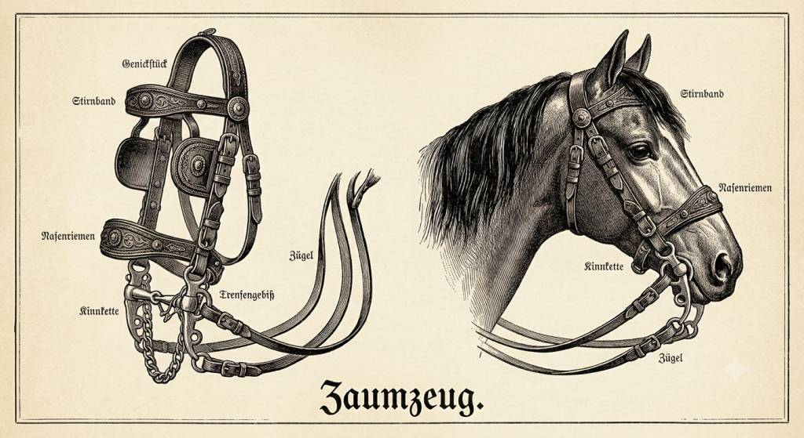

<p align="center">
  
</p>

# ZaumZeug - ZaZu

**A harness SDK and factory for configurable multi-agent AI workflows.**

ZaumZeug helps developers scaffold, configure, compile, and deploy **multi-agent harnesses** — not a single chatbot relabeled as an agent, but a **workflow** plus a **collection of named agents**, each with its own model and tool configuration. You edit YAML, add Python only where custom logic is needed, and ship a production-ready bundle to any host without touching Haystack, DSPy, or GEPA internals.

> **Status:** Phase 1 complete — epics **E2** (config/validation), **E3** (runtime/serve/run), and **E1** onboarding through **E1-S07** (three-OS CI matrix) are **done**. **E1-S08** (`zaumzeug install-project`) is **deferred** until PyPI package publish (open #3 resolved: clone+`install/` for v1; CLI after publish). Phase 2 complete for **E4** / **E6** / **E5** (2026-07-28 / 2026-07-29). Phase 4 pull-forward: **[E8-S07](docs/stories/epic-stories/64-story.md)** (workflow run reliability — `runtime.retry`, stage INFO logs, `output.format: json`, doctor fail on phase-gated `tools.custom`) **done** (2026-08-01). Phase 3 start: **[E7-S01](docs/stories/epic-stories/50-story.md)** (MCP tool configuration — `tools.mcp` → `MCPToolset`, `zaumzeug mcp`) **done** (2026-08-14). Next: [E7-S02](docs/stories/epic-stories/51-story.md) (custom tool loader). Cross-platform CI: [`.github/workflows/ci-matrix.yml`](.github/workflows/ci-matrix.yml). Track progress in [docs/stories/](docs/stories/00-README.md).

**Formula:** `Harness = Workflow + Agents + Machinery`

---

## Why ZaumZeug?

ZaumZeug is not trying to be the most flexible agent orchestrator or the deepest provider SDK. It is a **factory for turning YAML-defined multi-agent workflows into compile-optimized, mock-testable, deployable production harnesses** — Haystack runtime, GEPA-guided improvement loops, and enforced dev/deploy boundaries.

Building on Haystack, DSPy, and GEPA today means wiring compile-time optimization and runtime serving yourself — and it's easy to mix them incorrectly. ZaumZeug provides a single SDK with enforced golden rules, a CLI workflow, and a clear boundary between development and production.

| Problem | ZaumZeug approach |
|---|---|
| Complex Haystack + DSPy + GEPA integration | One SDK with compile/runtime separation built in |
| Unclear dev vs production artifacts | `usr-harnesses/` for development, `deploy/` for shipping |
| Model provider lock-in | Per-agent `agents-models.yaml` + stage-scoped model routing |
| Different clients need different protocols | One Haystack core, multiple serve surfaces (REST, MCP, ACP) |

### How ZaumZeug is different

- **Factory, not one-off framework** — scaffold → configure → compile → deploy → serve; the unit of shipping is `deploy/<name>/`, not your dev repo
- **Compile ≠ runtime, enforced** — DSPy/GEPA offline; Haystack `Agent` on the hot path; never both loops in one request
- **Workflow stages, not one mega-agent** — serial stages (parallel later), each running one agent loop, chained by `workflow.yaml`
- **Guides + sensors** — GEPA-optimized prompts (guides) and metric feedback (sensors) baked into the lifecycle
- **Mock-first dev** — `zaumzeug doctor`, dry-run, and mock model profile for zero-API-key local dev and CI

### What we do better

| Area | ZaumZeug advantage |
|---|---|
| Compile → ship loop | DSPy/GEPA offline, Haystack online — enforced separation |
| Production packaging | Explicit `deploy/` bundle; GEPA never on production servers |
| Config-first multi-agent | YAML workflow + per-agent `agents-models.yaml` |
| Ops clarity | Dev vs deploy is a product rule, not a team convention |

### What others do better today

| Framework | Their strength | ZaumZeug gap (for now) |
|---|---|---|
| [LangGraph](https://langchain.com/langgraph) | Stateful graphs, checkpointing, human-in-the-loop, branching | Serial workflows only in Phase 1 |
| [OpenAI Agents SDK](https://openai.github.io/openai-agents-python/) / Claude Agent SDK | Provider-native tracing, guardrails, sandbox execution | Sandbox deferred; less provider magic |
| [CrewAI](https://www.crewai.com/) | Role-based crews, rapid prototyping, large community | Less persona ergonomics; more deploy discipline |
| [Strands Compose](https://github.com/strands-compose/sdk-python) / AgentCore | YAML multi-agent, swarm/graph modes, managed hosting | Fewer orchestration modes until Phase 3+ |
| [Raw Haystack](https://haystack.deepset.ai/) | RAG pipelines, retrieval integrations | ZaumZeug wraps Haystack — use raw Haystack for RAG-only |
| [Pydantic AI](https://ai.pydantic.dev/) | Typed structured outputs, test models | Pydantic for config, not agent programming model |
| [Hermes Agent](https://github.com/NousResearch/hermes-agent) | Personal agent with memory, skills, messaging, cron | Factory for domain harnesses — not a personal assistant |

> **Honest caveat:** LangGraph, OpenAI SDK, CrewAI, Strands, and Hermes have shipping code and large ecosystems. ZaumZeug is early Phase 1 — comparisons above reflect architectural intent as the SDK lands story by story.

Full analysis: [Competitive landscape](docs/competitive-landscape.md)

---

## Core concepts

**Harness** — A named project containing a workflow definition, one or more agents, and the machinery to compile and serve them.

**Workflow** — A serial (or later, parallel) pipeline of stages. Each stage is either an **agent** (LLM-driven) or a **pipeline** (deterministic Haystack components).

**Agents** — Named, independently configured LLM agents. Each agent has its own `agents-models.yaml` for model selection and tool bindings.

**Compile vs runtime** — DSPy and GEPA run at compile time to optimize prompts and modules. Haystack runs at runtime to serve requests. ZaumZeug enforces this separation so production servers never run optimization workloads.

**Dev vs deploy** — You author and experiment in `usr-harnesses/<name>/`. `zaumzeug deploy` produces a self-contained `deploy/<name>/` bundle ready for any target host.

---

## Creating a harness

Rough steps to go from zero to a working harness:

1. **Install** — OS wrapper or Python entrypoint (see [installation](user-docs/getting-started/installation.md)):
   - Windows (PowerShell): `.\install\client-install.ps1`
   - macOS / Linux: `./install/client-install.sh`
   - Any OS: `python install/client_install.py`
   - Install also scaffolds `usr-harnesses/example/`, `config/models.yaml`, `.env.example`, and related project files (idempotent; never overwrites an existing `.env`).
2. **Scaffold more harnesses** — `zaumzeug init <name>` creates additional `usr-harnesses/<name>/` trees; add `--with-eval` for an optional DeepEval pytest scaffold under `eval/`. After install you can already `zaumzeug serve example` with the mock model (no API keys).
3. **Define the workflow** — edit `workflow.yaml`: set the `entry` agent and ordered `stages` (agent or pipeline steps).
4. **Configure agents** — under `agents/<name>/`, set prompts and tools in `agent.yaml` and pick models in `agents-models.yaml`.
5. **Add code only if needed** — custom tools, pipelines, or DSPy modules when YAML is not enough.
6. **Validate** — `zaumzeug doctor <name>` checks config, model refs, and environment before you run anything.

See [Multi-agent workflow](user-docs/guides/multi-agent-workflow.md) for file layout and YAML examples.

---

## Development workflow

Once scaffolded, you iterate in `usr-harnesses/<name>/`:

1. **Edit** — change workflow, agent prompts, tools, or models in YAML; touch Python only for custom logic.
2. **Validate** — `zaumzeug doctor <name>` after each meaningful change.
3. **Run locally** — `zaumzeug run <name>` executes all workflow stages in order; `zaumzeug serve <name>` opens interactive chat with the entry agent.
4. **Compile** *(Phase 2+)* — `zaumzeug compile <name>` runs DSPy/GEPA offline and writes optimized artifacts under each agent.
5. **Test** — `pytest` for SDK contributors; harness developers can add optional `eval/` tests with DeepEval (`pip install "zaumzeug[eval]"` — E6-S01; scaffold via `zaumzeug init --with-eval` or the example harness — E6-S04; run `deepeval test run usr-harnesses/<name>/eval/`). Score a captured failure with `zaumzeug eval --trace` (E6-S05). Black-box a running serve with `zaumzeug eval --base-url` (E6-S06, staging/debug). Default dev uses the **mock** model profile — no API keys required.
6. **Deploy** — `zaumzeug deploy <name>` packages `usr-harnesses/<name>/` into `deploy/<name>/` for production. Ops **ships** that folder: copy → `target_install` → create `.env` on the target → `zaumzeug serve <name> --deploy` (or `HARNESS_ROOT=deploy` in containers / systemd). Linux is the primary production target (E5-S08); see [Deploy and ship](user-docs/guides/deploy.md).

**Production note:** Runtime deps on the target are updated by **redeploying** (`zaumzeug deploy` → copy bundle → `target_install`), not by upgrading packages in place. Target installs **`pip install zaumzeug` only** — no DSPy, GEPA, or DeepEval by default. Python **3.11+** must already be on the host. `.env` is created on the target and is **never** inside the bundle. By default `deploy/` is gitignored (local-only bundles); teams may force-add `deploy/<name>/` for audited release tags or upload the bundle as a CI artifact — see [Git policy](user-docs/guides/deploy.md#git-policy-for-deploy-bundles).

Never edit `deploy/` by hand — it is regenerated on each deploy. See [Testing](user-docs/guides/testing.md) for mock vs live test tiers.

---

## Technology stack

| Layer | Library | Role |
|---|---|---|
| Runtime | [Haystack](https://github.com/deepset-ai/haystack) + Hayhooks | Agent loop, tools, RAG, REST/MCP serve |
| Specification | [DSPy](https://dspy.ai/) | Signatures and modules (compile-time only) |
| Optimization | [GEPA](https://github.com/gepa-ai/gepa) | Offline prompt and module optimization |
| Evaluation | [DeepEval](https://github.com/confident-ai/deepeval) *(optional `[eval]` extra)* | Dev regression — install with `pip install "zaumzeug[eval]"` (E6-S01); `zaumzeug eval` **Done** (E6-S02); deploy eval gate **Done** (E6-S03 / E5-S06); `eval/` pytest scaffold **Done** (E6-S04); trace → test case **Done** (E6-S05); Mode C HTTP `--base-url` **Done** (E6-S06) |

Model routing is configuration-driven via `models.yaml` — swap providers without changing agent code. See [dependencies.md](dependencies.md) for the full list of external tools and libraries, including [Python version notes](dependencies.md#python-version-and-local-install).

---

## CLI

**Implemented (Phase 1):**

```bash
zaumzeug doctor [harness]     # Preflight env + config (scan all harnesses if name omitted)
zaumzeug doctor --deploy      # Validate production bundle under deploy/ (or HARNESS_ROOT=deploy)
zaumzeug doctor --verbose     # Include passing checks
zaumzeug doctor --json        # Machine-readable report (exit 1 on fail; warns are non-blocking)
```

Doctor validates `harness.yaml`, **`workflow.yaml`** (entry, stages, agent refs, agent folder names), merged model registries, and runtime paths. It warns (non-blocking) when: MCP tools are configured but `uv` is missing, or `workflow.yaml` is newer than `docs/workflow-diagram.md`. Optional `eval:` / `deploy:` sections are validated (no Phase warn after E6-S02 / E6-S03). In `--deploy` mode, doctor validates `manifest.json`, pinned artifact runs, and reuses core config/runtime checks against the deploy bundle (dev-only warnings are skipped).

```bash
zaumzeug serve <harness> --dry-run    # Validate harness.yaml, workflow.yaml, and resolved paths (no Hayhooks, no LLM)
zaumzeug serve <harness> --dry-run --deploy   # Same against deploy/<harness>/
zaumzeug serve <harness> --deploy     # Production serve from deploy/<harness>/ (E5-S03)
HARNESS_ROOT=deploy zaumzeug serve <harness>  # Same without --deploy (E5-S04; containers / systemd)
zaumzeug serve <harness> --dry-run --json     # Machine-readable summary
zaumzeug serve <harness> --verbose    # SDK + Haystack debug logging (or HARNESS_LOG_LEVEL=DEBUG)
zaumzeug compile <harness> --verbose  # Same logging for compile (Phase 2+)
zaumzeug compile <harness> --workflow-diagram-only  # Refresh docs/workflow-diagram.md without GEPA
zaumzeug eval <harness>               # Builtin JSONL or DeepEval regression (E6-S02)
zaumzeug eval <harness> --trace PATH  # Score a captured data/traces/ JSONL turn (E6-S05)
zaumzeug eval <harness> --base-url    # Mode C HTTP black-box vs running serve (E6-S06; staging/debug)
deepeval test run usr-harnesses/<name>/eval/   # Optional pytest scaffold (E6-S04; needs [eval])
zaumzeug deploy <harness>             # Doctor + eval gate + write deploy/<name>/ (E5-S01)
zaumzeug deploy <harness> --eval-gate block  # Override deploy.eval_gate for one run
zaumzeug init <name> --with-eval      # Scaffold harness + optional eval/ DeepEval tests (E6-S04)
zaumzeug mcp <harness>                # Serve MCP at http://127.0.0.1:{mcp_port}/mcp (E7-S01; default 1417)
```

**Planned:**

```bash
zaumzeug acp <harness>        # Agent Client Protocol adapter (E7-S05)
```

---

## Repository layout

```text
├── docs/                  # PRD, architecture, epic stories (planning)
├── user-docs/             # End-user guides (getting started, workflow, testing)
├── install/               # Client and target install scripts + templates
├── scripts/               # Doc maintenance utilities
├── src/zaumzeug/          # SDK source (`cli`, `config`, `doctor`, `runtime`, …)
├── usr-harnesses/         # Developer workspace for harness authoring
└── deploy/                # Production bundles (generated by zaumzeug deploy)
```

---

## Documentation

| Document | Description |
|---|---|
| [Product Requirements (PRD)](docs/prd.md) | Goals, personas, epics, acceptance criteria, phases |
| [Architecture](docs/architecture.md) | Technical design — stack, data flows, config, deploy |
| [Epic stories](docs/stories/00-README.md) | Implementation backlog broken into epics and stories |
| [User guides](user-docs/README.md) | How to build and run harnesses — install, workflow, compile, [deploy/ship](user-docs/guides/deploy.md), testing |
| [Dependencies](dependencies.md) | External tools, libraries, and protocols |
| [Competitive landscape](docs/competitive-landscape.md) | How ZaumZeug compares to other harness SDKs |

---

## Who is this for?

- **Harness developers** — Scaffold a harness, configure models and tools, compile, deploy
- **SDK maintainers** — Extend the framework, examples, CI, and docs; deploy git policy (ignore vs release commit vs CI artifact) in [CONTRIBUTING.md](CONTRIBUTING.md#deploy-git-policy-maintainers)
- **Ops / platform** — Copy `deploy/<name>/` → `target_install` → `.env` → `zaumzeug serve --deploy` (or `HARNESS_ROOT=deploy`). Linux-first production (VM / bare metal / Docker/K8s); Win/macOS best-effort. Full guide: [Deploy and ship](user-docs/guides/deploy.md).
- **Client integrators** — Call a harness via REST, MCP, or ACP from an app or IDE

---

## Contributing

Issues and discussions are welcome. See [docs/stories/](docs/stories/00-README.md) for the implementation roadmap and current progress. For local SDK work, use **Python 3.11–3.13** and see [Python version and local install](dependencies.md#python-version-and-local-install) if `pip install -e ".[dev]"` fails.

---

## License

[GNU General Public License v3.0](LICENSE)
