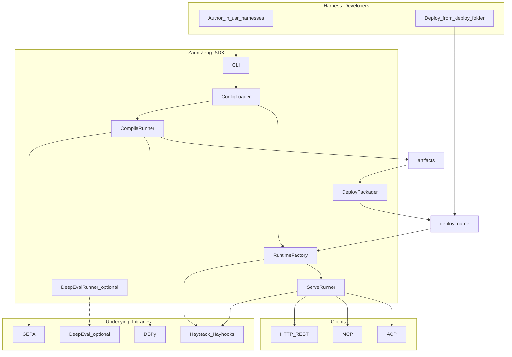

# ZaumZeug — Architecture

**Last updated:** 2026-07-28 (E4-S04 Pattern B / Haystack GEPA evaluator shipped)  

**Related:** [PRD](prd.md) · [Ideation archive](ideation-stage.md) · [Stories index](stories/00-README.md)

**Document scope:** This document defines **how** the system is built — structure, flows, protocols, and SDK modules. Product **what/why**, epics, acceptance criteria, and phases live in **[prd.md](prd.md)**. Cross-reference; do not duplicate.

Technical architecture for the harness factory SDK: Haystack runtime, DSPy specification, GEPA optimization, optional DeepEval, and multi-protocol serving.

---

## System context

**Formula:** `Harness = Workflow + Agents + Machinery`. Each **agent** inside a harness binds its own LLM via `agents-models.yaml`. See [PRD §1](prd.md#1-executive-summary) and [harness folder layout](architecture/02-repository-and-layout.md#33-harness-folder-layout).

| Role | Description | Requirements |
|---|---|---|
| **ZaumZeug SDK** | Pip package `zaumzeug` / import `zaumzeug` / CLI `zaumzeug` | [PRD E1–E3](prd.md#8-functional-requirements-epics) |
| **Dev workspace** | `usr-harnesses/<name>/` — multi-agent harness: author, compile, experiment | [PRD G1, G5](prd.md#3-goals) |
| **Production bundle** | `deploy/<name>/` — generated, runtime-only (all agents + workflow) | [PRD E5](prd.md#epic-e5--deploy-packaging-phase-2) |

---

## Architecture topics

| # | Topic | File | Contents |
|---|---|---|---|
| 01 | Overview and principles | [01-overview-and-principles.md](architecture/01-overview-and-principles.md) | System context detail, golden rules, harness vs agent, guides/sensors, portability |
| 02 | Repository and layout | [02-repository-and-layout.md](architecture/02-repository-and-layout.md) | Repo tree, harness folders, model files, install scripts, user-docs |
| 03 | Technology stack | [03-technology-stack.md](architecture/03-technology-stack.md) | Haystack/DSPy/GEPA/Jinja2 boundaries, `pyproject.toml` groups, test dependencies |
| 04 | Data flows | [04-data-flows.md](architecture/04-data-flows.md) | compile → deploy → serve, artifacts, workflow diagram |
| 05 | Configuration | [05-configuration.md](architecture/05-configuration.md) | YAML schema, model merge, eval, ModelRouter |
| 06 | Runtime and protocols | [06-runtime-and-protocols.md](architecture/06-runtime-and-protocols.md) | CLI layering, MCP/ACP/REST, web layouts |
| 07 | Deploy packaging | [07-deploy-packaging.md](architecture/07-deploy-packaging.md) | Packager, manifest, target install, platform matrix |
| 08 | Compile and optimization | [08-compile-and-optimization.md](architecture/08-compile-and-optimization.md) | GEPA patterns A/B/C; Pattern A CLI; Pattern B adapter ✅ (E4-S04); optional runtime `input_rewrite` (E4-S03b ✅) |
| 09 | SDK module map | [09-sdk-module-map.md](architecture/09-sdk-module-map.md) | Epic → module table |
| 10 | Operations and reference | [10-operations-and-reference.md](architecture/10-operations-and-reference.md) | Debug/test pyramid, testing playbook, security, anti-patterns, ecosystem, links |

**Reader paths:**

- **New harness author:** 02 → 05 → 04
- **SDK implementer:** 09 → 08 → 06
- **Deploy / ops:** 07 → 10

---

## Anchor index (legacy links)

These headings preserve links from [PRD](../prd.md) and [stories](../stories/00-README.md) that pointed at the monolithic architecture doc.

| Topic | New location |
|---|---|
| [§2 Architectural principles](architecture/01-overview-and-principles.md#2-architectural-principles) | 01-overview-and-principles |
| [§2.1 Golden rules](architecture/01-overview-and-principles.md#21-golden-rules) | 01-overview-and-principles |
| [§2.2.1 Harness vs agent](architecture/01-overview-and-principles.md#221-harness-vs-agent-terminology) | 01-overview-and-principles |
| [§2.3 Layer mapping](architecture/01-overview-and-principles.md#23-harness-layer-mapping-guides-and-sensors) | 01-overview-and-principles |
| [§2.5 Cross-platform portability](architecture/01-overview-and-principles.md#25-cross-platform-portability) | 01-overview-and-principles |
| [§3 Repository structure](architecture/02-repository-and-layout.md#3-repository-structure) | 02-repository-and-layout |
| [§3.1 Separation rules](architecture/02-repository-and-layout.md#31-separation-rules) | 02-repository-and-layout |
| [§3.2 Package naming](architecture/02-repository-and-layout.md#32-package-naming) | 02-repository-and-layout |
| [§3.3 Harness folder layout](architecture/02-repository-and-layout.md#33-harness-folder-layout) | 02-repository-and-layout |
| [§3.4 Install scripts](architecture/02-repository-and-layout.md#34-install-scripts-dev-vs-target) | 02-repository-and-layout |
| [§3.5 User documentation](architecture/02-repository-and-layout.md#35-user-documentation) | 02-repository-and-layout |
| [§4 Technology stack](architecture/03-technology-stack.md#4-technology-stack) | 03-technology-stack |
| [§4.1 Core libraries](architecture/03-technology-stack.md#41-core-libraries) | 03-technology-stack |
| [§4.4 pyproject.toml groups](architecture/03-technology-stack.md#44-pyprojecttoml-dependency-groups-phase-1-stub) | 03-technology-stack |
| [§4.5 Test dependencies](architecture/03-technology-stack.md#45-test-dependencies) | 03-technology-stack |
| [§5.2 Runtime agent resolution](architecture/04-data-flows.md#52-runtime-agent-resolution) | 04-data-flows |
| [§5.3 Artifact layout](architecture/04-data-flows.md#53-artifact-layout) | 04-data-flows |
| [§5.4 Workflow diagram](architecture/04-data-flows.md#54-workflow-diagram-compile) | 04-data-flows |
| [§6.1 Model registry merge](architecture/05-configuration.md#61-model-registry-merge) | 05-configuration |
| [§6.3 Eval frameworks](architecture/05-configuration.md#63-zaumzeug-eval-frameworks) | 05-configuration |
| [§6.4 Deploy eval gate](architecture/05-configuration.md#64-deploy-eval-gate) | 05-configuration |
| [§6.5 Builtin tools](architecture/05-configuration.md#65-builtin-tools-catalog) | 05-configuration |
| [§6.6 Phase 1 config schema](architecture/05-configuration.md#66-phase-1-config-schema) | 05-configuration |
| [§7 Model routing](architecture/05-configuration.md#7-model-routing) | 05-configuration |
| [§8 CLI and runtime](architecture/06-runtime-and-protocols.md#8-cli-and-runtime-layering) | 06-runtime-and-protocols |
| [§8.1 Source roots](architecture/06-runtime-and-protocols.md#81-source-roots) | 06-runtime-and-protocols |
| [§8.2 harness vs hayhooks](architecture/06-runtime-and-protocols.md#82-harness-vs-raw-hayhooks) | 06-runtime-and-protocols |
| [§8.3 Multi-harness serving](architecture/06-runtime-and-protocols.md#83-multi-harness-serving) | 06-runtime-and-protocols |
| [§9 Client access and protocols](architecture/06-runtime-and-protocols.md#9-client-access-and-protocols) | 06-runtime-and-protocols |
| [§9.1 Protocol selection](architecture/06-runtime-and-protocols.md#91-protocol-selection) | 06-runtime-and-protocols |
| [§9.4 Web deployment layouts](architecture/06-runtime-and-protocols.md#94-web-deployment-layouts) | 06-runtime-and-protocols |
| [§10.1 Dev vs deploy](architecture/07-deploy-packaging.md#101-dev-vs-deploy) | 07-deploy-packaging |
| [§10.6 Deploy platform targets](architecture/07-deploy-packaging.md#106-deploy-platform-targets) | 07-deploy-packaging |
| [§11 SDK modules](architecture/09-sdk-module-map.md#11-sdk-modules-to-build) | 09-sdk-module-map |
| [§13 Debug and test](architecture/10-operations-and-reference.md#13-debug-and-test-architecture) | 10-operations-and-reference |
| [§13.1 Design principles](architecture/10-operations-and-reference.md#131-design-principles) | 10-operations-and-reference |
| [§13.2 Mechanisms](architecture/10-operations-and-reference.md#132-mechanisms) | 10-operations-and-reference |
| [§13.3 Test pyramid](architecture/10-operations-and-reference.md#133-test-pyramid) | 10-operations-and-reference |
| [§13.6 Testing playbook](architecture/10-operations-and-reference.md#136-testing-playbook) | 10-operations-and-reference |
| [§14 Security](architecture/10-operations-and-reference.md#14-security-phase-1-stance) | 10-operations-and-reference |
| [§16 Supporting ecosystem](architecture/10-operations-and-reference.md#16-supporting-ecosystem-reference) | 10-operations-and-reference |
