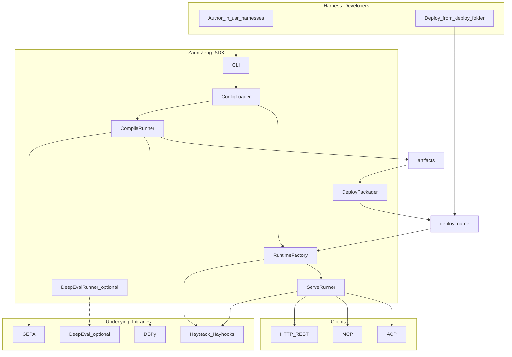

# Overview and principles

**Part of:** [Architecture index](../architecture.md) · [PRD](../prd.md)

---

## System context

**Formula:** `Harness = Workflow + Agents + Machinery`. Each **agent** inside a harness binds its own LLM via `agents-models.yaml`. See [PRD §1](../prd.md#1-executive-summary) and [§3.3](02-repository-and-layout.md#33-harness-folder-layout).

| Role | Description | Requirements |
|---|---|---|
| **ZaumZeug SDK** | Pip package `zaumzeug` / import `zaumzeug` / CLI `zaumzeug` | [PRD E1–E3](../prd.md#8-functional-requirements-epics) |
| **Dev workspace** | `usr-harnesses/<name>/` — multi-agent harness: author, compile, experiment | [PRD G1, G5](../prd.md#3-goals) |
| **Production bundle** | `deploy/<name>/` — generated, runtime-only (all agents + workflow) | [PRD E5](../prd.md#epic-e5--deploy-packaging-phase-2) |

---

## 2. Architectural principles

Product-facing wording: [PRD §6](../prd.md#6-product-principles). Non-goals: [PRD §4](../prd.md#4-non-goals-v1).

### 2.1 Golden rules

| Rule | Implication |
|---|---|
| **Compile-time vs runtime split** | DSPy and GEPA never run in the production request path. Haystack `Agent` owns the hot path. |
| **Never double agent loops** | Do not run DSPy `ReAct` and Haystack `Agent` in the same request. |
| **Model-agnostic** | No hardcoded provider or model names. Registry + `ModelRouter` inject LLMs from config. |
| **Dev vs deploy separation** | `usr-harnesses/` = build; `deploy/` = ship. Do not hand-edit `deploy/`. |
| **User code outside SDK** | Harness-specific code lives in `usr-harnesses/` or `deploy/`, never in `src/zaumzeug/`. |

### 2.2 Mental model

DSPy = blueprint · GEPA = tuning shop · Haystack = factory floor · DeepEval = optional quality inspection (dev only).

### 2.2.1 Harness vs agent (terminology)

A **harness** is **not** synonymous with a single LLM agent. Relabeling one agent deployment as a “harness” adds no meaning.

| Term | Meaning |
|---|---|
| **Harness** | A named system: **workflow** (serial stages now; parallel fan-out later) + **collection of agents** + shared machinery (tools policy, pipelines, eval, deploy, compile ratchet) |
| **Agent** | One role inside the harness (e.g. `researcher`, `reviewer`, `summarizer`). Lives in `agents/<agent-name>/` with its own config and LLM file. *(Example doc [cloudflare-harness.md](../cloudflare-harness.md) uses security-themed names for illustration only.)* |
| **Workflow** | Ordered (later: parallel) execution of agents and deterministic pipeline steps — declared in `workflow.yaml` |
| **ZaumZeug (product)** | Factory/SDK for building harnesses — not a factory for isolated single agents |

Each workflow stage runs **one Haystack `Agent` loop** for that step. The harness orchestrates **many such loops** across stages — not one monolithic chat session.

### 2.3 Harness layer mapping (guides and sensors)

| Harness component | Owner | Implementation |
|---|---|---|
| Agent loop | Haystack | `haystack.components.agents.Agent` |
| Context / RAG | Haystack | Retriever → prompt builder → generator pipelines |
| Tool interfaces | Haystack | `ComponentTool`, `MCPToolset`, Hayhooks MCP server |
| **Guides** (feedforward) | DSPy → GEPA → Haystack | Optimized instructions/demos exported to `system_prompt`, Jinja templates, tool descriptions; **optional** `prompts/input_rewrite.md` for compile-time-optimized user-input preprocessing (**export** E4-S03a ✅ · **runtime preprocess** E4-S03b ✅) |
| **Sensors** (feedback) | GEPA metric (+ optional DeepEval in `modules/metrics.py`) ✅ (E6-S07) | Score + **textual feedback** for compile |
| Regression testing | Optional DeepEval (or Promptfoo / custom pytest) | `[eval]` extra ✅ (E6-S01); `zaumzeug eval` ✅ (E6-S02); `eval/test_*.py` ✅ (E6-S04); trace → test case ✅ (E6-S05); Mode C HTTP `--base-url` ✅ (E6-S06) |
| Serving | Haystack + Hayhooks | REST, MCP, optional ACP/A2A |
| Observability | Haystack `track_stats`; optional OTel (Phase 4); DeepEval `@observe` if opted in | Trace export ✅ (E6-S05); production dataset ratchet → E8-S03 |

### 2.4 Industry patterns

- **MCP as tool boundary** — schema + timeout + idempotency + consistent error shape.
- **Guides + sensors** — ~70% compliance from optimized prompts (guides); ~100% enforcement from hooks/metrics (sensors).
- **Failure ladder** — retry → fallback → partial answer → human escalation.
- **One agent loop per workflow stage** — each agent role gets its own loop when its stage runs; the harness workflow chains stages (serial first, parallel fan-out later). Do not collapse multi-stage research into one exhaustive agent session.

### 2.5 Cross-platform portability

Requirements: **[PRD G4](../prd.md#3-goals)**, **[E1.7](../prd.md#epic-e1--onboarding-and-project-setup-phase-1)**, **[E3.2](../prd.md#epic-e3--runtime-and-local-serve-phase-1)**, **[E5.8](../prd.md#epic-e5--deploy-packaging-phase-2)**.

| Rule | Implementation |
|---|---|
| **Single install implementation** | All install logic in `install/client_install.py` (stdlib + `pathlib`); `.sh` / `.ps1` wrappers delegate only (**Done** E1-S01/S02 — [§3.4](02-repository-and-layout.md#34-install-scripts-dev-vs-target)) |
| **CI matrix (Win / macOS / Linux)** | **Done** (E1-S07, 2026-07-22) — [`.github/workflows/ci-matrix.yml`](../../.github/workflows/ci-matrix.yml); Python 3.11; install wrappers → doctor → dry-run → `ci_serve_smoke.py` → contract + unit/integration pytest. **Phase 2+ Linux deploy smoke** ✅ (E5-S08, 2026-07-29) — `zaumzeug deploy example` → `ci_serve_smoke.py example --deploy` on `ubuntu-latest` only |
| **No hardcoded paths** | SDK and install use `pathlib.Path`; no `/` or `\` literals for harness roots, venv, or artifacts |
| **OS detection** | `platform.system()` for venv paths (`Scripts` vs `bin`), activation hints, and optional shell-specific messaging — not duplicated in shell scripts |
| **Env over convention** | `HARNESS_ROOT`, `HARNESS_LOG_LEVEL`, port overrides in yaml — avoid OS-specific defaults in code. **`HARNESS_ROOT=deploy`** ✅ (E5-S04, 2026-07-28) forces `deploy/` for serve/mcp/acp via `config/harness_root.py` |
| **Line endings** | Repo `.gitattributes` normalizes text; generated files use `\n` |
| **Subprocess** | Use list-form `subprocess` args; no shell=True for install/serve unless documented for a specific wrapper |

**Dev vs production platforms:** local development and compile workflows must run on Windows, macOS, and Linux (CI matrix — **Done** E1-S07). Production deployment targets Linux-first; see [§10.6](07-deploy-packaging.md#106-deploy-platform-targets) (**Done** E5-S08, 2026-07-29 — platform matrix docs + OS-neutral bundle tests + Linux CI deploy→serve smoke).

**Implementation (E1-S07, 2026-07-22):** Smoke matrix on three OS runners; mock-only (no `HARNESS_LIVE_LLM=1`); ephemeral serve via `install/ci_serve_smoke.py` + `zaumzeug serve --port`. Details: [§13.6](10-operations-and-reference.md#136-testing-playbook).

**Implementation (E5-S08, 2026-07-29):** Linux-first production policy documented in `README.deploy.md` / [deploy.md](../../user-docs/guides/deploy.md#platforms); Win/macOS production serve best-effort (not CI-gated); optional Dockerfile → E8-S05.

---
