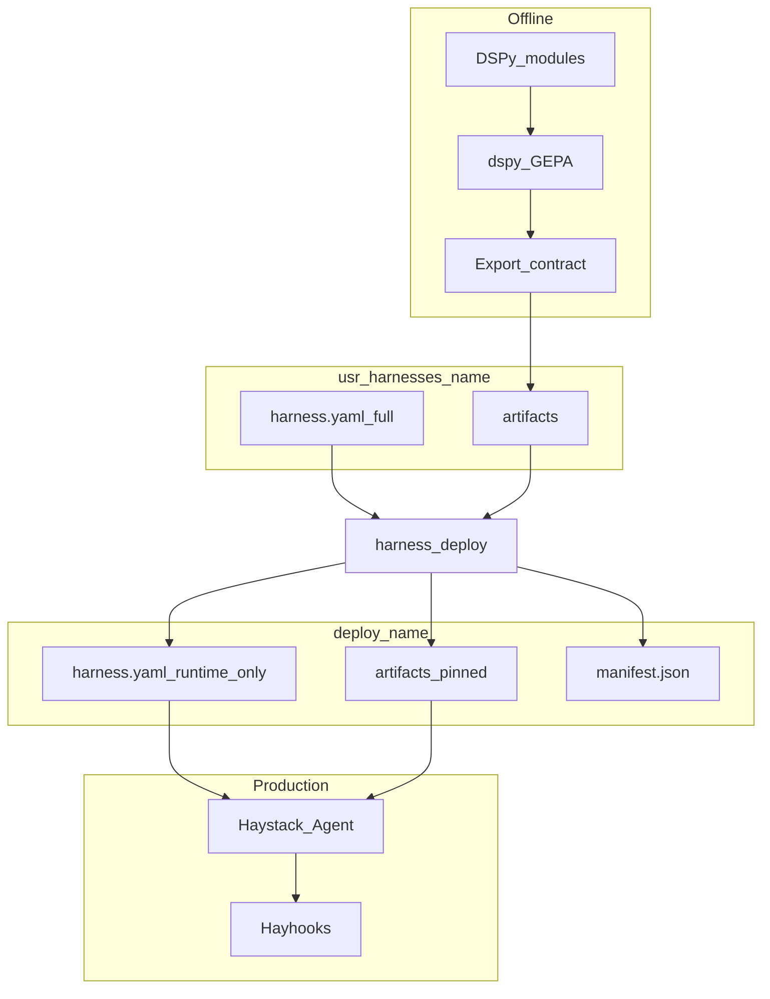
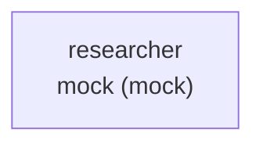

# End-to-end data flows

**Part of:** [Architecture index](../architecture.md) · [PRD](../prd.md)

---

## 5. End-to-end data flows

### 5.1 Default pattern (compile → deploy → serve)



### 5.2 Runtime agent resolution

At `zaumzeug serve` / `zaumzeug mcp` / `zaumzeug acp` / `zaumzeug run` (workflow):

1. Load `workflow.yaml` and resolve the requested stage (or default entry stage for interactive serve).
2. Resolve `agents/<agent-name>/` for that stage; load **`agents-models.yaml`** (merged per [§3.3.1](02-repository-and-layout.md#331-model-config-files-naming)) into a **stage-scoped `ModelRouter`**.
3. If `agent.yaml` → `artifact` exists with valid **artifact-manifest.json** → load into Haystack `Agent` (ignore `module`).
4. If artifact exports **input rewrite/clarify** text → runtime applies **one preprocess step** before the agent loop; **no GEPA** on the request path.
5. Else if `agent.yaml` → `system_prompt` file exists → use as `Agent.system_prompt`.
6. Else → fail fast with actionable error (include `harness-name` and `agent-name`).

**Implementation (E2-S03, 2026-07-08):** Serve/compile resolution via `zaumzeug.config.resolve_agent_serve()`, `resolve_agent_compile()`, and `resolve_serve_entry()` (`src/zaumzeug/config/resolver.py`). When `agent.artifact` is set, `artifact-manifest.json` must exist in that directory (legacy `manifest.json` also accepted — E4-S03a). No DSPy import on the serve resolution path.

**Implementation (E2-S04a, 2026-07-08):** `zaumzeug doctor` runtime path checks call `resolve_agent_serve()` for each workflow agent — same resolution logic as serve ([E3-S02](../stories/02-epic.md#e3-s02-zaumzeug-serve-dev-mode)).

**Implementation (E2-S05, 2026-07-08):** `zaumzeug serve <harness> --dry-run` calls `validate_serve()` (`src/zaumzeug/serve/validate.py`) — `load_harness()`, `resolve_serve_entry()`, doctor model/runtime checks, deploy manifest when `--deploy`. Human-readable or `--json` summary; no Hayhooks or LLM.

**Implementation (E3-S02, 2026-07-20):** `zaumzeug serve <harness>` calls the same `validate_serve()` then `runtime/factory.build_agent()` and starts Hayhooks via `serve/runner.py` — OpenAI `/v1/chat/completions` + `GET /v1/models`, bind `127.0.0.1`, port from `serve.hayhooks.port`. Escape hatch documented in `user-docs/reference/cli.md`.

**Implementation (E7-S04, 2026-08-21):** Optional `serve.hayhooks.chainlit: true` mounts `/chat` on that same process/port (`pip install "hayhooks[chainlit]"`). REST stays available. Docs: [web-deployment.md](../../user-docs/guides/web-deployment.md).

**Implementation (E3-S08, 2026-07-21):** `zaumzeug run <harness>` executes the full (or `--from`-partial) stage graph via `runtime/workflow.run_workflow()` — stage-scoped ModelRouter + factory per agent stage; prior output forwarded as prepended user context. Pipeline stages stubbed until Phase 4.

**Implementation (E8-S07, 2026-08-01):** Same `run_workflow` path adds typed live errors, optional `runtime.retry`, JSON `output.format`, and INFO stage logs with structured `stage`. Serve/HTTP path is a follow-up.

**Interactive serve** (`zaumzeug serve <harness>`): runs the workflow's **entry** agent (or sole agent) for chat/MCP/ACP clients. **Workflow run** (`zaumzeug run <harness>`): executes the full or partial stage graph.

At `zaumzeug compile <harness> --agent <agent-name>` (offline):

- Requires `agents/<agent-name>/agent.yaml` → `compile.module` (DSPy `Module` import path).
- Uses that agent's merged `agents-models.yaml` for `task_model_id` / `reflection_model_id`.
- Writes `agents/<agent-name>/artifacts/<run_id>/`, updates `artifacts/current` for that agent.
- Runtime prefers artifact over `system_prompt` after compile.

**Implementation (E4-S01, 2026-07-28):** `zaumzeug.compile.module_loader.load_dspy_module()` loads `compile.module` as `module.path:ClassName` from the agent folder (safe `sys.path`, no traversal) and validates a `dspy.Module` subclass. Compile-only — not imported by serve/runtime. **2026-08-14:** drops stale `sys.modules` entries for that dotted name before import.

**Implementation (E4-S02a, 2026-07-28):** `zaumzeug compile` wires the loader + LM preflight (`compile/runner.py`, `compile/gepa_runner.py`). Fails fast on missing `compile.module`, unimportable modules, or missing registry/`.env` keys for task/reflection LMs — before any GEPA call.

**Implementation (E4-S06, 2026-07-28):** `zaumzeug compile --dry-run` stops after that validation (prints task/reflection registry) — no GEPA, no LLM API calls, no artifacts. Tests: `tests/integration/compile/test_compile_dry_run.py`.

**Implementation (E4-S02b, 2026-07-28):** After preflight, `invoke_gepa()` runs `dspy.GEPA` (stub when `provider: mock` or injected for CI), writes `agents/<name>/artifacts/<run_id>/`, and updates `artifacts/current` (symlink or copy).

**Implementation (E4-S03a, 2026-07-28):** `compile/export.py` maps `dump_state()` → `prompts/system.md`, optional `prompts/input_rewrite.md`, `agent.json`, and `artifact-manifest.json` (legacy `manifest.json` accepted when resolving). Wired from `write_artifact_run` before `current` update.

**Implementation (E4-S03b, 2026-07-28):** When the artifact manifest lists `input_rewrite`, `runtime/preprocess.py` loads the fixed template and serve/`run_workflow` apply it to user messages before `Agent.run` (Jinja / format / plain prepend). Factory `build_agent_bundle()` exposes the template; no DSPy on the request path.

**Implementation (E4-S05, 2026-07-28):** After compile, serve prefers `agent.artifact` (valid `artifact-manifest.json`) over hand-edited `system_prompt` and never imports `compile.module`. Export records `source_hash` (SHA-256 of the module `.py`); `zaumzeug doctor` warns when that hash drifts (`check_artifact_module_staleness`). Happy path: [user-docs/guides/compile.md](../user-docs/guides/compile.md#serve-after-compile).

**Implementation (E4-S07, 2026-07-28):** Pin/rollback via `agent.artifact: artifacts/<run_id>/` or retargeting `artifacts/current`. Compile never overwrites an existing `<run_id>/` (`write_artifact_run`). Doctor `check_pinned_artifact` validates the pin manifest and warns when pin ≠ `current`. Rollback steps: [user-docs/guides/compile.md](../user-docs/guides/compile.md#rollback-to-a-pinned-run).

### 5.3 Artifact layout

Per-agent under `agents/<agent-name>/artifacts/`:

```text
usr-harnesses/<harness>/agents/<agent-name>/artifacts/
├── current/
│   ├── artifact-manifest.json
│   ├── agent.json
│   └── prompts/
│       ├── system.md
│       └── input_rewrite.md     # optional
└── <run_id>/
```

Deploy pins **each agent's** selected run under `deploy/<harness>/agents/<agent-name>/artifacts/`.

**Manifest naming:** Two different files — do not conflate:

| File | Scope | Written by | Purpose |
|---|---|---|---|
| **`agents/.../artifacts/<run_id>/artifact-manifest.json`** | Per-agent compile export | `zaumzeug compile --agent <name>` | Export version, `module_hash`, `source_hash` (module `.py`), GEPA run metadata |
| **`deploy/<harness>/manifest.json`** | Deploy bundle | `zaumzeug deploy` | Build id, git sha, yaml hash, per-agent `artifact_run_id` map ([§10.3](07-deploy-packaging.md#103-deploy-manifestjson)) |

Legacy alias: compile / serve accept `manifest.json` during migration (**implemented** E4-S03a via `find_artifact_manifest` / resolver); v1 canonical name is **`artifact-manifest.json`**.

**Implementation (E5-S01, 2026-07-28):** `write_deploy_bundle` writes deploy `manifest.json` (and copies `docs/workflow-diagram.md` into the bundle). Tests: `tests/integration/deploy/test_deploy.py`. **E5-S02 (2026-07-28):** §10.1 include/exclude matrix via `resolve_deploy_copy_plan` / `assert_required_paths`; golden `tests/integration/deploy/test_deploy_golden.py`.

### 5.4 Workflow diagram (compile)

At **`zaumzeug compile <harness>`**, the SDK **always** regenerates harness workflow documentation (even when no agent runs GEPA). Use **`zaumzeug compile <harness> --workflow-diagram-only`** to refresh the diagram without LLM or GEPA work.

| Output | Path |
|---|---|
| Workflow diagram (Markdown + Mermaid) | `usr-harnesses/<harness>/docs/workflow-diagram.md` |

**Generator inputs:** `workflow.yaml`, each `agents/<name>/agent.yaml`, merged `agents-models.yaml` (agent name + `default_model_id` + provider label), pipeline stages from `serve.expose`.

**Diagram (serial v1):** one node per workflow stage; directed edges in order; agent nodes labeled with role and resolved model id (no secrets).

**Operational rules:**

- Do not hand-edit `docs/workflow-diagram.md` — compile overwrites ([§15](10-operations-and-reference.md#15-anti-patterns)).
- `zaumzeug doctor` **warns** when `workflow.yaml` is newer than `docs/workflow-diagram.md` (or diagram missing).

**Implementation (E4-S08, 2026-07-28):** `compile/workflow_diagram.py` — `write_workflow_diagram()` / `render_workflow_diagram()`; invoked from `run_compile` after GEPA (and on `--workflow-diagram-only`). Doctor: `check_workflow_diagram_staleness()` (E2-S04b) compares file mtimes under each harness; missing diagram suggests `zaumzeug compile <harness> --workflow-diagram-only`.
- `zaumzeug deploy` copies `docs/` into `deploy/<harness>/docs/` ([§10.1](07-deploy-packaging.md#101-dev-vs-deploy)) — **Done** E5-S01; golden matrix **Done** E5-S02.
- Per-agent GEPA (`zaumzeug compile <harness> --agent <name>`) still refreshes the harness-level diagram.

Requirements: [PRD E4.7](../prd.md#epic-e4--compile-and-gepa-pipeline-phase-2).

**Example output** (`example` harness, serial) — file `docs/workflow-diagram.md`:

````text
# Workflow diagram — example

> Auto-generated by `zaumzeug compile example`. Do not edit by hand.



**Stages:** 1 serial stage · **Entry:** `researcher` · **Generated:** 2026-07-28
````

Agent nodes label `default_model_id (provider)`. For multi-stage harnesses, nodes chain left-to-right with edges in `workflow.yaml` order; pipeline stages use the pipeline id as the label.

### 5.5 Continuous improvement loop

See [PRD Journey C](../prd.md#73-journey-c--improve-after-failure-phase-2) and [Epic E8.3](../prd.md#epic-e8--rag-and-production-hardening-phase-4).

```text
production failure → trace → dataset row → zaumzeug eval (optional) → GEPA compile
→ zaumzeug deploy → zaumzeug serve --deploy
```

**Implementation (E6-S05, 2026-07-28):** Trace export + `zaumzeug eval --trace` land in `eval/trace.py` / `eval/runner.py`. End-to-end Journey C walkthrough: [user-docs/guides/testing.md](../user-docs/guides/testing.md#trace--test-case-journey-c).

**Implementation (E6-S07, 2026-07-28):** Failed eval → train via `eval/gepa_bridge.append_failed_eval_to_train`; shared val aliases; optional DeepEval GEPA metric. Docs: [testing.md — GEPA ↔ DeepEval bridge](../user-docs/guides/testing.md#gepa--deepeval-bridge-compile--eval--compile). Production auto-capture / dataset ratchet remains [E8-S03](../stories/epic-stories/60-story.md).

**Implementation (E5-S03, 2026-07-28):** `zaumzeug serve --deploy` runs production bundles under `deploy/<name>/` (same OpenAI REST as dev). Tests: `tests/integration/deploy/test_serve_deploy.py`.

**Implementation (E5-S04, 2026-07-28):** `HARNESS_ROOT=deploy` forces the same production root without `--deploy` (serve / mcp / acp / doctor / run) via `config/harness_root.resolve_harness_path()`. Tests: `tests/unit/deploy/test_harness_root.py`.

**Implementation (E5-S05, 2026-07-28):** Target ship workflow documented — copy `deploy/<name>/` → `target_install` → create `.env` → `zaumzeug serve --deploy`. Runtime-only install (no DSPy/GEPA/DeepEval); `.env` never in bundle. Docs: [user-docs/guides/deploy.md](../user-docs/guides/deploy.md), bundle `README.deploy.md`. Tests: `tests/integration/deploy/test_target_install.py`, `test_deploy.py::test_e5_s05_ac5_no_env_in_bundle`.

**Implementation (E5-S07, 2026-07-28):** Deploy git policy — default `.gitignore` includes `/deploy/` and `usr-harnesses/*/artifacts/`; documented release force-add and CI `upload-artifact` options. See [§10.4](07-deploy-packaging.md#104-git-and-gitignore).

**Implementation (E5-S08, 2026-07-29):** Deploy platform policy — Linux-first production matrix; OS-neutral bundle assertions; Linux CI `zaumzeug deploy` → `serve --deploy` smoke. See [§10.6](07-deploy-packaging.md#106-deploy-platform-targets).

**Implementation (E5-S09a/b/c, 2026-07-29):** Target install — optional `.venv`, runtime `pip install zaumzeug`, `.env` seed, sh/ps1 wrappers, `--verify` (doctor `--deploy` + serve `--deploy --dry-run`). See [§10.7](07-deploy-packaging.md#107-target-runtime-install-script); tests `test_target_install.py`.
---
