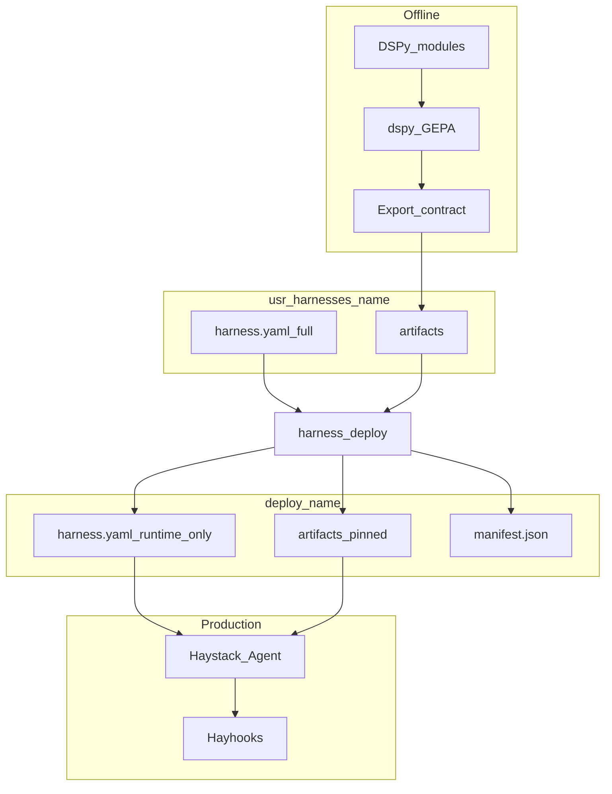

# End-to-end data flows

**Part of:** [Architecture index](../architecture.md) · [PRD](../prd.md)

---

## 5. End-to-end data flows

### 5.1 Default pattern (compile → deploy → serve)



### 5.2 Runtime agent resolution

At `zaumzeug serve` / `zaumzeug mcp` / `zaumzeug acp` / `zaumzeug run` (workflow):

1. Load `workflow.yaml` and resolve the requested stage (or default entry stage for interactive serve).
2. Resolve `agents/<agent-name>/` for that stage; load **`agents-models.yaml`** (merged per [§3.3.1](02-repository-and-layout.md#331-model-config-files-naming)) into a **stage-scoped `ModelRouter`**.
3. If `agent.yaml` → `artifact` exists with valid **artifact-manifest.json** → load into Haystack `Agent` (ignore `module`).
4. If artifact exports **input rewrite/clarify** text → runtime applies **one preprocess step** before the agent loop; **no GEPA** on the request path.
5. Else if `agent.yaml` → `system_prompt` file exists → use as `Agent.system_prompt`.
6. Else → fail fast with actionable error (include `harness-name` and `agent-name`).

**Implementation (E2-S03, 2026-07-08):** Serve/compile resolution via `zaumzeug.config.resolve_agent_serve()`, `resolve_agent_compile()`, and `resolve_serve_entry()` (`src/zaumzeug/config/resolver.py`). When `agent.artifact` is set, `artifact-manifest.json` must exist in that directory. No DSPy import on the serve resolution path.

**Implementation (E2-S04a, 2026-07-08):** `zaumzeug doctor` runtime path checks call `resolve_agent_serve()` for each workflow agent — same resolution logic as serve ([E3-S02](../stories/02-epic.md#e3-s02-zaumzeug-serve-dev-mode)).

**Implementation (E2-S05, 2026-07-08):** `zaumzeug serve <harness> --dry-run` calls `validate_serve()` (`src/zaumzeug/serve/validate.py`) — `load_harness()`, `resolve_serve_entry()`, doctor model/runtime checks, deploy manifest when `--deploy`. Human-readable or `--json` summary; no Hayhooks or LLM.

**Implementation (E3-S02, 2026-07-20):** `zaumzeug serve <harness>` calls the same `validate_serve()` then `runtime/factory.build_agent()` and starts Hayhooks via `serve/runner.py` — OpenAI `/v1/chat/completions` + `GET /v1/models`, bind `127.0.0.1`, port from `serve.hayhooks.port`. Escape hatch documented in `user-docs/reference/cli.md`.

**Interactive serve** (`zaumzeug serve <harness>`): runs the workflow's **entry** agent (or sole agent) for chat/MCP/ACP clients. **Workflow run** (`zaumzeug run <harness>`): executes the full or partial stage graph.

At `zaumzeug compile <harness> --agent <agent-name>` (offline):

- Requires `agents/<agent-name>/agent.yaml` → `compile.module` (DSPy `Module` import path).
- Uses that agent's merged `agents-models.yaml` for `task_model_id` / `reflection_model_id`.
- Writes `agents/<agent-name>/artifacts/<run_id>/`, updates `artifacts/current` for that agent.
- Runtime prefers artifact over `system_prompt` after compile.

### 5.3 Artifact layout

Per-agent under `agents/<agent-name>/artifacts/`:

```text
usr-harnesses/<harness>/agents/<agent-name>/artifacts/
├── current/
│   ├── artifact-manifest.json
│   ├── agent.json
│   └── prompts/
│       ├── system.md
│       └── input_rewrite.md     # optional
└── <run_id>/
```

Deploy pins **each agent's** selected run under `deploy/<harness>/agents/<agent-name>/artifacts/`.

**Manifest naming:** Two different files — do not conflate:

| File | Scope | Written by | Purpose |
|---|---|---|---|
| **`agents/.../artifacts/<run_id>/artifact-manifest.json`** | Per-agent compile export | `zaumzeug compile --agent <name>` | Export version, module hash, GEPA run metadata |
| **`deploy/<harness>/manifest.json`** | Deploy bundle | `zaumzeug deploy` | Build id, git sha, yaml hash, per-agent `artifact_run_id` map ([§10.3](07-deploy-packaging.md#103-deploy-manifestjson)) |

Legacy alias: compile may accept `manifest.json` during migration; v1 canonical name is **`artifact-manifest.json`**.

### 5.4 Workflow diagram (compile)

At **`zaumzeug compile <harness>`**, the SDK **always** regenerates harness workflow documentation (even when no agent runs GEPA). Use **`zaumzeug compile <harness> --workflow-diagram-only`** to refresh the diagram without LLM or GEPA work.

| Output | Path |
|---|---|
| Workflow diagram (Markdown + Mermaid) | `usr-harnesses/<harness>/docs/workflow-diagram.md` |

**Generator inputs:** `workflow.yaml`, each `agents/<name>/agent.yaml`, merged `agents-models.yaml` (agent name + `default_model_id` + provider label), pipeline stages from `serve.expose`.

**Diagram (serial v1):** one node per workflow stage; directed edges in order; agent nodes labeled with role and resolved model id (no secrets).

**Operational rules:**

- Do not hand-edit `docs/workflow-diagram.md` — compile overwrites ([§15](10-operations-and-reference.md#15-anti-patterns)).
- `zaumzeug doctor` **warns** when `workflow.yaml` is newer than `docs/workflow-diagram.md` (or diagram missing).

**Implementation (E2-S04b, 2026-07-08):** `check_workflow_diagram_staleness()` in `src/zaumzeug/doctor/checks.py` compares file mtimes under each harness; missing diagram suggests `zaumzeug compile <harness> --workflow-diagram-only`.
- `zaumzeug deploy` copies `docs/` into `deploy/<harness>/docs/` ([§10.1](07-deploy-packaging.md#101-dev-vs-deploy)).
- Per-agent GEPA (`zaumzeug compile <harness> --agent <name>`) still refreshes the harness-level diagram.

Requirements: [PRD E4.7](../prd.md#epic-e4--compile-and-gepa-pipeline-phase-2).

**Example output** (`example` harness, serial) — file `docs/workflow-diagram.md`:

```text
# Workflow diagram — example

> Auto-generated by `zaumzeug compile example`. Do not edit by hand.

--- mermaid block ---
flowchart LR
  entry["researcher\nmock-researcher"]
--- end mermaid ---

**Stages:** 1 serial · **Entry:** `researcher` · **Generated:** 2026-07-05
```

The generator writes a real fenced ` ```mermaid ` block in place of the placeholder above.

For multi-stage harnesses, nodes chain left-to-right (or top-to-bottom) with edges in `workflow.yaml` order; pipeline stages use the exposed pipeline id as the label.

### 5.5 Continuous improvement loop

See [PRD Journey C](../prd.md#73-journey-c--improve-after-failure-phase-2) and [Epic E8.3](../prd.md#epic-e8--rag-and-production-hardening-phase-4).

```text
production failure → trace → dataset row → zaumzeug eval (optional) → GEPA compile
→ zaumzeug deploy → zaumzeug serve --deploy
```

---
