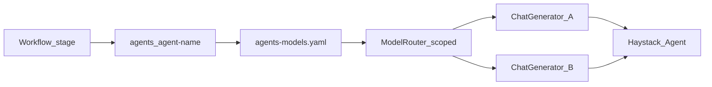

# Configuration and model routing

**Part of:** [Architecture index](../architecture.md) · [PRD](../prd.md)

---

## 6. Configuration architecture

Single entry per harness: **`harness.yaml`**. Workflow: **`workflow.yaml`**. Per-agent entry: **`agents/<agent-name>/agent.yaml`**. Global defaults: **`config/models.yaml`**.

### 6.1 Model registry merge

**Three-tier merge** (see [§3.3.1](02-repository-and-layout.md#331-model-config-files-naming)):

| Tier | File | Required? |
|---|---|---|
| Global | `config/models.yaml` | Optional project defaults |
| Harness | `usr-harnesses/<harness>/models.yaml` | Optional shared aliases |
| Agent | `agents/<agent-name>/agents-models.yaml` | **Required per agent** |

**Merge steps** (for each agent at runtime/compile):

1. Load global `config/models.yaml` if present.
2. If harness declares `models: models.yaml` in `harness.yaml`, deep-merge over global.
3. Load `agents/<agent-name>/agents-models.yaml` and deep-merge over harness + global.
4. Validate that agent's `default_model_id`, `compile.task_model_id`, `compile.reflection_model_id`, etc. against the **merged registry for that agent**.
5. Secrets in `.env` only — never in YAML or artifacts.

**Deep-merge rules (v1):**

| Rule | Behavior |
|---|---|
| Top-level keys | Child file overrides parent for same `model_id` key |
| Nested dicts (e.g. `generation_kwargs`) | Recursive merge; child keys win |
| Lists | Child list **replaces** parent list entirely (no append merge) |
| `null` / omitted | Omitted child key inherits parent; explicit empty dict replaces |

**Example:** `vuln-hunter` may use `provider: anthropic` from its `agents-models.yaml` while `finding-validator` in the **same harness** uses `provider: openai` from a separate `agents-models.yaml` — no request override required; the workflow switches routers per stage.

Requirements: [PRD E2.2](../prd.md#epic-e2--configuration-and-validation-phase-1).

**Implementation (E2-S02, 2026-07-08):** Three-tier merge via `zaumzeug.config.load_merged_agent_models()` (`src/zaumzeug/config/models.py`). `deep_merge()` applies the rules above (recursive dict merge, list replace, explicit empty dict replaces). `AgentModelsConfig` validates each agent's `default_model_id` against the merged registry and rejects secret keys in YAML (credentials in `.env` only). Harness `models:` file references are resolved by `load_harness()` (E2-S01).

### 6.2 Config sections

| Section | File | Phase | Wires | Epic |
|---|---|---|---|---|
| `harness` root | `harness.yaml` | 1+ | name, serve, deploy, eval, optional harness `models` | E2, E3, E5, E6 |
| `workflow` | `workflow.yaml` | 1+ | Serial stage graph; agent + pipeline references | E2, E3 |
| `agent` | `agents/<name>/agent.yaml` | 1+ | Per-role Haystack agent, tools, compile, hooks | E2, E3, E4, E7 |
| `agents-models` | `agents/<name>/agents-models.yaml` | 1+ | Per-agent LLM registry; stage-scoped `ModelRouter` | E2, E3 |
| `tools.builtin` | `agent.yaml` | 1+ | SDK catalog (`web_fetch` first) | E3 |
| `tools.mcp` | `agent.yaml` | 3 | `MCPToolset` | E7 |
| `tools.custom` | `agent.yaml` | 3 | `agents/<name>/tools/*.py` | E7 |
| `compile` | `agent.yaml` | 2 | DSPy + GEPA → agent `artifacts/` | E4 |
| `eval` | `harness.yaml` | 2 | Optional eval (`builtin` or `deepeval`) | E6 |
| `deploy` | `harness.yaml` | 2 | Eval gate on `zaumzeug deploy` ✅ (E6-S03 / E5-S06) | E5 |
| `serve` | `harness.yaml` | 1+ | Hayhooks ports, Chainlit, MCP, ACP, A2A | E3, E7, E8 |

Full schema examples: Phase 1 canonical examples in [§6.6](05-configuration.md#66-phase-1-config-schema); full multi-phase reference in [ideation-stage.md](../ideation-stage.md) until `user-docs/reference/harness-yaml.md` exists.

### 6.3 `zaumzeug eval` frameworks

`zaumzeug eval` behavior depends on `eval.framework` in `harness.yaml`:

| `eval.framework` | DeepEval required? | Behavior |
|---|---|---|
| *(no `eval` section)* | — | Exit 1: *"No eval configured. Add an `eval:` block to harness.yaml."* |
| `builtin` | **No** | Load `eval.valset` JSONL; per row run agent; check `expected_output` exact/substring match if present; report pass/fail counts. No LLM-as-judge. |
| `deepeval` | **Yes** (`[eval]` extra) | Run configured DeepEval metrics on valset; per-metric thresholds. **Default** when `eval:` present and `framework` omitted. |

**Integration modes:**

| Mode | Description | Phase |
|---|---|---|
| **A — In-process black-box** | Default: SDK runs Haystack agent, builds `LLMTestCase`, runs metrics (`zaumzeug eval`, `deepeval test run`) | 2 |
| **B — In-process tracing** | Wrap `Agent.run()` with DeepEval `@observe` / `update_current_span` | 4 |
| **C — HTTP black-box** | Client calls running `zaumzeug serve` `/v1/chat/completions`; same metrics — staging/debug | 2+ |

If `framework: deepeval` (or default) and `deepeval` not installed:

```text
Error: eval.framework is 'deepeval' but deepeval is not installed.
Install with: pip install "zaumzeug[eval]"
Or set eval.framework: builtin for JSONL checks without DeepEval.
```

**Implementation (E6-S01, 2026-07-28):** Message text lives in `zaumzeug.eval.DEEPEVAL_MISSING_MESSAGE` / `require_deepeval()`.

**Implementation (E6-S02, 2026-07-28):** `zaumzeug.eval.runner.run_eval()` — `EvalConfig` on `HarnessConfig`; builtin JSONL exact/substring checks; DeepEval metrics via `.measure()`; CLI `zaumzeug eval <name> [--framework builtin|deepeval]`. `eval` unblocked from `PHASE_GATED_FIELDS` (doctor no longer Phase-warns). Tests: `tests/unit/eval/test_runner.py`.

CLI: `zaumzeug eval <name> --framework builtin` overrides yaml for one run.

**`eval` config fields (deepeval):**

| Field | Purpose |
|---|---|
| `eval.framework` | `deepeval` (default) or `builtin` |
| `eval.valset` | JSONL — `input`, `expected_output`, optional `retrieval_context` |
| `eval.metrics` | DeepEval metric types + thresholds |
| `eval.judge_model_id` | `models.yaml` key for LLM-as-judge |
| `eval.confident_ai` | Optional cloud sync (`enabled`, `sync_test_results`); requires `deepeval login` |

**Suggested metrics by harness type:**

| Harness type | Suggested DeepEval metrics |
|---|---|
| General agent | `TaskCompletionMetric`, `GEval`, `HallucinationMetric` |
| Tool-using | `ToolCorrectnessMetric`, `ArgumentCorrectnessMetric`, `StepEfficiencyMetric` |
| RAG | `AnswerRelevancyMetric`, `FaithfulnessMetric`, `ContextualRecallMetric`, `RAGASMetric` |
| Multi-turn | `ConversationCompletenessMetric`, `KnowledgeRetentionMetric` |
| MCP-heavy | `MCPTaskCompletionMetric`, `MCPUseMetric` |

**GEPA ↔ DeepEval bridge:** compile then verify; failed rows → `data/train.jsonl`; shared `data/val.jsonl`; GEPA metric may call DeepEval `.measure()`.

Requirements: [PRD E6](../prd.md#epic-e6--evaluation-and-quality-phase-2-optional).

### 6.4 Deploy eval gate

Controls whether `zaumzeug deploy` runs eval first:

```yaml
# harness.yaml (dev copy; stripped from deploy bundle)
deploy:
  eval_gate: skip    # default
```

| `deploy.eval_gate` | Behavior |
|---|---|
| `skip` | Do not run eval on deploy (default). |
| `warn` | If `eval:` configured, run `zaumzeug eval`; print failures; **continue** deploy. |
| `block` | If `eval:` configured, run `zaumzeug eval`; **abort** deploy on any failure. |

CLI override: `zaumzeug deploy <name> --eval-gate block` (overrides yaml for one run).

If `eval:` absent, `eval_gate: block` is a no-op (nothing to run).

Requirements: [PRD E5.6](../prd.md#epic-e5--deploy-packaging-phase-2), [E6.3](../prd.md#epic-e6--evaluation-and-quality-phase-2-optional).

**Implementation (E5-S06 / E6-S03, 2026-07-28):** Single source of truth in [`deploy/packager.py`](../../src/zaumzeug/deploy/packager.py) — `apply_eval_gate()` / `package_harness()`; `DeployConfig` on `HarnessConfig`; CLI `zaumzeug deploy --eval-gate`. Tests: `tests/unit/deploy/test_eval_gate.py` (7 passed). Full stripped-bundle copy rules remain [E5-S01](../stories/epic-stories/41-story.md).

### 6.5 Builtin tools catalog

SDK-provided tools referenced by `tools.builtin` in `harness.yaml`:

| Tool ID | Phase | Description |
|---|---|---|
| `web_fetch` | **1** | Fetch URL content (HTTP GET); returns text for agent context. **v1 limits:** HTTPS only; 30s timeout; 1 MB response cap; blocks private/link-local IPs (SSRF guard). CI may stub HTTP. |
| `calculator` | 3 | Safe arithmetic expression evaluation |
| `read_file` | 3 | Read text file under harness folder (path sandboxed to workspace) |
| `search_docs` | 4 | Search indexed documents when RAG pipeline attached |

Phase 1 **minimum ship:** `web_fetch` only. Phase 3+ entries are planned; unknown builtin ID → config validation error with list of available IDs for current phase.

**Implementation (E3-S03, 2026-07-08; E3-S00, 2026-07-20):** Builtin `web_fetch` in `src/zaumzeug/runtime/tools/web_fetch.py` — Haystack `@component` + `ComponentTool`, outbound fetch via **httpx** (HTTPS only, 30s timeout, 1 MB cap, SSRF guard on host resolution and redirect chain). Phase-aware catalog in `src/zaumzeug/runtime/tools/catalog.py` and `src/zaumzeug/config/builtins.py`. `AgentConfig` / `load_agent_config()` validate `tools.builtin` ids; workflow cross-checks agent yaml via `load_workflow()`. `build_agent()` in `src/zaumzeug/runtime/factory.py` builds a single Haystack `Agent` from resolved harness config (ModelRouter chat generator, `resolve_agent_serve()` prompt path, builtins). Tests: `tests/unit/runtime/tools/test_web_fetch.py`, `tests/integration/test_runtime_factory.py`, `tests/unit/runtime/test_factory_imports.py`, `tests/unit/config/test_schemas.py` (`test_e3_s03_ac5_*`). Stub outbound HTTP in CI with **respx** ([§4.5](03-technology-stack.md#45-test-dependencies)).

Custom tools use `tools.custom` (user Python), not this catalog — [PRD E7.2](../prd.md#epic-e7--tools-mcp-and-acp-phase-3).

### 6.6 Phase 1 config schema

Canonical examples for [PRD E2.1](../prd.md#epic-e2--configuration-and-validation-phase-1), [E3.4](../prd.md#epic-e3--runtime-and-local-serve-phase-1), [E3.5](../prd.md#epic-e3--runtime-and-local-serve-phase-1).

**Implementation (E2-S01, 2026-07-08):** Phase 1 `harness.yaml` root fields are validated by `zaumzeug.config.load_harness()` → `HarnessConfig` (`src/zaumzeug/config/schemas.py`, `loader.py`). Phase-gated keys (`compile`, `serve.acp`, …) fail with a phase hint. **`eval` unblocked by E6-S02** (validated as `EvalConfig` when present). **`deploy` unblocked by E6-S03 / E5-S06** (validated as `DeployConfig` with `eval_gate`).

**Implementation (E2-S02, 2026-07-08):** Per-agent model registries merge via `zaumzeug.config.load_merged_agent_models()` (`models.py`).

**Implementation (E2-S07, 2026-07-08):** `workflow.yaml` validated by `zaumzeug.config.load_workflow()` → `WorkflowConfig` / `WorkflowStage` (`schemas.py`, `loader.py`). Requires non-empty `entry` and `stages`; each stage is exactly `agent` or `pipeline`; `parallelism` is Phase 2 (phase hint in Phase 1). Cross-checks: every `agent` ref (including `entry`) resolves to `agents/<name>/agent.yaml`; agent folder names match `agent.yaml` `name`; no duplicate agent names. Wired into `zaumzeug doctor` (`check_workflow_config`), `zaumzeug serve --dry-run` (`validate_serve`), and `resolve_serve_entry()`. Tests: `tests/unit/config/test_workflow_schema.py`.

**Implementation (E2-S03, 2026-07-08):** Per-agent serve/compile resolution via `zaumzeug.config.resolver` — `artifact` > `system_prompt` > error at serve; `compile.module` required at compile; `resolve_serve_entry()` reads `workflow.yaml` `entry`. Exported from `zaumzeug.config` for doctor, serve, and compile commands.

**Implementation (E4-S01, 2026-07-28):** `zaumzeug.compile.module_loader.load_dspy_module()` consumes `resolve_agent_compile()` and instantiates the DSPy `Module` named by `compile.module` (`module.path:ClassName`). Import errors include the expected file under `agents/<name>/modules/`. Serve/runtime do not import `zaumzeug.compile`. Tests: `tests/unit/compile/test_module_loader.py`.

**Implementation (E4-S02a, 2026-07-28):** Phase 2 `CompileConfig` on `agent.yaml` (`src/zaumzeug/config/schemas.py`). `zaumzeug compile <harness> [--agent]` via `compile/runner.py` validates schema, loads the DSPy module, and preflights task/reflection LM ids against the merged registry + `.env` (`compile/gepa_runner.preflight_compile_lms`).

**Implementation (E4-S06, 2026-07-28):** `zaumzeug compile --dry-run` — same Phase 2 validation + module import + LM preflight without GEPA or artifact writes. Docs: [CLI reference](../user-docs/reference/cli.md#zaumzeug-compile).

**Implementation (E4-S02b, 2026-07-28):** `invoke_gepa()` runs GEPA, wires LiteLLM strings, respects budget, writes `artifacts/<run_id>/` + `current`. Tests: `pytest … -k e4_s02` (8 passed).

**Implementation (E4-S04, 2026-07-28):** Pattern B schema on the same `CompileConfig` — `optimizer: optimize_anything` requires `mode` + `seed_artifact` (and train/val rules per mode). Runtime entry: `zaumzeug.compile.gepa_adapter.optimize_haystack_artifact`. `zaumzeug compile` rejects Pattern B with an actionable error (CLI stays Pattern A). Tests: `tests/unit/compile/test_gepa_adapter.py` (5 passed, 0 skipped).

Example Phase 2 `compile` section (**Pattern A** — default CLI):

```yaml
compile:
  module: modules.researcher:ResearchModule
  task_model_id: mock          # must exist in merged agents-models.yaml
  reflection_model_id: mock
  trainset: data/train.jsonl
  valset: data/val.jsonl
  budget: medium               # alias for auto: light|medium|heavy
```

Example **Pattern B** (`optimize_anything` — programmatic; modes: `single-task` | `multi-task` | `generalization`):

```yaml
compile:
  optimizer: optimize_anything
  mode: generalization
  seed_artifact: prompts/system.md
  trainset: data/train.jsonl
  valset: data/val.jsonl
  auto: light
```

**Implementation (E2-S04a, 2026-07-08):** `zaumzeug doctor` in `src/zaumzeug/doctor/` — environment checks (Python 3.11+, package import, `.env`/API keys), harness and workflow config validation, per-agent model registry checks, runtime path checks via `resolve_agent_serve()`, port conflict warn. CLI: optional harness name (project-wide scan when omitted), `--verbose`, `--json`. Tests: `tests/unit/cli/test_doctor.py`, `tests/integration/test_doctor.py`.

**Implementation (E2-S04b, 2026-07-08):** Phase-aware warn checks: MCP without `uv` on PATH (`mcp_uv`), stale or missing `docs/workflow-diagram.md` (`workflow_diagram`). Historically also warned on `eval` in Phase 1 (`eval_section`) — **superseded by E6-S02** (`eval` removed from `PHASE_GATED_FIELDS`; doctor no longer emits that warn). `load_harness_for_doctor()` still strips remaining warned keys before validation so exit code stays 0 when only warnings fire.

**Implementation (E2-S04c, 2026-07-08):** `zaumzeug doctor --deploy` (or `HARNESS_ROOT=deploy`) resolves harnesses under `deploy/<name>/`. Validates deploy `manifest.json` (§10.3 schema) and pinned `artifact-manifest.json` paths when `artifact_run_id` is a per-agent map; reuses E2-S04a core checks (config, models, runtime paths, port). Dev-only warnings (`mcp_uv`, `workflow_diagram`, `artifact_module`) are skipped in deploy mode. Root resolution: `src/zaumzeug/config/harness_root.py`.

**Implementation (E4-S05, 2026-07-28):** Dev-mode warn check `artifact_module` (`check_artifact_module_staleness`) compares `compile.module` source SHA-256 to `source_hash` in `artifact-manifest.json`. Mismatch → warn (exit 0) suggesting re-compile. Export records `source_hash` via `compile/export.py`. Tests: `tests/integration/test_doctor.py::test_e4_s05_ac5_stale_artifact_warn`.

**Implementation (E4-S07, 2026-07-28):** `check_pinned_artifact` — fail when `agent.artifact` pin lacks a valid `artifact-manifest.json`; warn when explicit `<run_id>` pin differs from `artifacts/current`. Tests: `tests/integration/test_doctor.py::test_e4_s07_ac2_doctor_validates_pinned_manifest`. Deploy `artifact_run_id` pin contract: `tests/integration/deploy/test_deploy_pin.py` (shared E5-S01).

**Implementation (E2-S05, 2026-07-08):** `zaumzeug serve <harness> --dry-run` in `src/zaumzeug/serve/` — `validate_serve()` uses strict `load_harness()` and `load_workflow()`, `resolve_serve_entry()`, and doctor model/runtime checks; optional `--deploy` and `--json`. No Hayhooks bind or LLM. Tests: `tests/integration/test_serve_dry_run.py`.

**Implementation (E3-S02, 2026-07-20):** `zaumzeug serve <harness>` via `serve/runner.py` — same `validate_serve()`, then `build_agent()`, Hayhooks on `127.0.0.1` / `serve.hayhooks.port`. Tests: `tests/integration/test_serve.py`, `tests/integration/test_openai_contract.py` (AC-4).

**Implementation (E3-S07, 2026-07-21):** OpenAI REST contract — `AgentPipelineWrapper.run_chat_completion` reads optional request `model_id` and swaps the agent `chat_generator` via stage-scoped `ModelRouter`. Ephemeral-port fixture `tests/integration/conftest.py::ephemeral_serve_url`; tests `tests/integration/test_openai_contract.py` (`-k e3_s07`); `web_fetch` stubbed with `respx` for offline CI. Cross-OS green closed by [E1-S07](../stories/epic-stories/24-story.md) (2026-07-22).

**Implementation (E3-S05, 2026-07-08):** Mock model profile — `MockChatGenerator` in `src/zaumzeug/integrations/mock.py` returns canned text from `tests/fixtures/responses/{model}.txt` (or `.json` with a `content` field); bundled copy under `src/zaumzeug/fixtures/responses/` for pip installs. `ModelRouter` in `src/zaumzeug/runtime/model_router.py` dispatches `provider: mock` without `haystack_integrations` packages. Shipped default: `install/templates/config/models.example.yaml` (`default_model_id: mock`, `model: harness-fixture`). Tests: `tests/unit/runtime/test_model_router.py` (`-k e3_s05`).

**Implementation (E3-S04, 2026-07-20):** Reference `example` harness at `usr-harnesses/example/` (and install template `install/templates/usr-harnesses/example/`) — `agents/researcher/` with `default_model_id: mock`, single-stage `workflow.yaml`, builtin `web_fetch`, no RAG. First-run docs: `user-docs/getting-started/first-harness.md`. Tests: `tests/usr-harnesses/fixture/test_example_harness.py`, `tests/integration/test_serve.py` (`-k e3_s04`).

**Phase 1:** `workflow.yaml` ships with the multi-agent layout (minimum one serial stage). **`zaumzeug run`** executes serial stages (**Done** — E3-S08, 2026-07-21). **Parallel fan-out** (`parallelism: N`) is deferred post–Phase 1.

**`usr-harnesses/example/harness.yaml`** (Phase 1 CI — multi-agent layout, single stage):

```yaml
name: example
description: Reference research harness (multi-agent layout; one workflow stage in Phase 1)

models: models.yaml    # optional harness-wide aliases

serve:
  hayhooks:
    port: 1416
```

**`usr-harnesses/example/agents/researcher/agent.yaml`:**

```yaml
name: researcher
default_model_id: mock
agent:
  system_prompt: prompts/system.md
tools:
  builtin: [web_fetch]
compile:                                 # Phase 2 — GEPA (E4-S02b)
  module: modules.researcher:ResearchModule
  task_model_id: mock
  reflection_model_id: mock
  trainset: data/train.jsonl
  valset: data/val.jsonl
  auto: light
```

**`usr-harnesses/example/agents/researcher/agents-models.yaml`:**

```yaml
default_model_id: mock

models:
  mock:
    provider: mock
    model: harness-fixture
  default:
    provider: openai
    model: gpt-4o-mini
```

**`usr-harnesses/example/workflow.yaml`** (Phase 1 — one stage; add stages as needed):

```yaml
entry: researcher
stages:
  - agent: researcher
```

**First-run path:** `default_model_id: mock` on the entry agent allows `zaumzeug serve example` and CI smoke **without** live API keys ([PRD Journey A](../prd.md#71-journey-a--config-only-harness-phase-1)). `zaumzeug compile example` also works offline with mock → stub GEPA (writes `artifacts/<run_id>/`); live task/reflection models need API keys in `.env`. Workflow diagram regeneration remains [E4-S08](../stories/epic-stories/33-story.md).

User-facing explanation of `workflow.yaml`, pipeline stages, and agent-internal control flow: [user-docs/guides/multi-agent-workflow.md](../user-docs/guides/multi-agent-workflow.md).

---


## 7. Model routing

**Resolved (PRD open #5):** Ship a **custom `ModelRouter`** (`runtime/model_router.py`) as the default. It reads `model_id` from the **active agent's** merged `agents-models.yaml` and optional request override; lazily constructs the matching Haystack `ChatGenerator`. **Phase 1 live providers:** `openrouter` via `openrouter-haystack`; **`openai_compatible`** via `openai-haystack` with `api_base_url` for local OpenAI-compatible servers (LM Studio, Ollama, vLLM). Native cloud providers (`openai`, `anthropic`, …) are Phase 2+.



- **Registry:** per-agent `model_id` → provider + model + optional `api_base_url` + kwargs (`agents-models.yaml`). `api_base_url` is not a secret — use YAML for localhost endpoints; override via `OPENAI_API_BASE` in `.env` when needed.
- **ModelRouter:** one instance (or cache) **per agent role**; workflow stage transition swaps active router.
- **API:** OpenAI `model` = harness name; optional request `model_id` overrides **current stage's** registry. **Done** (E3-S07 HTTP path).
- **Cross-agent models:** `vuln-hunter` and `finding-validator` may use different providers with no client-side override — workflow handles the switch.
- **Compile:** DSPy/GEPA use LiteLLM strings from **that agent's** merged registry.
- **Secrets:** `.env` only; provider packages opt-in per referenced providers across all agents in the harness.
- **Mock profile:** `provider: mock` in `agents-models.yaml` for CI and first-run serve. `MockChatGenerator` loads `{model}.txt` or `{model}.json` from `tests/fixtures/responses/` (repo dev) or `zaumzeug.fixtures.responses` (pip install). No `haystack_integrations` package required. **Done** (E3-S05).
- **Local dev (LM Studio):** `provider: openai_compatible`, `api_base_url: http://localhost:1234/v1`, and the model id from the local server. Placeholder `OPENAI_API_KEY` in `.env` is enough for most localhost endpoints. Shipped `models.example.yaml` stays mock-only for CI; local profiles are opt-in per harness.

**Implementation (E3-S05, 2026-07-08):** Mock model profile — `MockChatGenerator` in `src/zaumzeug/integrations/mock.py` returns canned text from `tests/fixtures/responses/{model}.txt` (or `.json` with a `content` field); bundled copy under `src/zaumzeug/fixtures/responses/` for pip installs. `ModelRouter` in `src/zaumzeug/runtime/model_router.py` dispatches `provider: mock` without `haystack_integrations` packages. Shipped default: `install/templates/config/models.example.yaml` (`default_model_id: mock`, `model: harness-fixture`). Tests: `tests/unit/runtime/test_model_router.py` (`-k e3_s05`).

**Implementation (E3-S01, 2026-07-08):** Full `ModelRouter` — `src/zaumzeug/integrations/haystack.py` maps Phase 1 providers (`openrouter`, `openai_compatible`) to Haystack `ChatGenerator` classes; `ModelEntryConfig.api_base_url` for local OpenAI-compatible servers (LM Studio); secrets from `.env` via `os.environ`; generator cache keyed by `(provider, api_base_url, model)`; missing packages fail with `pip install …` hint; native cloud providers phase-gated to Phase 2+. Tests: `tests/unit/runtime/test_model_router.py` (`-k e3_s01`); AC-8 routing helper in `tests/integration/test_openai_contract.py`.

**Implementation (E3-S07, 2026-07-21):** HTTP `model_id` override on `POST /v1/chat/completions` — see serve runner note above; contract tests assert default vs `alt` mock fixture content.

---
