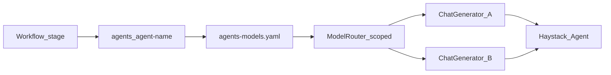

# Configuration and model routing

**Part of:** [Architecture index](../architecture.md) · [PRD](../prd.md)

---

## 6. Configuration architecture

Single entry per harness: **`harness.yaml`**. Workflow: **`workflow.yaml`**. Per-agent entry: **`agents/<agent-name>/agent.yaml`**. Global defaults: **`config/models.yaml`**.

### 6.1 Model registry merge

**Three-tier merge** (see [§3.3.1](02-repository-and-layout.md#331-model-config-files-naming)):

| Tier | File | Required? |
|---|---|---|
| Global | `config/models.yaml` | Optional project defaults |
| Harness | `usr-harnesses/<harness>/models.yaml` | Optional shared aliases |
| Agent | `agents/<agent-name>/agents-models.yaml` | **Required per agent** |

**Merge steps** (for each agent at runtime/compile):

1. Load global `config/models.yaml` if present.
2. If harness declares `models: models.yaml` in `harness.yaml`, deep-merge over global.
3. Load `agents/<agent-name>/agents-models.yaml` and deep-merge over harness + global.
4. Validate that agent's `default_model_id`, `compile.task_model_id`, `compile.reflection_model_id`, etc. against the **merged registry for that agent**.
5. Secrets in `.env` only — never in YAML or artifacts.

**Deep-merge rules (v1):**

| Rule | Behavior |
|---|---|
| Top-level keys | Child file overrides parent for same `model_id` key |
| Nested dicts (e.g. `generation_kwargs`) | Recursive merge; child keys win |
| Lists | Child list **replaces** parent list entirely (no append merge) |
| `null` / omitted | Omitted child key inherits parent; explicit empty dict replaces |

**Example:** `vuln-hunter` may use `provider: anthropic` from its `agents-models.yaml` while `finding-validator` in the **same harness** uses `provider: openai` from a separate `agents-models.yaml` — no request override required; the workflow switches routers per stage.

Requirements: [PRD E2.2](../prd.md#epic-e2--configuration-and-validation-phase-1).

### 6.2 Config sections

| Section | File | Phase | Wires | Epic |
|---|---|---|---|---|
| `harness` root | `harness.yaml` | 1+ | name, serve, deploy, eval, optional harness `models` | E2, E3, E5, E6 |
| `workflow` | `workflow.yaml` | 1+ | Serial stage graph; agent + pipeline references | E2, E3 |
| `agent` | `agents/<name>/agent.yaml` | 1+ | Per-role Haystack agent, tools, compile, hooks | E2, E3, E4, E7 |
| `agents-models` | `agents/<name>/agents-models.yaml` | 1+ | Per-agent LLM registry; stage-scoped `ModelRouter` | E2, E3 |
| `tools.builtin` | `agent.yaml` | 1+ | SDK catalog (`web_fetch` first) | E3 |
| `tools.mcp` | `agent.yaml` | 3 | `MCPToolset` | E7 |
| `tools.custom` | `agent.yaml` | 3 | `agents/<name>/tools/*.py` | E7 |
| `compile` | `agent.yaml` | 2 | DSPy + GEPA → agent `artifacts/` | E4 |
| `eval` | `harness.yaml` | 2 | Optional eval (`builtin` or `deepeval`) | E6 |
| `deploy` | `harness.yaml` | 2 | Eval gate on `zaumzeug deploy` | E5 |
| `serve` | `harness.yaml` | 1+ | Hayhooks ports, Chainlit, MCP, ACP, A2A | E3, E7, E8 |

Full schema examples: Phase 1 canonical examples in [§6.6](05-configuration.md#66-phase-1-config-schema); full multi-phase reference in [ideation-stage.md](../ideation-stage.md) until `user-docs/reference/harness-yaml.md` exists.

### 6.3 `zaumzeug eval` frameworks

`zaumzeug eval` behavior depends on `eval.framework` in `harness.yaml`:

| `eval.framework` | DeepEval required? | Behavior |
|---|---|---|
| *(no `eval` section)* | — | Exit 1: *"No eval configured. Add an `eval:` block to harness.yaml."* |
| `builtin` | **No** | Load `eval.valset` JSONL; per row run agent; check `expected_output` exact/substring match if present; report pass/fail counts. No LLM-as-judge. |
| `deepeval` | **Yes** (`[eval]` extra) | Run configured DeepEval metrics on valset; per-metric thresholds. **Default** when `eval:` present and `framework` omitted. |

**Integration modes:**

| Mode | Description | Phase |
|---|---|---|
| **A — In-process black-box** | Default: SDK runs Haystack agent, builds `LLMTestCase`, runs metrics (`zaumzeug eval`, `deepeval test run`) | 2 |
| **B — In-process tracing** | Wrap `Agent.run()` with DeepEval `@observe` / `update_current_span` | 4 |
| **C — HTTP black-box** | Client calls running `zaumzeug serve` `/v1/chat/completions`; same metrics — staging/debug | 2+ |

If `framework: deepeval` (or default) and `deepeval` not installed:

```text
Error: eval.framework is 'deepeval' but deepeval is not installed.
Install with: pip install "zaumzeug[eval]"
Or set eval.framework: builtin for JSONL checks without DeepEval.
```

CLI: `zaumzeug eval <name> --framework builtin` overrides yaml for one run.

**`eval` config fields (deepeval):**

| Field | Purpose |
|---|---|
| `eval.framework` | `deepeval` (default) or `builtin` |
| `eval.valset` | JSONL — `input`, `expected_output`, optional `retrieval_context` |
| `eval.metrics` | DeepEval metric types + thresholds |
| `eval.judge_model_id` | `models.yaml` key for LLM-as-judge |
| `eval.confident_ai` | Optional cloud sync (`enabled`, `sync_test_results`); requires `deepeval login` |

**Suggested metrics by harness type:**

| Harness type | Suggested DeepEval metrics |
|---|---|
| General agent | `TaskCompletionMetric`, `GEval`, `HallucinationMetric` |
| Tool-using | `ToolCorrectnessMetric`, `ArgumentCorrectnessMetric`, `StepEfficiencyMetric` |
| RAG | `AnswerRelevancyMetric`, `FaithfulnessMetric`, `ContextualRecallMetric`, `RAGASMetric` |
| Multi-turn | `ConversationCompletenessMetric`, `KnowledgeRetentionMetric` |
| MCP-heavy | `MCPTaskCompletionMetric`, `MCPUseMetric` |

**GEPA ↔ DeepEval bridge:** compile then verify; failed rows → `data/train.jsonl`; shared `data/val.jsonl`; GEPA metric may call DeepEval `.measure()`.

Requirements: [PRD E6](../prd.md#epic-e6--evaluation-and-quality-phase-2-optional).

### 6.4 Deploy eval gate

Controls whether `zaumzeug deploy` runs eval first:

```yaml
# harness.yaml (dev copy; stripped from deploy bundle)
deploy:
  eval_gate: skip    # default
```

| `deploy.eval_gate` | Behavior |
|---|---|
| `skip` | Do not run eval on deploy (default). |
| `warn` | If `eval:` configured, run `zaumzeug eval`; print failures; **continue** deploy. |
| `block` | If `eval:` configured, run `zaumzeug eval`; **abort** deploy on any failure. |

CLI override: `zaumzeug deploy <name> --eval-gate block` (overrides yaml for one run).

If `eval:` absent, `eval_gate: block` is a no-op (nothing to run).

Requirements: [PRD E5.6](../prd.md#epic-e5--deploy-packaging-phase-2), [E6.3](../prd.md#epic-e6--evaluation-and-quality-phase-2-optional).

### 6.5 Builtin tools catalog

SDK-provided tools referenced by `tools.builtin` in `harness.yaml`:

| Tool ID | Phase | Description |
|---|---|---|
| Tool ID | Phase | Description |
|---|---|---|
| `web_fetch` | **1** | Fetch URL content (HTTP GET); returns text for agent context. **v1 limits:** HTTPS only; 30s timeout; 1 MB response cap; blocks private/link-local IPs (SSRF guard). CI may stub HTTP. |
| `calculator` | 3 | Safe arithmetic expression evaluation |
| `read_file` | 3 | Read text file under harness folder (path sandboxed to workspace) |
| `search_docs` | 4 | Search indexed documents when RAG pipeline attached |

Phase 1 **minimum ship:** `web_fetch` only. Phase 3+ entries are planned; unknown builtin ID → config validation error with list of available IDs for current phase.

Custom tools use `tools.custom` (user Python), not this catalog — [PRD E7.2](../prd.md#epic-e7--tools-mcp-and-acp-phase-3).

### 6.6 Phase 1 config schema

Canonical examples for [PRD E2.1](../prd.md#epic-e2--configuration-and-validation-phase-1), [E3.4](../prd.md#epic-e3--runtime-and-local-serve-phase-1), [E3.5](../prd.md#epic-e3--runtime-and-local-serve-phase-1).

**Phase 1:** `workflow.yaml` ships with the multi-agent layout (minimum one serial stage). **`zaumzeug run`** executes serial stages (E3). **Parallel fan-out** (`parallelism: N`) is deferred post–Phase 1.

**`usr-harnesses/example/harness.yaml`** (Phase 1 CI — multi-agent layout, single stage):

```yaml
name: example
description: Reference research harness (multi-agent layout; one workflow stage in Phase 1)

models: models.yaml    # optional harness-wide aliases

serve:
  hayhooks:
    port: 1416
```

**`usr-harnesses/example/agents/researcher/agent.yaml`:**

```yaml
name: researcher
default_model_id: mock
agent:
  system_prompt: prompts/system.md
tools:
  builtin: [web_fetch]
```

**`usr-harnesses/example/agents/researcher/agents-models.yaml`:**

```yaml
default_model_id: mock

models:
  mock:
    provider: mock
    model: harness-fixture
  default:
    provider: openai
    model: gpt-4o-mini
```

**`usr-harnesses/example/workflow.yaml`** (Phase 1 — one stage; add stages as needed):

```yaml
entry: researcher
stages:
  - agent: researcher
```

**First-run path:** `default_model_id: mock` on the entry agent allows `zaumzeug serve example` and CI smoke **without** live API keys ([PRD Journey A](../prd.md#71-journey-a--config-only-harness-phase-1)). After first `zaumzeug compile example` (or `--workflow-diagram-only`), the harness gains `docs/workflow-diagram.md` for documentation and deploy.

User-facing explanation of `workflow.yaml`, pipeline stages, and agent-internal control flow: [user-docs/guides/multi-agent-workflow.md](../user-docs/guides/multi-agent-workflow.md).

---


## 7. Model routing

**Resolved (PRD open #5):** Ship a **custom `ModelRouter`** (`runtime/model_router.py`) as the default. It reads `model_id` from the **active agent's** merged `agents-models.yaml` and optional request override; lazily constructs the matching Haystack `ChatGenerator`. **OpenRouter** is supported via `openrouter-haystack` when a registry entry uses `provider: openrouter`.



- **Registry:** per-agent `model_id` → provider + model + kwargs (`agents-models.yaml`).
- **ModelRouter:** one instance (or cache) **per agent role**; workflow stage transition swaps active router.
- **API:** OpenAI `model` = harness name; optional request `model_id` overrides **current stage's** registry.
- **Cross-agent models:** `vuln-hunter` and `finding-validator` may use different providers with no client-side override — workflow handles the switch.
- **Compile:** DSPy/GEPA use LiteLLM strings from **that agent's** merged registry.
- **Secrets:** `.env` only; provider packages opt-in per referenced providers across all agents in the harness.
- **Mock profile:** `mock` provider in `agents-models.yaml` for CI.

---
