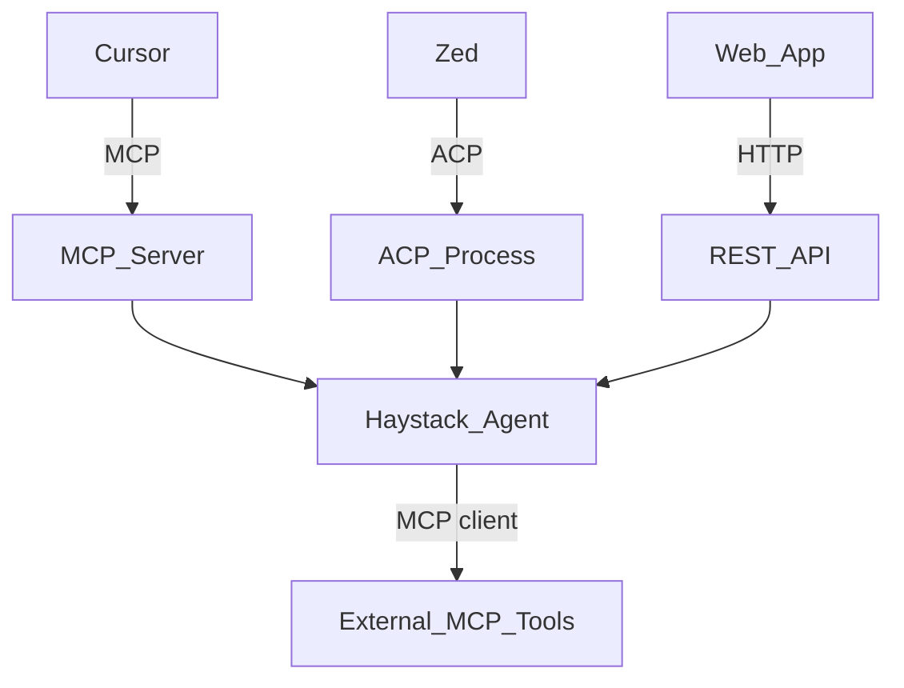

# Runtime, CLI, and protocols

**Part of:** [Architecture index](../architecture.md) · [PRD](../prd.md)

---

## 8. CLI and runtime layering

Command list and epic mapping: **[PRD §9](../prd.md#9-cli-surface-epic-mapping)**. Below: runtime behavior only.

### 8.1 Source roots

| Mode | Path | Flag / env |
|---|---|---|
| Development | `usr-harnesses/<name>/` | default |
| Production | `deploy/<name>/` | `--deploy` or `HARNESS_ROOT=deploy` |

**Implementation (E2-S04c, 2026-07-08):** Harness root resolution centralized in `src/zaumzeug/config/harness_root.py` (`is_deploy_mode()`, `harness_dir()`). `zaumzeug doctor --deploy` validates bundles under `deploy/<name>/`; `zaumzeug serve --dry-run --deploy` uses the same root resolution ([E2-S05](../stories/epic-stories/06-story.md)).

**Implementation (E5-S03, 2026-07-28):** Full Hayhooks `zaumzeug serve <name> --deploy` loads only `deploy/<name>/` (same OpenAI REST as dev serve), fails on missing folder or invalid `manifest.json`, and works without `usr-harnesses/`. Tests: `tests/integration/deploy/test_serve_deploy.py` (`e5_s03`).

**Implementation (E5-S04, 2026-07-28):** `HARNESS_ROOT=deploy` is the env equivalent of `--deploy` for serve / mcp / acp (and doctor / run). Canonical API: `resolve_harness_path()` in `config/harness_root.py`. Docs: `README.deploy.md`, CLI reference. Tests: `tests/unit/deploy/test_harness_root.py` (`e5_s04`).

**Implementation (E5-S05, 2026-07-28):** Ops ship path (copy → `target_install` → `.env` → serve) documented in `README.deploy.md` and [user-docs/guides/deploy.md](../../user-docs/guides/deploy.md). Tests: `tests/integration/deploy/test_target_install.py`.

**Implementation (E5-S07, 2026-07-28):** Deploy git policy (default ignore + release/CI options) — [user-docs/guides/deploy.md](../../user-docs/guides/deploy.md#git-policy-for-deploy-bundles); Architecture [§10.4](07-deploy-packaging.md#104-git-and-gitignore).

**Implementation (E5-S08, 2026-07-29):** Deploy platform policy (Linux-first + OS-neutral bundle + Linux CI deploy→serve smoke) — [user-docs/guides/deploy.md](../../user-docs/guides/deploy.md#platforms); Architecture [§10.6](07-deploy-packaging.md#106-deploy-platform-targets).

**Implementation (E5-S09a/b/c, 2026-07-29):** Target install (core / wrappers / `--verify`) — [user-docs/guides/deploy.md](../../user-docs/guides/deploy.md#target-install--win--macos--linux); Architecture [§10.7](07-deploy-packaging.md#107-target-runtime-install-script).

**Implementation (E2-S06, 2026-07-08):** `src/zaumzeug/logging.py` — `configure_logging()` wired from `zaumzeug serve` and `zaumzeug compile` when `--verbose` or `HARNESS_LOG_LEVEL=DEBUG`. Structured request context via `log_request()`; API keys redacted in log output.

**Implementation (E3-S02, 2026-07-20):** `src/zaumzeug/serve/runner.py` — `validate_serve()` → `build_agent()` → Hayhooks `create_app` / `run_app` on `127.0.0.1` and `serve.hayhooks.port`. OpenAI routes via Hayhooks registry (`/v1/chat/completions`, `GET /v1/models`). Production `--deploy` path closed by [E5-S03](../stories/epic-stories/43-story.md) (2026-07-28). Optional `/chat` (E7-S04) uses the same runner when `serve.hayhooks.chainlit: true`. **`serve.expose`** YAML pipelines (E8-S01, 2026-08-21) register as `POST /{id}/run`.

**Implementation (E7-S01, 2026-08-14):** `src/zaumzeug/serve/mcp.py` — `zaumzeug mcp <name>` validates like serve, builds the entry agent, registers it with `skip_mcp=False`, and starts Hayhooks MCP (`create_mcp_server` / `create_starlette_app`) on `127.0.0.1`:`serve.hayhooks.mcp_port` (default 1417). Endpoints: `POST /mcp`, `GET /status`. Malformed `POST /mcp` returns JSON-RPC 2.0 `{jsonrpc, error: {code, message, data}}` with `data.ok: false`. `zaumzeug serve` keeps `skip_mcp=True`. `tools.mcp` → Haystack `MCPToolset` in `runtime/tools/mcp.py`. Tests: `tests/integration/mcp/` (`-k e7_s01`). Production `--deploy` / `HARNESS_ROOT=deploy` closed by [E7-S06](../stories/epic-stories/55-story.md) (2026-08-21).

**Implementation (E7-S02, 2026-08-14):** `src/zaumzeug/runtime/tools/custom.py` — `load_custom_tools()` imports `tools.custom` from `agents/<name>/` (path, dotted module, or `module:attr`; no traversal; stale `sys.modules` dropped). Registers Haystack `Tool` / `ComponentTool` / `@component` / typed functions. Factory `build_agent_tools(..., agent_dir=)` appends custom tools after builtins and MCP; import errors raise `RuntimeFactoryError` with the module path. Tests: `tests/unit/runtime/tools/test_custom_loader.py`.

**Implementation (E7-S07, 2026-08-21):** `src/zaumzeug/runtime/tools/calculator.py` and `read_file.py` — Haystack `@component` + `ComponentTool`. Factory `build_agent_tools(..., workspace=)` sandboxes `read_file` to the harness folder. Catalog phase is `BUILTIN_CATALOG_PHASE` (`CURRENT_SDK_PHASE` stays **1**). Tests: `tests/unit/runtime/tools/test_extended_builtins.py`, `tests/unit/runtime/tools/test_read_file.py`.

**Implementation (E8-S01, 2026-08-21):** `serve.expose` unblocked from `PHASE_GATED_FIELDS`. Serve registers listed `pipelines/*.yaml` via Hayhooks `deploy_pipeline_yaml` as `POST /{id}/run`. `search_docs` builtin (catalog phase **4**) attaches to a RAG-named expose row. Workflow `pipeline:` stages invoke the same YAML. Docs: [pipelines.md](../../user-docs/guides/pipelines.md). Tests: `tests/integration/pipelines/test_serve_expose.py`.

**Implementation (E3-S07, 2026-07-21):** OpenAI REST contract tests on ephemeral localhost port; optional request `model_id` overrides the entry agent's ModelRouter registry (`AgentPipelineWrapper`). Tests: `tests/integration/test_openai_contract.py` (`-k e3_s07`).

**Implementation (E3-S08, 2026-07-21):** `src/zaumzeug/runtime/workflow.py` — `run_workflow()` executes `workflow.yaml` stages serially; per-stage `ModelRouter` + `build_agent()`; prior stage output prepended as a user message; `--from <stage>` partial runs; pipeline stages invoke YAML listed in `serve.expose` (**Done** E8-S01). CLI: `zaumzeug run <harness> [--from STAGE] [--input TEXT]`. Tests: `tests/integration/test_workflow_run.py` (`-k e3_s08`).

**Implementation (E8-S07, 2026-08-01):** Run-path reliability on the same `run_workflow()` — typed live-generation `WorkflowError` (harness/agent/stage); optional `runtime.retry` (build once, retry `Agent.run` + JSON check); INFO stage lifecycle via `log_request(..., stage=...)`; optional agent `output.format: json` (fence strip). **Serve/HTTP does not share this layer yet.** Docs: [multi-agent-workflow.md](../../user-docs/guides/multi-agent-workflow.md#run-reliability-zaumzeug-run). Tests: `tests/unit/runtime/test_workflow_reliability.py`, `tests/integration/test_workflow_reliability.py` (`-k e8_s07`).

**Implementation (E1-S04, 2026-07-22):** `src/zaumzeug/scaffold/` — `init_harness()` scaffolds `usr-harnesses/<name>/` from `install/templates/harness/` (Phase 1 minimal harness: serve + optional models, workflow, mock agent + system prompt). CLI: `zaumzeug init <name> [--force]`. Safe path-segment names; fail-fast if the folder exists unless `--force`. Tests: `tests/unit/cli/test_init.py`. Docs: [project-setup.md](../../user-docs/getting-started/project-setup.md).

### 8.2 `harness` vs raw `hayhooks`

**Canonical:** `zaumzeug serve|mcp|acp|run`. SDK loads config, builds agents from `agents/<name>/`, invokes **self-hosted Hayhooks** for serve paths.

| Command | Behavior |
|---|---|
| `zaumzeug init <name>` | Scaffold `usr-harnesses/<name>/` from template ([E1-S04](../stories/epic-stories/21-story.md)); `--force` overwrites |
| `zaumzeug install-project` | **Deferred** — PyPI consumer scaffold (no editable install); after package publish ([E1-S08](../stories/epic-stories/25-story.md)) |
| `zaumzeug mcp <harness>` | Hayhooks MCP Streamable HTTP on `serve.hayhooks.mcp_port` (default **1417**) — `{host}:{mcp_port}/mcp` ✅ (E7-S01); `--deploy` / `HARNESS_ROOT=deploy` same as serve ✅ (E7-S06) |
| `zaumzeug acp <harness>` | Agent Client Protocol newline-delimited JSON-RPC on **stdio** (`serve/acp.py`); logs on stderr; `--deploy` / `HARNESS_ROOT=deploy` same as serve ✅ (E7-S05) |
| `zaumzeug serve <harness> --deploy` | Same OpenAI REST as dev serve, loads **only** `deploy/<name>/` (manifest required; no `usr-harnesses/`) ([E5-S03](../stories/epic-stories/43-story.md)) |
| `HARNESS_ROOT=deploy` | Env equivalent of `--deploy` for serve / mcp / acp (and doctor / run); preferred in containers / systemd ([E5-S04](../stories/epic-stories/44-story.md)) |
| `zaumzeug serve <harness> --dry-run` | Validate `harness.yaml`, `workflow.yaml`, and resolved paths; print summary — no Hayhooks bind, no LLM ([E2-S05](../stories/epic-stories/06-story.md), [E2-S07](../stories/epic-stories/08-story.md)); combine with `--deploy` for production bundles |
| `zaumzeug serve <harness> --verbose` | Enable SDK + Haystack debug logging ([E2-S06](../stories/epic-stories/07-story.md)); equivalent to `HARNESS_LOG_LEVEL=DEBUG` |
| `zaumzeug compile <harness> --verbose` | Same structured logging for compile path ([E2-S06](../stories/epic-stories/07-story.md)) |
| `zaumzeug run <harness>` | **Serial workflow:** executes `workflow.yaml` stages in order; stage-scoped `ModelRouter` per agent ([PRD E3.6](../prd.md#epic-e3--runtime-and-local-serve-phase-1)); **`pipeline:`** stages invoke YAML in `serve.expose` ([PRD E8.1](../prd.md#epic-e8--rag-and-production-hardening-phase-4) / E8-S01); optional retry / JSON / stage logs ([PRD E8.7](../prd.md#epic-e8--rag-and-production-hardening-phase-4) / E8-S07) |
| `zaumzeug run <harness> --from <stage>` | Partial run from a workflow stage (debug) |
| `HARNESS_LOG_LEVEL=INFO zaumzeug run …` | Reconstruct stage start/success/retry/failure (default WARNING hides INFO stage logs; `--verbose` also works) |

Production targets bare metal, VM, or container — not Haystack Enterprise Platform ([PRD §12 resolved](../prd.md#12-open-decisions-blockers-for-some-stories)).

**Escape hatch:** `hayhooks run` / `hayhooks mcp run` for low-level Haystack debugging only.

### 8.3 Multi-harness serving

**Default:** one Hayhooks process per `zaumzeug serve <name>`. One process = one harness name = one port pair from that harness's `serve.hayhooks`.

Multi-tenant single process (many harness instances, one Hayhooks) is **explicitly out of scope v1** — [PRD NG1](../prd.md#4-non-goals-v1), [open #6](../prd.md#12-open-decisions-blockers-for-some-stories). Do not document multi-harness routing in Phase 1–3 implementations.

---

## 9. Client access and protocols

Product context: [PRD §5, §7](../prd.md#5-users-and-personas). Web UI choice: [open #2](../prd.md#12-open-decisions-blockers-for-some-stories).

> **ACP naming:** **Agent Client Protocol** (Zed/JetBrains) ≠ IBM Agent Communication Protocol (merged into **A2A**).

### 9.1 Protocol selection

| Protocol | Layer | Best for | Cursor | Web app | Zed / JetBrains |
|---|---|---|---|---|---|
| **MCP** | Host calls harness as tools | Capability plugin inside another agent | **Primary** | Rare | Internal tools |
| **ACP** | IDE drives harness as agent | Full agent UX in editor | Limited¹ | No | **Primary** |
| **OpenAI REST** | HTTP chat completions | Custom web, Chainlit, Open WebUI | No | **Primary** | No |
| **A2A** | Agent ↔ agent delegation | Multi-agent fleets | Future | Via gateway | Via gateway |
| **Direct REST** | `POST /{pipeline}/run` | Batch, webhooks | No | Yes | No |

¹ Cursor is primarily an ACP **server** for other editors — practical external harness path today is **MCP**.

| Client | Protocol | Command | Endpoint |
|---|---|---|---|
| Web app, Chainlit, Open WebUI | OpenAI-compatible REST | `zaumzeug serve` | `/v1/chat/completions` |
| Cursor, Claude Desktop | MCP | `zaumzeug mcp` (`--deploy` for production) | `{host}:{mcp_port}/mcp` |
| Zed, JetBrains, Neovim | ACP | `zaumzeug acp` | stdio JSON-RPC |
| Batch jobs | Direct REST | `zaumzeug serve` | `POST /{pipeline}/run` |
| Agent fleets (Phase 4) | A2A | `serve.a2a: true` | Agent Card |

**Insight:** MCP and ACP sit on different sides — ACP = editor drives your harness; MCP = your harness as tools **or** harness calls external tools.

### 9.2 MCP — when to use

Use when harness is a **capability** invoked by Cursor's (or another host's) agent. Limitations: no native IDE agent UX; host stays in control; not designed for agent-to-agent delegation.

**Implementation (E7-S03, 2026-08-21):** Cursor setup guide [cursor-mcp.md](../../user-docs/guides/cursor-mcp.md) — `mcp.json` URL `http://localhost:{mcp_port}/mcp` (default 1417); install scaffolds `.cursor/mcp.json.example`; `--cursor-mcp` writes live `.cursor/mcp.json` (copy-if-missing). `uv` is required only when the harness uses stdio `tools.mcp` servers. Tests: `tests/unit/install/test_scaffolding.py::test_e7_s03_ac2_mcp_json_example_scaffolded`, `tests/unit/install/test_client_install.py::test_e7_s03_ac3_cursor_mcp_flag_writes_json`.

**Implementation (E7-S06, 2026-08-21):** Production MCP — `zaumzeug mcp <name> --deploy` (or `HARNESS_ROOT=deploy`) loads only `deploy/<name>/`; same Streamable HTTP surface as dev. Docs: `README.deploy.md`, [deploy.md](../../user-docs/guides/deploy.md), [cursor-mcp.md](../../user-docs/guides/cursor-mcp.md). Tests: `tests/integration/mcp/test_mcp_deploy.py`.

### 9.3 ACP — when to use

Use when harness **is** the primary agent in Zed/JetBrains/Neovim. Harness may still use MCP internally for its own tools. Limitations: Cursor does not generically adopt third-party ACP agents; more implementation work than MCP expose.

**Implementation (E7-S05, 2026-08-21):** `zaumzeug acp <name>` — Agent Client Protocol stdio JSON-RPC (`serve/acp.py`). Guide: [acp.md](../../user-docs/guides/acp.md) (Zed `agent_servers`, JetBrains `~/.jetbrains/acp.json`, ACP ≠ A2A, Cursor MCP-only). Tests: `tests/integration/acp/test_acp_stdio.py`.

### 9.4 Web deployment layouts

**OpenAI-compatible** means Hayhooks exposes `/v1/chat/completions` with OpenAI JSON shape — clients use `baseURL` pointing at your server (not OpenAI).

| Layout | How it works |
|---|---|
| **Chainlit embedded** | `chainlit: true` — UI at `/chat` on same port as API |
| **Open WebUI + Hayhooks** | Two containers; Open WebUI → `http://hayhooks:1416/v1` |
| **Custom SPA + proxy** | Nginx serves static UI; `/api/v1/*` → `127.0.0.1:1416` |
| **Next.js co-located** | App on `:3000` calls `localhost:1416` |

Also exposed: `GET /v1/models`, `POST /{pipeline}/run` (entry agent plus each `serve.expose` id — **Done** E8-S01), optional `/docs` (Swagger) for manual probes.

Clients use OpenAI-shaped requests against your `baseURL` (e.g. `http://127.0.0.1:1416/v1`) — not the OpenAI API. Any HTTP client or OpenAI SDK with custom `baseURL` works.

**Request fields:** OpenAI `model` = harness/pipeline name. Optional ZaumZeug extension `model_id` selects the LLM from the entry agent's ModelRouter registry ([Architecture §7](05-configuration.md#7-model-routing)).

**Implementation (E3-S07, 2026-07-21):** Contract tests assert response shape (`choices` / `message` / `role` / `content`), HTTP `model_id` override, and offline CI (mock + `respx`-stubbed `web_fetch`). Fixture: `tests/integration/conftest.py::ephemeral_serve_url`. Tests: `tests/integration/test_openai_contract.py` (`-k e3_s07`). Cross-OS CI green — closed by [E1-S07](../stories/epic-stories/24-story.md#e1-s07-cross-platform-ci-matrix) (2026-07-22).

**Implementation (E7-S04, 2026-08-21):** Optional Chainlit GUI — `serve.hayhooks.chainlit: true` sets Hayhooks `chainlit_enabled` before `create_app()` so `/chat` shares the REST port. Requires `pip install "hayhooks[chainlit]"` (fail-fast install hint if missing). OpenAI `/v1/chat/completions` stays mounted. Docs: [web-deployment.md](../../user-docs/guides/web-deployment.md). Tests: `tests/integration/serve/test_chainlit.py`. PRD open #2 (primary web UI) remains open — Chainlit is one layout, not a product default.

**Implementation (E7-S08, 2026-08-21):** Remaining §9.4 recipes in [web-deployment.md](../../user-docs/guides/web-deployment.md) — Open WebUI two-container (`OPENAI_API_BASE_URL=http://hayhooks:1416/v1`), SPA + Nginx (`/api/v1/` → `127.0.0.1:1416/v1/`), Next.js co-located (`OPENAI_BASE_URL=http://127.0.0.1:1416/v1`). Clients use the harness `baseURL`, not `api.openai.com`. Probes: `GET /v1/models`, `GET /docs`. Tests: `tests/unit/docs/test_web_deployment.py`. Open #2 remains open.

**Implementation (E7-S05, 2026-08-21):** `src/zaumzeug/serve/acp.py` — `zaumzeug acp <name>` validates like serve, builds the entry agent (including `tools.mcp`), and serves Agent Client Protocol JSON-RPC on stdio (`initialize`, `session/new`, `session/prompt`; logs on stderr). Zed/JetBrains registration: [acp.md](../../user-docs/guides/acp.md). Cursor remains MCP-primary. Tests: `tests/integration/acp/test_acp_stdio.py`.

### 9.5 What does NOT call the harness directly

| Component | Runs where | Relationship |
|---|---|---|
| DSPy + GEPA | CI / offline | Export artifacts only; never request path |
| Cursor built-in agent | Cursor | Calls harness via **MCP tools** |
| LLM providers | External API | Called **by** ModelRouter inside harness |

---
