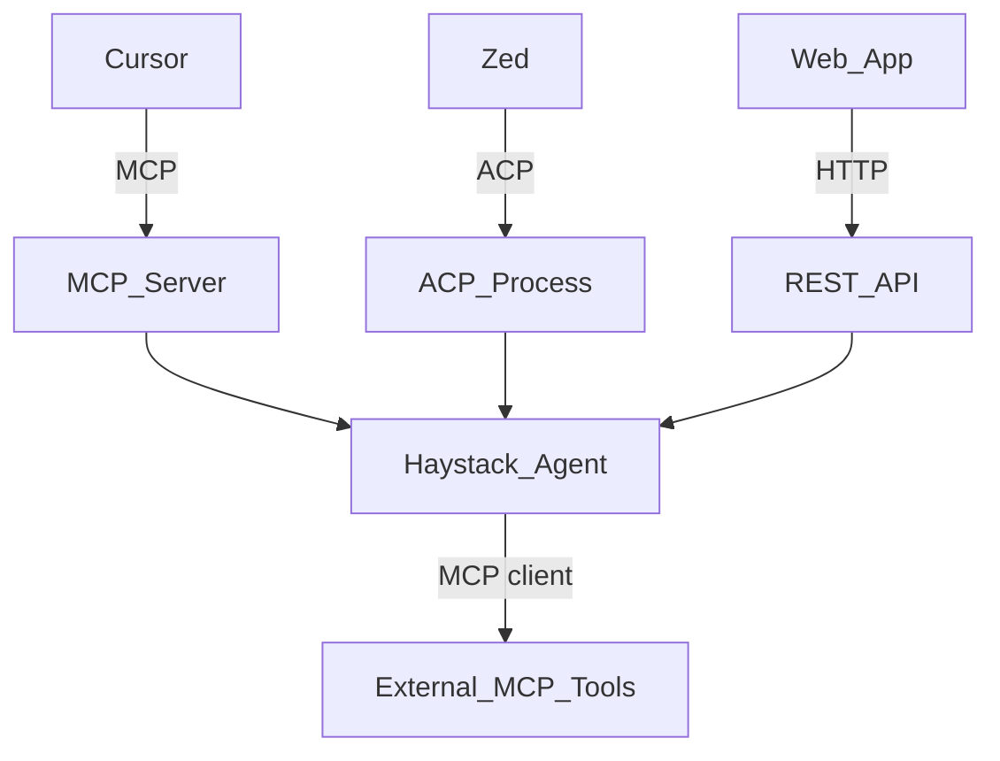

# Runtime, CLI, and protocols

**Part of:** [Architecture index](../architecture.md) · [PRD](../prd.md)

---

## 8. CLI and runtime layering

Command list and epic mapping: **[PRD §9](../prd.md#9-cli-surface-epic-mapping)**. Below: runtime behavior only.

### 8.1 Source roots

| Mode | Path | Flag / env |
|---|---|---|
| Development | `usr-harnesses/<name>/` | default |
| Production | `deploy/<name>/` | `--deploy` or `HARNESS_ROOT=deploy` |

**Implementation (E2-S04c, 2026-07-08):** Harness root resolution centralized in `src/zaumzeug/config/harness_root.py` (`is_deploy_mode()`, `harness_dir()`). `zaumzeug doctor --deploy` validates bundles under `deploy/<name>/`; `zaumzeug serve --dry-run --deploy` uses the same root resolution ([E2-S05](../stories/epic-stories/06-story.md)). Full Hayhooks serve/mcp/acp `--deploy` wiring is still pending ([E5-S03](../stories/epic-stories/43-story.md), [E5-S04](../stories/epic-stories/44-story.md)).

**Implementation (E2-S06, 2026-07-08):** `src/zaumzeug/logging.py` — `configure_logging()` wired from `zaumzeug serve` and `zaumzeug compile` when `--verbose` or `HARNESS_LOG_LEVEL=DEBUG`. Structured request context via `log_request()`; API keys redacted in log output.

**Implementation (E3-S02, 2026-07-20):** `src/zaumzeug/serve/runner.py` — `validate_serve()` → `build_agent()` → Hayhooks `create_app` / `run_app` on `127.0.0.1` and `serve.hayhooks.port`. OpenAI routes via Hayhooks registry (`/v1/chat/completions`, `GET /v1/models`). Full `--deploy` path for production bundles remains E5-S03/E5-S04; runner already accepts `deploy=` for root resolution.

**Implementation (E3-S07, 2026-07-21):** OpenAI REST contract tests on ephemeral localhost port; optional request `model_id` overrides the entry agent's ModelRouter registry (`AgentPipelineWrapper`). Tests: `tests/integration/test_openai_contract.py` (`-k e3_s07`).

**Implementation (E3-S08, 2026-07-21):** `src/zaumzeug/runtime/workflow.py` — `run_workflow()` executes `workflow.yaml` stages serially; per-stage `ModelRouter` + `build_agent()`; prior stage output prepended as a user message; `--from <stage>` partial runs; pipeline stages raise a Phase-1 stub error (full invoke Phase 4). CLI: `zaumzeug run <harness> [--from STAGE] [--input TEXT]`. Tests: `tests/integration/test_workflow_run.py` (`-k e3_s08`).

**Implementation (E1-S04, 2026-07-22):** `src/zaumzeug/scaffold/` — `init_harness()` scaffolds `usr-harnesses/<name>/` from `install/templates/harness/` (Phase 1 minimal harness: serve + optional models, workflow, mock agent + system prompt). CLI: `zaumzeug init <name> [--force]`. Safe path-segment names; fail-fast if the folder exists unless `--force`. Tests: `tests/unit/cli/test_init.py`. Docs: [project-setup.md](../../user-docs/getting-started/project-setup.md).

### 8.2 `harness` vs raw `hayhooks`

**Canonical:** `zaumzeug serve|mcp|acp|run`. SDK loads config, builds agents from `agents/<name>/`, invokes **self-hosted Hayhooks** for serve paths.

| Command | Behavior |
|---|---|
| `zaumzeug init <name>` | Scaffold `usr-harnesses/<name>/` from template ([E1-S04](../stories/epic-stories/21-story.md)); `--force` overwrites |
| `zaumzeug serve <harness>` | Interactive: workflow `entry` agent via Hayhooks (`/v1/chat/completions`, optional MCP/ACP) |
| `zaumzeug serve <harness> --dry-run` | Validate `harness.yaml`, `workflow.yaml`, and resolved paths; print summary — no Hayhooks bind, no LLM ([E2-S05](../stories/epic-stories/06-story.md), [E2-S07](../stories/epic-stories/08-story.md)) |
| `zaumzeug serve <harness> --verbose` | Enable SDK + Haystack debug logging ([E2-S06](../stories/epic-stories/07-story.md)); equivalent to `HARNESS_LOG_LEVEL=DEBUG` |
| `zaumzeug compile <harness> --verbose` | Same structured logging for compile path ([E2-S06](../stories/epic-stories/07-story.md)) |
| `zaumzeug run <harness>` | **Serial workflow:** executes `workflow.yaml` stages in order; stage-scoped `ModelRouter` per agent ([PRD E3.6](../prd.md#epic-e3--runtime-and-local-serve-phase-1)) |
| `zaumzeug run <harness> --from <stage>` | Partial run from a workflow stage (debug) |

Production targets bare metal, VM, or container — not Haystack Enterprise Platform ([PRD §12 resolved](../prd.md#12-open-decisions-blockers-for-some-stories)).

**Escape hatch:** `hayhooks run` / `hayhooks mcp run` for low-level Haystack debugging only.

### 8.3 Multi-harness serving

**Default:** one Hayhooks process per `zaumzeug serve <name>`. One process = one harness name = one port pair from that harness's `serve.hayhooks`.

Multi-tenant single process (many harness instances, one Hayhooks) is **explicitly out of scope v1** — [PRD NG1](../prd.md#4-non-goals-v1), [open #6](../prd.md#12-open-decisions-blockers-for-some-stories). Do not document multi-harness routing in Phase 1–3 implementations.

---

## 9. Client access and protocols

Product context: [PRD §5, §7](../prd.md#5-users-and-personas). Web UI choice: [open #2](../prd.md#12-open-decisions-blockers-for-some-stories).

> **ACP naming:** **Agent Client Protocol** (Zed/JetBrains) ≠ IBM Agent Communication Protocol (merged into **A2A**).

### 9.1 Protocol selection

| Protocol | Layer | Best for | Cursor | Web app | Zed / JetBrains |
|---|---|---|---|---|---|
| **MCP** | Host calls harness as tools | Capability plugin inside another agent | **Primary** | Rare | Internal tools |
| **ACP** | IDE drives harness as agent | Full agent UX in editor | Limited¹ | No | **Primary** |
| **OpenAI REST** | HTTP chat completions | Custom web, Chainlit, Open WebUI | No | **Primary** | No |
| **A2A** | Agent ↔ agent delegation | Multi-agent fleets | Future | Via gateway | Via gateway |
| **Direct REST** | `POST /{pipeline}/run` | Batch, webhooks | No | Yes | No |

¹ Cursor is primarily an ACP **server** for other editors — practical external harness path today is **MCP**.

| Client | Protocol | Command | Endpoint |
|---|---|---|---|
| Web app, Chainlit, Open WebUI | OpenAI-compatible REST | `zaumzeug serve` | `/v1/chat/completions` |
| Cursor, Claude Desktop | MCP | `zaumzeug mcp` | `{host}:{mcp_port}/mcp` |
| Zed, JetBrains, Neovim | ACP | `zaumzeug acp` | stdio JSON-RPC |
| Batch jobs | Direct REST | `zaumzeug serve` | `POST /{pipeline}/run` |
| Agent fleets (Phase 4) | A2A | `serve.a2a: true` | Agent Card |

**Insight:** MCP and ACP sit on different sides — ACP = editor drives your harness; MCP = your harness as tools **or** harness calls external tools.

### 9.2 MCP — when to use

Use when harness is a **capability** invoked by Cursor's (or another host's) agent. Limitations: no native IDE agent UX; host stays in control; not designed for agent-to-agent delegation.

### 9.3 ACP — when to use

Use when harness **is** the primary agent in Zed/JetBrains/Neovim. Harness may still use MCP internally for its own tools. Limitations: Cursor does not generically adopt third-party ACP agents; more implementation work than MCP expose.

### 9.4 Web deployment layouts

**OpenAI-compatible** means Hayhooks exposes `/v1/chat/completions` with OpenAI JSON shape — clients use `baseURL` pointing at your server (not OpenAI).

| Layout | How it works |
|---|---|
| **Chainlit embedded** | `chainlit: true` — UI at `/chat` on same port as API |
| **Open WebUI + Hayhooks** | Two containers; Open WebUI → `http://hayhooks:1416/v1` |
| **Custom SPA + proxy** | Nginx serves static UI; `/api/v1/*` → `127.0.0.1:1416` |
| **Next.js co-located** | App on `:3000` calls `localhost:1416` |

Also exposed: `GET /v1/models`, `POST /{pipeline}/run`, optional `/docs` (Swagger) for manual probes.

Clients use OpenAI-shaped requests against your `baseURL` (e.g. `http://127.0.0.1:1416/v1`) — not the OpenAI API. Any HTTP client or OpenAI SDK with custom `baseURL` works.

**Request fields:** OpenAI `model` = harness/pipeline name. Optional ZaumZeug extension `model_id` selects the LLM from the entry agent's ModelRouter registry ([Architecture §7](05-configuration.md#7-model-routing)).

**Implementation (E3-S07, 2026-07-21):** Contract tests assert response shape (`choices` / `message` / `role` / `content`), HTTP `model_id` override, and offline CI (mock + `respx`-stubbed `web_fetch`). Fixture: `tests/integration/conftest.py::ephemeral_serve_url`. Tests: `tests/integration/test_openai_contract.py` (`-k e3_s07`). Cross-OS CI green open — carried to [E1-S07](../stories/epic-stories/24-story.md#e1-s07-cross-platform-ci-matrix).

### 9.5 What does NOT call the harness directly

| Component | Runs where | Relationship |
|---|---|---|
| DSPy + GEPA | CI / offline | Export artifacts only; never request path |
| Cursor built-in agent | Cursor | Calls harness via **MCP tools** |
| LLM providers | External API | Called **by** ModelRouter inside harness |

---
