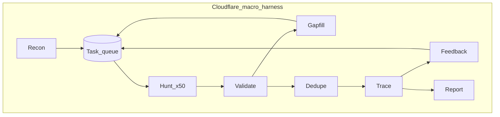
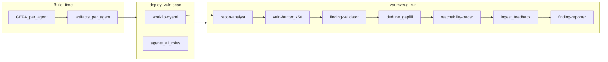

# Cloudflare Vulnerability Discovery Harness — Illustrative Example

| | |
|---|---|
| **Document** | **Illustrative example only** — maps Cloudflare’s published harness design onto ZaumZeug concepts |
| **File** | `docs/cloudflare-harness.md` |
| **Created** | 2026-07-05 |
| **Last modified** | 2026-07-05 |
| **Status** | **Example / design exploration — not in ZaumZeug scope** |
| **Related** | [PRD](prd.md) · [Architecture](architecture.md) · [Epic E8](stories/08-epic.md) |

> **Scope disclaimer**
>
> This document is an **illustrative worked example**. It shows how a **user-built** harness *could* be structured on ZaumZeug using ideas from a third-party blog post. **ZaumZeug does not implement, ship, or maintain** a vulnerability scanner, `vuln-scan` template, security-research agents, or any Cloudflare-specific pipeline.
>
> **In scope for ZaumZeug:** the generic factory — multi-agent folder layout, `workflow.yaml`, per-agent `agents-models.yaml`, compile/deploy/serve tooling ([Architecture §3.3](architecture/02-repository-and-layout.md#33-harness-folder-layout)).
>
> **Out of scope for ZaumZeug:** security scanning product features, PoC sandboxes for exploit research, dedupe/gapfill components tied to findings queues, or any requirement to reproduce Cloudflare’s harness in the SDK or repo.
>
> Sections [§5](#5-illustrative-sdk-ideas-inspired-by-this-example) list **deferred** optional primitives. Serial workflow and compile-time diagram are **in** E2/E3/E4 — not listed as gaps here.

**Source (external):** [Project Glasswing: what Mythos showed us](https://blog.cloudflare.com/cyber-frontier-models/) — section *Our vulnerability discovery harness*.

---

## 1. Executive summary

This doc uses Cloudflare’s published vulnerability-discovery pipeline as a **teaching example** for ZaumZeug’s **multi-agent harness** model. It is **not** a product spec and **not** something the ZaumZeug project will build.

Cloudflare’s harness is **not** a single long-lived coding-agent session. It is a **multi-stage workflow** with many narrow, parallel agent jobs and deterministic glue between stages. That shape motivates ZaumZeug’s generic concepts: one harness folder, `agents/<name>/`, per-agent `agents-models.yaml`, and `workflow.yaml` ([Architecture §2.2.1](architecture/01-overview-and-principles.md#221-harness-vs-agent-terminology)).

The fictional example harness name **`vuln-scan`** and agent roles (`vuln-hunter`, `finding-validator`, etc.) exist **only in this document** to make the mapping concrete. Replace them with your own domain.

This document:

1. Analyses Cloudflare’s harness structure (external reference).
2. Shows how a **user** might lay out an analogous harness on ZaumZeug ([§4](#4-illustrative-zaumzeug-layout)).
3. Surfaces generic gaps between today’s docs and that layout.
4. Suggests **illustrative** SDK ideas ([§5](#5-illustrative-sdk-ideas-inspired-by-this-example)) — not ZaumZeug deliverables unless promoted to the PRD separately.

---

## 2. Cloudflare harness structure

### 2.1 Stage table

| Stage | What it does | Why it matters |
|---|---|---|
| **Recon** | Reads the repository top-down; fans out to subagents per subsystem; produces an architecture document (build commands, trust boundaries, entry points, attack surface) and an initial hunt task queue. | Shared context for every downstream agent; reduces the “wander” problem. |
| **Hunt** | One attack class paired with a scope hint per task. Hunters run concurrently (~50 at once), each with exploration subagents. Each hunter can compile and run proof-of-concept code in a per-task scratch directory. | Most of the work happens here: many narrow tasks in parallel, not one exhaustive agent. |
| **Validate** | Independent agent re-reads code and tries to **disprove** the finding. Different prompt and model; **cannot** emit new findings. | Adversarial review catches noise the hunter misses when checking its own work. |
| **Gapfill** | Hunters flag under-covered areas; those areas are re-queued. | Counteracts drift toward attack classes the model already “succeeded” on. |
| **Dedupe** | Findings sharing the same root cause collapse to one record. | Variant analysis without inflating the triage queue. |
| **Trace** | For shared-library findings, a tracer fans out (one instance per consumer repo), uses a cross-repo symbol index, and decides whether attacker-controlled input reaches the bug from outside the system. | Turns “there is a flaw” into “there is a reachable vulnerability.” |
| **Feedback** | Reachable traces become new hunt tasks in consumer repositories where the bug is exposed. | Closes the loop; the pipeline improves as it runs. |
| **Report** | Agent writes a structured report against a predefined schema, self-corrects validation errors, and submits to an ingest API. | Output is queryable data, not free-form prose. |

### 2.2 Design principles

Four lessons from running at scale — each points away from a chat interface toward a **harness that manages execution**:

| Principle | Implication |
|---|---|
| **Narrow scope produces better findings** | “Find command injection in *this function* with *this trust boundary* and *this architecture doc*” beats “find vulnerabilities in this repository.” |
| **Adversarial review reduces noise** | A second agent with a different prompt and model — deliberately in disagreement — beats telling one agent to be careful. |
| **Split the chain across agents** | “Is this code buggy?” and “Can an attacker reach this bug?” are separate questions; the model answers each better when asked alone. |
| **Parallel narrow tasks beat one exhaustive agent** | Many tightly scoped agents + deduplication afterward beats one agent trying to be exhaustive. |

### 2.3 Macro flow



### 2.4 Why a generic coding agent fails here

Cloudflare’s post identifies two structural mismatches:

- **Context** — Coding agents hold one hypothesis and iterate. Vulnerability research is narrow and parallel: thousands of small, focused investigations across a large codebase. A single session covers a fraction of useful surface before context compaction discards earlier work.
- **Throughput** — Real codebases need many hypotheses against many components at once, with further fan-out when something interesting appears. The bottleneck becomes the **shape of the interaction**, not the model.

The fix is a **harness around the model**, not a better chat prompt.

---

## 3. ZaumZeug mapping

ZaumZeug is a **harness factory**: `Harness = Workflow + Agents + Machinery` ([PRD §1](prd.md#1-executive-summary), [Architecture §2.2.1](architecture/01-overview-and-principles.md#221-harness-vs-agent-terminology)). Cloudflare’s pipeline is **one harness** with multiple agent roles and deterministic pipeline steps.

### 3.1 Primitive mapping

| Cloudflare concept | ZaumZeug primitive | Reference |
|---|---|---|
| Entire discovery pipeline | **One user harness folder** (example name: `vuln-scan`) | [Architecture §3.3](architecture/02-repository-and-layout.md#33-harness-folder-layout) |
| Stage-specific agent behavior | `agents/<agent-name>/agent.yaml` | [Architecture §3.3](architecture/02-repository-and-layout.md#33-harness-folder-layout) |
| Hunter vs validator LLM | Separate `agents/<name>/agents-models.yaml` per agent | [Architecture §3.3.1](architecture/02-repository-and-layout.md#331-model-config-files-naming), [§7](architecture/05-configuration.md#7-model-routing) |
| Optimized stage prompts | GEPA → per-agent `artifacts/` → `system_prompt` | [Architecture §2.3](architecture/01-overview-and-principles.md#23-harness-layer-mapping-guides-and-sensors) |
| Serial / parallel stages | `workflow.yaml` + `pipelines/` | [Architecture §6.2](architecture/05-configuration.md#62-config-sections) |
| PoC compile/run tool | `agents/vuln-hunter/tools/poc_sandbox.py` | [E7-S02](stories/07-epic.md#e7-s02--custom-tool-loader) |
| Repo reading | `read_file` builtin (Phase 3) | [Architecture §6.5](architecture/05-configuration.md#65-builtin-tools-catalog) |
| Symbol index | `tools.mcp` on `reachability-tracer` agent | [E7-S01](stories/07-epic.md#e7-s01--mcp-tool-configuration) |
| Validator cannot emit findings | Per-agent tool policy + `hooks.py` | [Architecture §2.3](architecture/01-overview-and-principles.md#23-harness-layer-mapping-guides-and-sensors) |
| Parallel hunters (~50) | `workflow.yaml` `parallelism: 50` (illustrative) | [§5](#5-illustrative-sdk-ideas-inspired-by-this-example) |
| Dedupe / gapfill | `pipelines/dedupe_gapfill.yaml` in same harness | [E8-S01](stories/08-epic.md#e8-s01--pipeline-exposure-via-serveexpose) |
| Improve prompts from bad runs | trace → `data/val.jsonl` → `zaumzeug compile <harness> --agent <name>` | [Architecture §5.5](architecture/04-data-flows.md#55-continuous-improvement-loop) |
| Production deploy | `zaumzeug deploy <harness>` (user’s bundle) | [Architecture §10](architecture/07-deploy-packaging.md#10-deploy-packager) |

### 3.2 Gaps a user might hit (not ZaumZeug backlog from this doc)

| Gap | Note |
|---|---|
| Serial `workflow.yaml` + `zaumzeug run` | **In ZaumZeug scope** — E2-S07 ✅, E3-S08 ([§4.8](#48-how-zaumzeug-epics-deliver-this-factory-only--not-cloudflare-specific)) |
| Workflow diagram in harness docs | **Done** (E4-S08, 2026-07-28) — `docs/workflow-diagram.md` at compile; `--workflow-diagram-only` |
| Parallel fan-out (`parallelism: N`) | Deferred post–Phase 1; serial workflow first |
| PoC sandbox isolation | User/tool concern for this domain; [Architecture §14](architecture/10-operations-and-reference.md#14-security-phase-1-stance) |
| Cross-repo symbol index | User MCP tool on tracer agent |
| A2A between agents | Optional for cross-harness delegation only |

### 3.3 Principle alignment

| Cloudflare lesson | ZaumZeug mechanism |
|---|---|
| Narrow scope | Hunt agent prompt + task payload; per-agent GEPA guides |
| Adversarial review | `finding-validator` agent — different `agents-models.yaml`, restricted tools |
| Split bug vs reachability | `vuln-hunter` vs `reachability-tracer` agents in same harness |
| Parallel coverage | Workflow `parallelism` (illustrative); one agent loop per task invocation |
| PoC proof loop | `poc_sandbox` tool on hunter agent |
| Over-report then filter | Workflow enqueues broadly; validator + dedupe pipeline |
| Closed-loop coverage | Gapfill pipeline step → `data/queue.jsonl` |
| Queryable output | `finding-reporter` agent + ingest tool |

---

## 4. Illustrative ZaumZeug layout

> **Example only.** The tree below is a **hypothetical user harness** inspired by Cloudflare’s stages. ZaumZeug will not ship `usr-harnesses/vuln-scan/` in the SDK repo. The Phase 1 reference harness remains **`example`** ([Architecture §6.6](architecture/05-configuration.md#66-phase-1-config-schema)).

If a security team were to build their own harness on ZaumZeug, they might use **one harness folder** with uniquely named agents under `agents/`:

```text
usr-harnesses/vuln-scan/
├── harness.yaml
├── workflow.yaml
├── models.yaml                      # optional shared aliases
├── data/
│   └── queue.jsonl
├── pipelines/
│   ├── dedupe_gapfill.yaml
│   └── ingest_feedback.yaml
└── agents/
    ├── recon-analyst/
    │   ├── agent.yaml
    │   ├── agents-models.yaml
    │   ├── prompts/system.md
    │   └── tools/emit_tasks.py
    ├── vuln-hunter/
    │   ├── agent.yaml
    │   ├── agents-models.yaml       # e.g. anthropic / cyber-frontier model
    │   ├── prompts/system.md
    │   ├── tools/poc_sandbox.py
    │   ├── tools/flag_gaps.py
    │   ├── modules/agent.py
    │   └── artifacts/
    ├── finding-validator/
    │   ├── agent.yaml
    │   ├── agents-models.yaml       # e.g. openai — different provider entirely
    │   ├── prompts/disprove.md
    │   └── hooks.py
    ├── reachability-tracer/
    │   ├── agent.yaml
    │   ├── agents-models.yaml
    │   └── prompts/system.md        # tools.mcp: symbol-index in agent.yaml
    └── finding-reporter/
        ├── agent.yaml
        ├── agents-models.yaml
        ├── prompts/report_schema.md
        └── tools/ingest_api.py
```

### 4.1 Harness and workflow

```yaml
# usr-harnesses/vuln-scan/harness.yaml
name: vuln-scan
description: Cloudflare-style vulnerability discovery harness

models: models.yaml    # optional harness-wide aliases

serve:
  hayhooks:
    port: 1416
  expose: [dedupe_gapfill, ingest_feedback]

deploy:
  eval_gate: warn
```

```yaml
# usr-harnesses/vuln-scan/workflow.yaml
entry: recon-analyst
stages:
  - agent: recon-analyst
  - agent: vuln-hunter
    parallelism: 50              # illustrative — requires generic workflow support if ever built
    input_from: data/queue.jsonl
  - agent: finding-validator
  - pipeline: dedupe_gapfill
  - agent: reachability-tracer
    parallelism: consumer_repos  # fan-out per consumer repo
  - pipeline: ingest_feedback    # re-queue reachable findings
  - agent: finding-reporter
```

### 4.2 Recon agent (`recon-analyst`)

```yaml
# agents/recon-analyst/agent.yaml
name: recon-analyst
agents_models: agents-models.yaml
agent:
  system_prompt: prompts/system.md
tools:
  builtin: [read_file, web_fetch]
  custom: [tools.emit_tasks]
```

```yaml
# agents/recon-analyst/agents-models.yaml
default_model_id: recon-fast

models:
  recon-fast:
    provider: openai
    model: gpt-4o-mini
    generation_kwargs: { temperature: 0.1 }
```

Subsystem fan-out is a workflow/pipeline concern (parallel `recon-analyst` invocations with scoped `input` per subsystem — illustrative).

### 4.3 Hunt agent (`vuln-hunter`)

```yaml
# agents/vuln-hunter/agent.yaml
name: vuln-hunter
agents_models: agents-models.yaml
agent:
  artifact: artifacts/current
tools:
  builtin: [read_file]
  custom: [tools.poc_sandbox, tools.flag_gaps]
compile:
  module: modules.agent
  task_model_id: mythos-preview
  reflection_model_id: strong-reasoner
```

```yaml
# agents/vuln-hunter/agents-models.yaml
default_model_id: mythos-preview

models:
  mythos-preview:
    provider: anthropic
    model: claude-sonnet-4-20250514
    generation_kwargs: { temperature: 0.2 }
  strong-reasoner:
    provider: anthropic
    model: claude-opus-4-20250514
```

`poc_sandbox.py` writes/compiles/runs PoC in per-task scratch dir; returns exit code to the agent loop.

### 4.4 Validate agent (`finding-validator`)

Adversarial role — **different LLM file** from hunter (no shared `default_model_id`):

```yaml
# agents/finding-validator/agent.yaml
name: finding-validator
role: validator                    # illustrative — generic role presets if ever in SDK
agents_models: agents-models.yaml
agent:
  system_prompt: prompts/disprove.md
hooks:
  enabled: true
tools:
  builtin: [read_file]
  custom: [tools.poc_sandbox]      # replay only
```

```yaml
# agents/finding-validator/agents-models.yaml
default_model_id: validator-opus

models:
  validator-opus:
    provider: openai
    model: gpt-4o
    generation_kwargs: { temperature: 0.0 }
```

Workflow automatically loads validator's `agents-models.yaml` when the validate stage runs — hunter's Anthropic router is not reused.

### 4.5 Deterministic stages (Gapfill, Dedupe, Feedback)

Implemented as `pipelines/` in the **same harness** — not separate top-level folders:

- **`dedupe_gapfill`** — collapse root causes; append `coverage_gaps` to `queue.jsonl`
- **`ingest_feedback`** — reachable traces → new hunt tasks in consumer repos

### 4.6 Tracer and reporter agents

**`reachability-tracer`** — own `agents-models.yaml`; MCP symbol index in `agent.yaml` `tools.mcp`.

**`finding-reporter`** — JSON schema in prompt; `ingest_api.py` POSTs to triage API.

### 4.7 End-to-end flow



**Compile ratchet** (generic ZaumZeug path) per agent in the user’s harness:

```text
noisy hunter output → data/val.jsonl
  → zaumzeug eval <harness> --agent vuln-hunter
  → zaumzeug compile <harness> --agent vuln-hunter
  → zaumzeug deploy <harness>
```

### 4.8 How ZaumZeug epics deliver this (factory only — not Cloudflare-specific)

| Epic | Generic capability |
|---|---|
| E2 | `workflow.yaml` schema; per-agent `agents-models.yaml` merge |
| E3 | `zaumzeug run` serial workflow; stage-scoped `ModelRouter` |
| E4 | GEPA per agent; **`docs/workflow-diagram.md` at compile** ✅ (E4-S08, 2026-07-28) ([Architecture §5.4](architecture/04-data-flows.md#54-workflow-diagram-compile)) |
| E5 | Deploy bundle: all agents + workflow + diagram |
| E7–E8 | Tools, MCP, pipelines in workflow stages |

Parallel fan-out (`parallelism: N`) is **deferred** post–Phase 1 — not a separate epic; add when prioritized in PRD.

---

## 5. Illustrative SDK ideas inspired by this example

> **Not ZaumZeug scope.** Brainstorming notes for **optional** primitives beyond Phase 1–2 factory work. Serial workflow (`workflow.yaml`, `zaumzeug run`, workflow diagram at compile) is **already** in E2/E3/E4 — see [§4.8](#48-how-zaumzeug-epics-deliver-this-factory-only--not-cloudflare-specific). Nothing below is a ship target unless promoted to [PRD](prd.md) and `docs/stories/`.

### 5.1 In factory scope (not this example)

| Capability | Epic | Story |
|---|---|---|
| `workflow.yaml` schema (serial) | E2 | E2-S07 ✅ |
| `zaumzeug run` + stage-scoped `ModelRouter` | E3 | E3-S08 |
| `docs/workflow-diagram.md` at compile | E4 | E4-S08 ✅ (2026-07-28) |
| Deploy agents + workflow + diagram | E5 | E5-S02 |

### 5.2 Deferred / illustrative ideas (not committed)

#### Parallel fan-out (`map_over`, `parallelism: N`) — illustrative

**Problem:** This example’s hunter fan-out needs parallel stages; Phase 1 ships serial workflow only.

**Proposal:** `parallelism: N`, `map_over` on queue files — promote via PRD when prioritized (not a separate epic).

---

#### Per-agent tool policy — illustrative

**Problem:** Validator constraints need first-class enforcement.

**Proposal:**

| Feature | Description |
|---|---|
| **`role: validator` in `agent.yaml`** | Preset tool denylist (`emit_*`) |
| **`tools.policy: allowlist \| denylist`** | Per-agent tool surface |
| **Hook templates** | SDK `hooks/validator.py` optional import |

---

#### Per-agent `agents-models.yaml` — in factory scope (E2-S02)

**Status:** Shipped via E2 — three-tier merge (global → harness `models.yaml` → `agents-models.yaml`). See [Architecture §6.1](architecture/05-configuration.md#61-model-registry-merge).

---

#### Sandbox tool — illustrative (domain-specific for this example)

**Problem:** PoC compile/run needs isolated execution ([Architecture §14](architecture/10-operations-and-reference.md#14-security-phase-1-stance)).

**Proposal:** `tools.sandbox` in hunter `agent.yaml`; `sandbox_run` builtin; per-task scratch paths.

---

#### Structured output per agent — illustrative

**Proposal:** `agent.output_schema` in `agent.yaml`; builtin schema metric in eval.

---

#### Dedupe / gapfill components — illustrative (this example’s domain logic)

**Proposal:** `zaumzeug.components.dedupe`, `zaumzeug.components.gapfill` for `pipelines/`.

---

#### Shared context store — illustrative

**Proposal:** `data/context/{scan_id}/`; `context.ref` in workflow task payload; optional RAG (E8).

---

#### A2A (optional) — illustrative

A2A is for **delegating to external harnesses** — not required for agents within one user harness.

---

#### User guide — illustrative

| Deliverable | Note |
|---|---|
| `user-docs/guides/multi-agent-workflow.md` | Generic guide; may **cite** this example in passing |
| **No** `zaumzeug init vuln-scan` in SDK | Security scanning is not a built-in template |

---

### 5.3 Illustrative epic mapping (deferred items only)

**Not** a separate workflow epic. Items still **out of** E2–E5 factory scope might be promoted individually:

| Idea | Suggested home when promoted |
|---|---|
| `map_over` / `parallelism: N` | E3 extension or new PRD feature |
| Per-agent `role` + tool policy | E2 schema + E7 tools |
| `sandbox_run` builtin | E7 builtin catalog |
| `output_schema` + schema eval metric | E2 + E6 |
| Dedupe + gapfill components | E8 pipelines |
| Context store + `context.ref` | E8 / workflow extension |
| Multi-agent workflow user guide | E1 docs — [user-docs/guides/multi-agent-workflow.md](../user-docs/guides/multi-agent-workflow.md) |

**Depends on:** E2 (config), E3 (runtime), E7 (tools), E8 (pipelines).

### 5.4 Non-goals (ZaumZeug product)

| Non-goal | Rationale |
|---|---|
| One top-level folder per agent role | Harness = collection of agents ([§2.2.1](architecture/01-overview-and-principles.md#221-harness-vs-agent-terminology)) |
| Single shared `models.yaml` for all agents | Defeats per-stage LLM independence; use `agents-models.yaml` |
| 50 agent loops in one Haystack chat session | One loop per stage invocation; parallelism via workflow |
| DSPy/GEPA on scan hot path | Compile offline only |
| Multi-tenant Hayhooks | [PRD NG1](prd.md#4-non-goals-v1) unchanged |
| **Shipping Cloudflare-style vuln scanning in ZaumZeug** | User domain; external blog is inspiration only |
| **`vuln-scan` / security agents as SDK templates** | Example names in this doc only |

### 5.5 Illustrative completeness check

With Phase 1–2 factory work (E2–E5), a **user** building a harness **like** this example could:

1. Scaffold a multi-agent harness (e.g. `zaumzeug init my-harness`) with `agents/` subfolders and `workflow.yaml`.
2. Set **different** `agents-models.yaml` per agent (different providers).
3. `zaumzeug compile <harness>` — GEPA per agent **and** auto-generated `docs/workflow-diagram.md`.
4. `zaumzeug deploy <harness>` — one bundle with all agents, workflow, and diagram.
5. `zaumzeug run <harness>` — serial stages; parallel fan-out when promoted later.

That is **user success** with the factory — not “ZaumZeug implements Cloudflare’s scanner.”

---

## 6. References

- [Cloudflare — Project Glasswing / cyber frontier models](https://blog.cloudflare.com/cyber-frontier-models/)
- [ZaumZeug PRD](prd.md)
- [ZaumZeug Architecture](architecture.md)
- [Epic E7 — Tools, MCP, ACP](stories/07-epic.md)
- [Epic E8 — RAG and Production Hardening](stories/08-epic.md)
