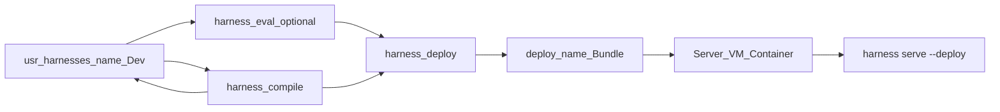
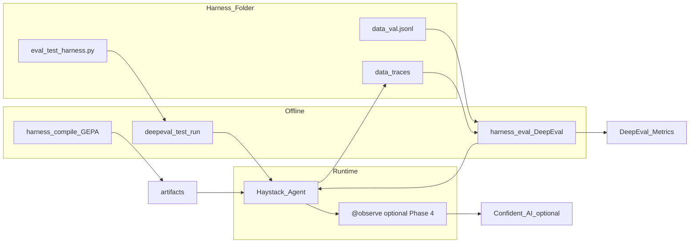
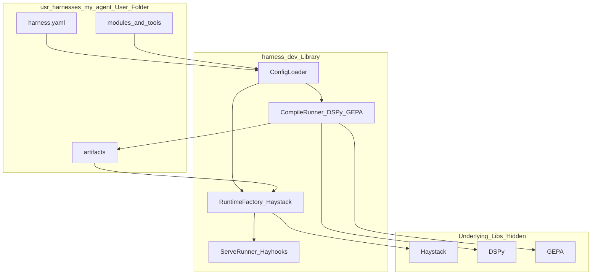
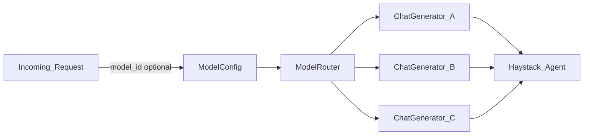
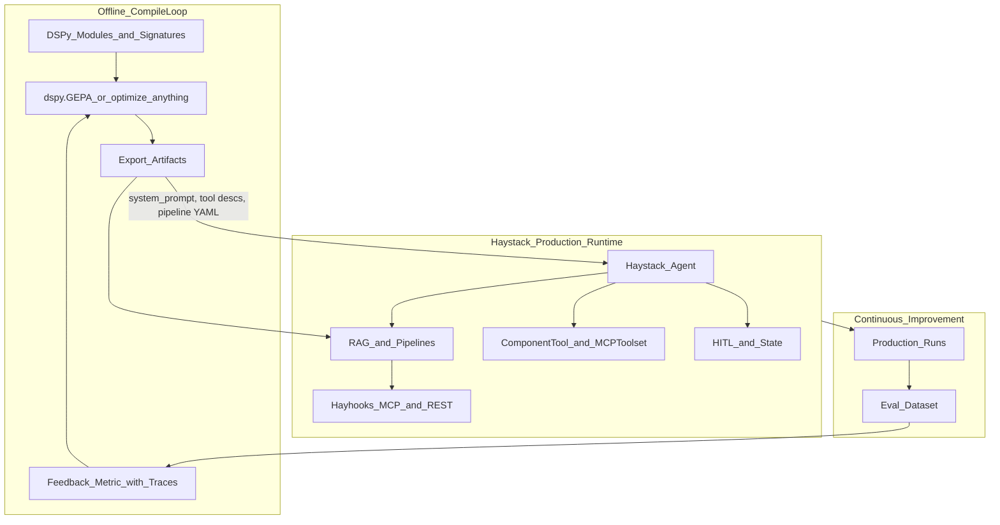
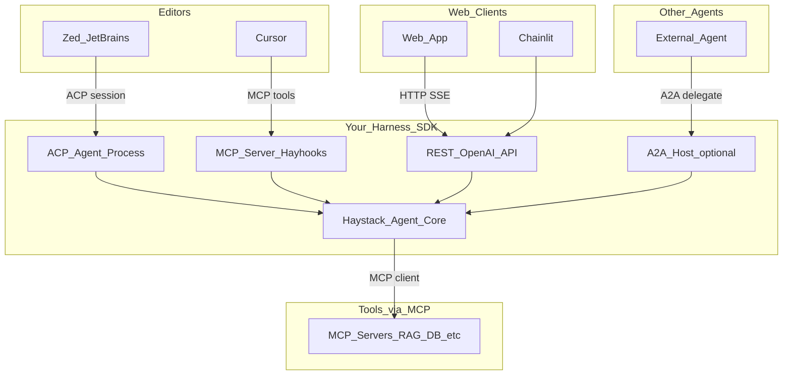
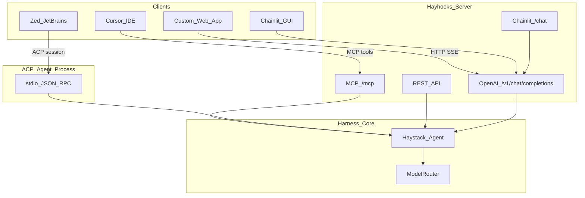

# AI Harness — Ideation & Research (archive)

**Last updated:** 2026-06-24 *(scaffolding marked Done — E1-S03, 2026-07-22; wrappers Done — E1-S02, 2026-07-22)*

> **Structured outputs:** Requirement-level content from this archive is mirrored in **[prd.md](prd.md)** and **[architecture.md](architecture.md)**. This file retains full YAML examples, install script walkthroughs, and protocol essays.

---

## Vision

Build a **harness library** (SDK) that lets developers create new AI harnesses through configuration and a dedicated user workspace — without touching the underlying Haystack, DSPy, and GEPA integration code.

Each **harness instance** is a folder the developer owns: their agents, tools, prompts, and config. The library wires runtime, compile, and serving layers from that config.

- **Haystack** runs production agents (loop, RAG, tools, MCP)
- **DSPy** defines the program as composable modules, not hand-written prompts
- **GEPA** optimizes the harness over execution traces — prompts, demos, configs, skills
- **No vendor lock-in** — any LLM provider; models switched at runtime via configuration
- **Clean separation** — framework code in the library package; harness-specific code in a user-facing folder; **production bundles** in `deploy/` separate from dev `usr-harnesses/`
- **Easy to debug and test** — fast feedback, reproducible runs, clear errors; optional **DeepEval** for richer quality metrics during development

**Formula (industry consensus):** `Agent = Model + Harness`. This project builds the **harness factory**, not a single harness.

---

## Product shape: library + user workspace

| Concept | What it is |
|---|---|
| **Harness SDK** (library) | Pip-installable package that integrates Haystack, DSPy, GEPA, Hayhooks, ModelRouter, export contract; **optional** DeepEval integration for dev-time eval |
| **Harness instance (dev)** | `usr-harnesses/<name>/` — where you author config, modules, train data, and run compile/eval |
| **Deploy bundle (production)** | `deploy/<name>/` — **generated** runtime-only package you ship to a server, container, or VM |
| **Configuration** | YAML files (`harness.yaml`, `models.yaml`) — in dev under `usr-harnesses/`; production copy is stripped and written to `deploy/` |

Developers **do not** copy-paste Haystack/DSPy boilerplate. They scaffold a harness folder, edit config, add code only where they need custom logic.

---

## Languages and runtimes

### What you must use

| Layer | Language / format | Required? | Role |
|---|---|---|---|
| **SDK & stack** | **Python 3.11+** | **Yes** | Haystack, DSPy, GEPA, and `harness_dev` are Python-only; the library cannot be embedded in Node, Go, Rust, etc. |
| **Harness config** | **YAML** | **Yes** | `harness.yaml`, `models.yaml` — primary wiring without code |
| **Prompts & docs** | Markdown (`.md`) | Optional | `prompts/`, `user-docs/`; plain text also works |

### What harness developers write

| Harness style | Languages | When |
|---|---|---|
| **Config-only** | YAML (+ optional `.md` prompts) | Builtin tools, hand-authored `system_prompt`, no custom logic — **no Python in the harness folder** |
| **Custom harness** | **Python** in `modules/`, `tools/`, `hooks.py` | DSPy modules, custom tools, GEPA metrics, lifecycle hooks |
| **Pipelines (Phase 4)** | YAML and/or Python | Haystack pipeline definitions |

**Bottom line:** you need **Python on the machine** to install and run the SDK. You only need to **write Python** when the harness goes beyond YAML + builtins.

### What clients can use (calling a deployed harness)

Once `harness serve` or `harness mcp` is running, **callers are not limited to Python**:

| Client | Typical language | Protocol |
|---|---|---|
| Web app / SPA | JavaScript, TypeScript, any HTTP client | OpenAI-compatible REST |
| Mobile / backend | Any | HTTP REST |
| Cursor, Claude Desktop | (host app) | MCP |
| Zed, JetBrains | (host IDE) | ACP |

Install scripts use **shell** (bash, PowerShell) as thin wrappers around `client_install.py` (dev) and `target_install.py` (target deploy host) — harness developers do not need to write shell to use the library.

### Optional advanced override (open decision #9)

**`harness.py`** — if adopted, would be Python for advanced config overrides; YAML remains the default.

---

## Repository layout

```text
HarnessDevelopment/
├── README.md                     # PLANNED — entry point; see Root README section below
├── src/
│   └── harness_dev/              # LIBRARY — framework internals (do not edit per-harness)
│       ├── cli.py                  # see CLI section (init | compile | deploy | serve | mcp | acp | eval | doctor)
│       ├── config/                 # schemas, loaders, validation (Pydantic)
│       ├── runtime/                # Agent factory, ModelRouter, tool registry
│       ├── compile/                # DSPy module loader, GEPA runner, export contract
│       ├── deploy/                 # packager: usr-harnesses/ → deploy/ bundle
│       ├── eval/                   # DeepEval runner, Haystack trace → LLMTestCase bridge
│       ├── serve/                  # Hayhooks wrapper, MCP/REST bootstrapping
│       └── integrations/         # thin adapters (Haystack, DSPy, GEPA, LiteLLM)
│
├── usr-harnesses/                    # USER-FACING — one subfolder per harness
│   └── example/                    # reference harness (shipped as template)
│       ├── harness.yaml            # main config: name, runtime, tools, compile, serve
│       ├── models.yaml             # model registry (or inherit global)
│       ├── modules/                # DSPy modules (user logic)
│       │   └── agent.py
│       ├── prompts/                # hand-authored or GEPA-exported prompt files
│       ├── skills/                 # skill files (GEPA-optimizable)
│       ├── pipelines/                # Haystack pipeline YAML or PipelineWrapper
│       ├── tools/                    # custom tools (@tool, ComponentTool)
│       ├── hooks.py                  # optional SDK lifecycle hooks
│       ├── data/                     # train/val sets for GEPA and DeepEval
│       ├── eval/                     # optional — DeepEval pytest (if [eval] installed)
│       │   └── test_harness.py
│       └── artifacts/                # GEPA-exported state (generated; dev working copy)
│
├── deploy/                       # PRODUCTION — generated bundles (do not edit by hand)
│   └── example/                    # output of `harness deploy example`
│       ├── manifest.json             # build id, source hash, timestamp
│       ├── harness.yaml              # runtime + serve only (no compile/eval)
│       ├── models.yaml               # production model registry
│       ├── artifacts/                # pinned export copied from dev
│       ├── prompts/
│       ├── pipelines/                # runtime pipeline YAML only
│       ├── tools/                    # runtime custom tools (if any)
│       ├── hooks.py                  # copied only if referenced at runtime
│       └── README.deploy.md          # how to run on target host
│
├── config/                       # optional global defaults (shared across harnesses)
│   └── models.yaml
├── user-docs/                    # END-USER DOCS — guides & manuals (Markdown)
│   ├── README.md                   # documentation index / TOC
│   ├── getting-started/
│   │   ├── installation.md
│   │   ├── first-harness.md
│   │   └── project-setup.md
│   ├── guides/
│   │   ├── configuration.md
│   │   ├── compile-with-gepa.md
│   │   ├── cursor-mcp.md
│   │   ├── web-gui.md
│   │   └── model-switching.md
│   └── reference/
│       ├── cli.md
│       ├── harness-yaml.md
│       └── models-yaml.md
├── docs/                         # internal design
│   ├── prd.md                      # product requirements (story-ready)
│   ├── architecture.md             # technical architecture
│   └── ideation-stage.md           # research archive (this file)
├── install/                      # INSTALL — setup scripts & templates (cross-platform)
│   ├── README.md                   # how to run install on each OS
│   ├── client_install.py           # dev machine: venv + editable install
│   ├── client-install.sh           # POSIX wrapper
│   ├── client-install.ps1          # PowerShell wrapper
│   ├── target_install.py           # target machine: runtime deps only (bundled in deploy/)
│   ├── target-install.sh           # POSIX wrapper (copied into deploy/<name>/)
│   ├── target-install.ps1          # PowerShell wrapper (copied into deploy/<name>/)
│   └── templates/                  # scaffold copied into project root
│       ├── usr-harnesses/example/
│       ├── user-docs/
│       ├── config/models.example.yaml
│       ├── .env.example
│       └── .cursor/mcp.json.example
├── tests/
│   ├── unit/                       # SDK tests
│   └── usr-harnesses/                  # integration tests per example harness
└── pyproject.toml
```

### Separation rules

| Location | Contains | Who edits |
|---|---|---|
| `src/harness_dev/` | Framework: config parsing, ModelRouter, GEPA bridge, Hayhooks boot | Library maintainers only |
| `usr-harnesses/<name>/` | **Development** — config, DSPy modules, train/eval data, compile settings, working artifacts | Harness developer |
| `deploy/<name>/` | **Production bundle** — runtime config, pinned artifacts, runtime tools/pipelines only; **generated** by `harness deploy` | Generated; deploy to any host |
| `config/` | Shared defaults (e.g. global model registry) | Optional; overridable per harness |
| `user-docs/` | End-user guides and reference manuals (`.md`) | Docs authors; read by harness developers |
| `docs/` | Internal design / ideation notes | Library maintainers |
| `install/` | Client setup scripts + `templates/` for scaffolding | Library maintainers; run by developers once per machine |

User harness code **never** lives inside `src/harness_dev/`. The library **loads** user code by path from `usr-harnesses/<name>/` (dev) or `deploy/<name>/` (production).

`usr-harnesses/` is for **building**; `deploy/` is for **shipping**. Do not edit files under `deploy/` — regenerate with `harness deploy`.

`user-docs/` is separate from `docs/`: **`user-docs/`** is the manual developers read; **`docs/`** is build-time design material.

`install/` is separate from `src/`: **`install/`** holds onboarding scripts and template files copied into the project — not runtime library code.

---

Until finalized (open decision #1), the doc uses this mapping:

| Surface | Name |
|---|---|
| PyPI package | `harness-dev` (`pip install harness-dev` or editable `pip install -e ".[dev]"` in this repo) |
| Python import | `harness_dev` (`from harness_dev.config import ...`) |
| Console script | `harness` (`harness serve example`) |
| `pyproject.toml` | `[project.scripts] harness = "harness_dev.cli:main"` |

Install verification may use `python -m harness_dev.cli --version` if the console script is not yet on PATH.

### Install vs `harness init`

| Step | Scope | When |
|---|---|---|
| **`install/client_install.py`** | **Project once** — venv, editable install, `usr-harnesses/example/`, `user-docs/`, global `config/models.yaml`, `.env` | First clone or new machine |
| **`install/target_install.py`** | **Target once per deploy** — runtime `pip install harness-dev`, optional venv, `harness doctor --deploy`; copied into `deploy/<name>/` by `harness deploy` | Desktop PC or server after copying bundle |
| **`zaumzeug init <name>`** *(shipped E1-S04; was `harness init`)* | **One harness** — scaffolds `usr-harnesses/<name>/` from `install/templates/harness/` | Each new agent/harness you add |

Client-install copies the reference **`example`** harness; `zaumzeug init` creates additional named harnesses without re-running install. See [Architecture §3.4](architecture/02-repository-and-layout.md#34-install-scripts-dev-vs-target).

---

## Root `README.md` (planned, not written yet)

A **`README.md` at the project root** is the first file developers see after clone. It is **not** a duplicate of `user-docs/` — it is a short **entry point** that orients and links outward.

### Purpose

| Role | Detail |
|---|---|
| **Explain the project** | One-paragraph what this library is (harness SDK / factory) and what problem it solves |
| **State who it is for** | Developers building configurable AI harnesses without touching Haystack/DSPy/GEPA internals |
| **Install in < 1 screen** | Point to `install/` scripts (Windows / macOS / Linux) and venv activation — not full install docs |
| **Minimal usage** | `harness serve` (Phase 1); later `compile` / `mcp` per roadmap |
| **Delegate depth** | Link to **`user-docs/`** for guides, reference, and walkthroughs |
| **Honest status** | Note early-development / which CLI commands exist yet |

### What belongs in root README vs elsewhere

| Content | Root `README.md` | `user-docs/` | `docs/prd.md` / `docs/architecture.md` |
|---|---|---|---|
| Elevator pitch | Yes | — | PRD §1 |
| Install commands (summary) | Yes | Full guide in `getting-started/installation.md` | PRD E1 |
| `harness.yaml` field reference | Link only | `reference/harness-yaml.md` | Architecture §6 |
| Architecture / protocol comparison | — | `guides/` | Architecture §9 |
| Epics / stories / roadmap | — | — | PRD §8–10 |
| Internal research notes | — | — | This file (archive) |

### Planned sections (outline for when README is written)

1. **Title + one-line description**
2. **What it is for** — bullet list of use cases
3. **Stack** — Haystack / DSPy / GEPA table (one line each)
4. **Prerequisites** — Python 3.11+, API keys, optional uv
5. **Install** — table: Windows / macOS / Linux → `install/` commands
6. **Quick start** — activate venv, `harness serve example` (Phase 1); expand as phases ship
7. **Project layout** — abbreviated tree (`usr-harnesses/`, `user-docs/`, `install/`, `src/`)
8. **Documentation** — links to `user-docs/README.md`, getting-started, guides, reference
9. **License** — when decided

### When to create it

Create root `README.md` in **Phase 1** alongside the install script and `user-docs/` skeleton — after `harness` CLI exists or with an explicit “in development” note. Do not author before install path is stable, or links and commands will drift.

---

## Setup procedure (client-install script)

A **client-install script** gets a developer from “cloned or downloaded the repo” to “ready to create and run a harness” in one command. It must run on **Windows, macOS, and Linux** without maintaining three separate implementations.

### Cross-platform design

| File | Role |
|---|---|
| **`install/client_install.py`** | Single source of truth — all install logic in stdlib Python 3.11+ (`pathlib`, `subprocess`, `venv`, `platform`) |
| **`install/client-install.sh`** | Thin POSIX wrapper: finds `python3`, runs `client_install.py "$@"` |
| **`install/client-install.ps1`** | Thin PowerShell wrapper: finds `python`, runs `client_install.py` with forwarded args |
| **`install/templates/`** | Source files copied into project root during install (harness example, user-docs skeleton, `.env.example`, etc.) |

OS-specific behavior (venv paths, shell activation hints, path separators) lives **only** in `client_install.py` via `platform.system()` — not duplicated in shell scripts.

```text
                    ┌─────────────────────────┐
  Windows           │  install/client-install.ps1 │
  macOS / Linux     │  install/client-install.sh  │──► install/client_install.py
  Any (fallback)    │  python install/client_install.py │
                    └───────────┬─────────────┘
                                │ copies from
                                ▼
                    install/templates/  →  project root
```

### How to run (per OS)

| OS | Recommended command | Notes |
|---|---|---|
| **Windows** (PowerShell) | `.\install\client-install.ps1` | Default terminal on Windows |
| **Windows** (cmd) | `python install\client_install.py` | No execution-policy issues |
| **macOS** | `./install/client-install.sh` | `chmod +x` committed in repo |
| **Linux** | `./install/client-install.sh` | Same as macOS |
| **Any OS** (universal) | `python install/client_install.py` | Works if Python 3.11+ is on PATH |
| **Windows Git Bash** | `./install/client-install.sh` | Same wrapper as macOS/Linux |

Optional flags are identical on every platform: `--verify`, `--no-example`, `--skip-venv`, `--cursor-mcp`.

### When to run it

| Situation | Command |
|---|---|
| **First clone** | OS-specific wrapper above, or `python install/client_install.py` |
| **New machine** / fresh venv | Same (idempotent) |
| **CI** | `python install/client_install.py --skip-venv --verify` |

**`zaumzeug init`** (E1-S04) scaffolds individual harnesses; client-install prepares the **project once**.

### What `client_install.py` does (step by step)

```text
1. Preflight
   ├─ Detect OS: Windows | Darwin (macOS) | Linux
   ├─ Require Python 3.11+ (sys.version_info)
   ├─ Resolve project root (parent of install/)
   ├─ Check git (optional, warn only)
   └─ Warn if uv / uvx missing (needed for MCP servers)

2. Virtual environment
   ├─ Create .venv in project root (if missing) via venv module
   ├─ Windows: .venv\Scripts\python.exe
   ├─ macOS/Linux: .venv/bin/python
   └─ All pip/ harness calls use venv python explicitly (no rely on activate)

3. Install library
   ├─ {venv_python} -m pip install -e ".[dev]"
   └─ {venv_python} -m harness_dev.cli --version  (or `harness --version` when script on PATH)

4. Project scaffolding (idempotent — copy from install/templates/) *(Done — E1-S03, 2026-07-22)*
   ├─ usr-harnesses/example/     from install/templates/usr-harnesses/example/ (--no-example skips)
   ├─ user-docs/             from install/templates/user-docs/ (copy-if-missing)
   ├─ config/models.yaml     from install/templates/config/models.example.yaml
   ├─ .env.example           from install/templates/.env.example
   ├─ .env                   from .env.example when missing (never overwrite)
   ├─ .cursor/mcp.json.example from install/templates/.cursor/
   └─ ensure .gitignore      entries for .venv, artifacts/, deploy/, .env

5. Environment hints (OS-aware)
   ├─ Print API keys to set in .env
   ├─ Write .cursor/mcp.json.example from install/templates/ *(Done — E1-S03)*
   ├─ Optional `--cursor-mcp` live mcp.json → E7-S03
   └─ Print activation hint:
   │     Windows:  .venv\Scripts\Activate.ps1
   │     macOS/Linux:  source .venv/bin/activate

6. Smoke check (optional --verify)
   ├─ {venv_python} -m harness doctor
   └─ dry-run serve check
```

Using the venv Python by **absolute path** avoids shell differences (`Activate.ps1` vs `source`) and makes the script reliable in CI.

### What `target_install.py` does (step by step)

Runs on the **target machine** (desktop PC or server) after copying `deploy/<name>/`. Does **not** install Python.

```text
1. Preflight — OS detect, Python 3.11+, verify deploy bundle (manifest.json, harness.yaml)
2. Virtual environment — optional .venv beside bundle (skip with --skip-venv)
3. pip install harness-dev — runtime only (no DSPy, GEPA, DeepEval, [dev], [eval])
4. harness doctor <name> --deploy — validate bundle
5. .env — copy .env.example → .env if missing (never overwrite)
6. Smoke check (optional --verify) — harness serve <name> --deploy --dry-run
```

`harness deploy` copies `target_install.py` plus `target-install.sh` / `target-install.ps1` into each `deploy/<name>/` bundle. Same pattern as client install: one Python module, thin OS wrappers.

### Developer flow after install

**Phase 1 (minimal):** activate venv, set `.env`, `harness serve example`.

**Full flow (after Phase 2–3):** add `harness compile`, `harness deploy`, `harness eval`, `harness mcp`, etc.

**Windows (PowerShell):**

```powershell
git clone <repo> && cd HarnessDevelopment
.\install\client-install.ps1
.\.venv\Scripts\Activate.ps1
notepad .env
harness serve example              # Phase 1
harness init my_agent              # optional: new harness
harness compile my_agent           # Phase 2+
harness deploy my_agent            # Phase 2+
# on target machine (desktop or server):
./deploy/my_agent/target-install.sh   # or target-install.ps1 on Windows
notepad .env                          # set API keys
harness serve my_agent --deploy
harness mcp my_agent               # Phase 3+
```

**macOS / Linux:**

```bash
git clone <repo> && cd HarnessDevelopment
./install/client-install.sh
source .venv/bin/activate
$EDITOR .env
harness serve example
harness init my_agent
harness compile my_agent           # Phase 2+
harness deploy my_agent            # Phase 2+
# on target machine (desktop or server):
./deploy/my_agent/target-install.sh   # or target-install.ps1 on Windows
notepad .env                          # set API keys
harness serve my_agent --deploy
harness mcp my_agent               # Phase 3+
```

**Universal (any OS):**

```bash
python install/client_install.py
# then activate venv per OS (script prints exact command)
```

### Script flags

| Flag | Effect |
|---|---|
| `--skip-venv` | Use current `python` on PATH (CI or pre-activated venv) |
| `--no-example` | Do not scaffold `usr-harnesses/example/` |
| `--verify` | Run `harness doctor` at end |
| `--cursor-mcp` | Write `.cursor/mcp.json` from template (not just `.example`) |

### Scaffolding implementation *(Done — E1-S03, 2026-07-22)*

Shipped in `install/client_install.py` → `scaffold_project()`: copy-if-missing from `install/templates/` for example harness, `config/models.yaml`, `.env.example`, seeded `.env` (never overwrite), `.cursor/mcp.json.example`, `user-docs/`, and `.gitignore` merge. Flag `--no-example` skips the harness tree. Tests: `tests/unit/install/test_scaffolding.py`. See [Architecture §3.4](architecture/02-repository-and-layout.md#34-install-scripts-dev-vs-target).

### Wrapper implementation *(Done — E1-S02, 2026-07-22)*

Shipped as `install/client-install.sh` and `install/client-install.ps1` (prefer working `py -3` / `python3` / `python`; forward all args; no install logic). See [Architecture §3.4](architecture/02-repository-and-layout.md#34-install-scripts-dev-vs-target) and [installation.md](../user-docs/getting-started/installation.md). Archive sketch below retained for history:

**`install/client-install.sh`:**

```bash
#!/usr/bin/env bash
set -euo pipefail
ROOT="$(cd "$(dirname "$0")/.." && pwd)"
exec python3 "$ROOT/install/client_install.py" "$@"
```

**`install/client-install.ps1`:**

```powershell
$ErrorActionPreference = "Stop"
$Root = Split-Path -Parent (Split-Path -Parent $MyInvocation.MyCommand.Path)
$Python = Get-Command python -ErrorAction SilentlyContinue
if (-not $Python) { $Python = Get-Command python3 -ErrorAction Stop }
& $Python.Source (Join-Path $Root "install\client_install.py") @args
```

### Consumer-project variant (future)

If the library is published to PyPI, a slimmer path for **other repos**:

```bash
pip install harness-dev
harness install-project               # scaffolds usr-harnesses/, user-docs/, .env.example in cwd
```

`client_install.py` in **this** repo is the superset (editable install + full tree). `harness install-project` reuses the same Python module for downstream projects.

---

## User documentation (`user-docs/`)

All end-user-facing documentation lives in **`user-docs/`** as **Markdown** (`.md`). Not mixed with library source or internal `docs/`.

### Purpose

| Folder | Audience | Content |
|---|---|---|
| `user-docs/getting-started/` | New developers | Install, first harness, project layout |
| `user-docs/guides/` | Day-to-day use | Config, GEPA compile, Cursor MCP, web GUI, models |
| `user-docs/reference/` | Lookup | CLI commands, `harness.yaml` fields, `models.yaml` schema |

### Conventions

- One topic per file; cross-link with relative paths (`../guides/configuration.md`)
- `user-docs/README.md` — table of contents with short descriptions
- Diagrams: Mermaid inside `.md` where helpful (same as ideation doc)
- **Do not** put internal design notes here — those stay in `docs/`
- Client-install copies or verifies the skeleton; authors expand guides as features ship

### Initial skeleton (created by client-install)

```text
user-docs/
├── README.md
├── getting-started/
│   ├── installation.md       # links to client-install script
│   ├── project-setup.md      # folder layout, .env, models.yaml
│   └── first-harness.md        # init → compile → serve walkthrough
├── guides/
│   └── .gitkeep              # populated as features land
└── reference/
    └── cli.md                  # harness init | serve | compile | ...
```

---

## Configuration model

Single entry point per harness: **`harness.yaml`**. The SDK reads this and wires all integrated libs.

### Phase 1 minimal example

Enough to run `harness serve` after install (no compile, MCP, or Chainlit yet):

```yaml
# usr-harnesses/example/harness.yaml — Phase 1
name: example
description: Reference general research agent   # general task + web_fetch; RAG in Phase 4

runtime:
  default_model_id: default
  agent:
    system_prompt: prompts/system.md   # hand-authored until compile (Phase 2)

models: models.yaml                      # optional; inherits global if omitted

tools:
  builtin: [web_fetch]

serve:
  hayhooks:
    port: 1416
```

### Full reference example (all phases)

```yaml
# usr-harnesses/example/harness.yaml — full reference (annotate by phase in user-docs)
name: example
description: Reference general research agent   # general task + web_fetch; RAG in Phase 4

runtime:
  default_model_id: default          # key in models.yaml
  agent:
    module: modules.agent:ResearchAgent   # compile only (Phase 2); ignored at runtime if artifact set
    artifact: artifacts/current/          # GEPA export dir (Phase 2+); see resolution order below
    system_prompt: prompts/system.md      # fallback when no artifact

models: models.yaml                    # per-harness registry (optional)

tools:
  builtin: [web_fetch]                 # SDK-provided tools
  mcp:                                   # Phase 3
    - name: fetch
      transport: stdio
      command: uvx
      args: [mcp-server-fetch]
  custom:                                # Phase 3
    - tools.calculator:calculator

compile:                                 # Phase 2 — GEPA optimization
  enabled: true
  optimizer: dspy.GEPA
  trainset: data/train.jsonl
  valset: data/val.jsonl
  reflection_model_id: strong
  budget: medium

eval:                                    # optional — Phase 2
  framework: deepeval                    # deepeval | builtin (builtin needs no [eval] extra)
  valset: data/val.jsonl
  metrics:
    - type: TaskCompletionMetric
      threshold: 0.7
    - type: ToolCorrectnessMetric
      threshold: 0.8
  judge_model_id: strong
  confident_ai:
    enabled: false
    sync_test_results: true

deploy:                                  # Phase 2 — dev only; stripped from deploy bundle
  eval_gate: skip                        # skip | warn | block

serve:
  hayhooks:
    port: 1416
    mcp_port: 1417
    chainlit: true                       # Phase 3 — embedded GUI at /chat
  acp:
    enabled: false                       # Phase 3 — stdio agent for Zed/JetBrains
  a2a:
    enabled: false                       # Phase 4 — agent-to-agent delegation
  expose:
    - agent                              # MCP tools + REST + optional ACP
    - pipelines.rag                      # Phase 4
```

### Runtime agent resolution order

At **`harness serve` / `harness mcp` / `harness acp`** (production hot path):

1. If `runtime.agent.artifact` exists and contains a valid **artifact manifest** → load exported prompts/state into Haystack `Agent` (DSPy `module` is **not** loaded).
2. Else if `runtime.agent.system_prompt` points to an existing file → use that as `Agent.system_prompt`.
3. Else → **fail fast** with a clear error (“run `harness compile` or add `system_prompt`”).

At **`harness compile`** (offline only):

- Requires `runtime.agent.module` (import path to DSPy `Module`).
- Writes to `artifacts/<run_id>/` and updates `artifacts/current` symlink or manifest pointer.
- After successful compile, runtime prefers `artifact` over `system_prompt`.

**Without ever compiling:** set `system_prompt` only (Phase 1 path). **After compile:** artifact is authoritative; edit prompts via recompile, not hand-editing exported files (see anti-patterns).

### Artifact layout

```text
usr-harnesses/<name>/artifacts/
├── current/              # pointer or symlink to latest good export (what runtime loads)
│   ├── manifest.json     # version, compile timestamp, source module hash
│   ├── agent.json        # exported DSPy state / prompt bundle
│   └── ...
└── <run_id>/             # immutable export per compile run (rollback)
```

`harness.yaml` may set `artifact: artifacts/current` (directory) or a pinned `artifacts/<run_id>` for rollback.

### Model registry inheritance (`models.yaml`)

| File | Role |
|---|---|
| `config/models.yaml` | **Global defaults** — shared across harnesses in this project |
| `usr-harnesses/<name>/models.yaml` | **Per-harness overrides** — optional |

**Merge rules:**

1. Load global `config/models.yaml` if present.
2. If harness declares `models: models.yaml` (or inline path), **deep-merge** harness entries over global keys (same `model_id` key → harness wins).
3. `runtime.default_model_id`, `compile.reflection_model_id`, etc. reference keys from the **merged** registry.
4. If a key is missing after merge → config validation error at `harness serve` / `harness compile`.

Provider secrets stay in `.env`; `models.yaml` holds provider + model id + generation kwargs only.

### What config controls (no code required)

| Config section | Wires |
|---|---|
| `runtime` | Haystack `Agent`, `ModelRouter`, default model |
| `models` | LiteLLM / provider registry |
| `tools.builtin` | SDK tool catalog — [architecture.md §6.5](architecture/05-configuration.md#65-builtin-tools-catalog) |
| `tools.mcp` | `MCPToolset` server definitions |
| `tools.custom` | User Python tools from `usr-harnesses/<name>/tools/` |
| `compile` | DSPy module load + `dspy.GEPA.compile()` → `artifacts/` |
| `eval` | Optional eval (`builtin` \| `deepeval`) — [architecture.md §6.3](architecture/05-configuration.md#63-zaumzeug-eval-frameworks) |
| `deploy` | Eval gate on deploy — [architecture.md §6.4](architecture/05-configuration.md#64-deploy-eval-gate) |
| `serve` | Hayhooks ports, Chainlit, MCP/REST; optional ACP agent process, A2A host |

---

## Deploy folder (production bundle)

`deploy/` holds **production-ready** harness packages — everything needed to run on a server, **without** dev-only files (DSPy modules, train sets, GEPA config, eval tests).

### Dev vs deploy

| | `usr-harnesses/<name>/` (dev) | `deploy/<name>/` (production) |
|---|---|---|
| **Purpose** | Author, compile, experiment | Ship and run |
| **Edited by** | Developer | **Generated** by SDK (`harness deploy`) |
| **`harness.yaml`** | Full (runtime, compile, eval, serve) | **Stripped** — runtime + serve + tools only |
| **`modules/`** | DSPy source | **Excluded** — already compiled into `artifacts/` |
| **`data/`** | train/val JSONL | **Excluded** |
| **`eval/`** | DeepEval pytest | **Excluded** |
| **`artifacts/`** | Working / `current` symlink | **Pinned copy** (immutable for this build) |
| **`tools/`**, **`pipelines/`** | Dev copies | **Included** only if needed at runtime |
| **Typical host** | Developer laptop | VM, Docker, Kubernetes, bare metal |



### What `harness deploy <name>` does

1. **Validate** dev folder — `harness doctor`, runtime path resolvable (`artifact` or `system_prompt`)
2. **Eval gate** — per `deploy.eval_gate` (`skip` \| `warn` \| `block`) or `--eval-gate`; see [architecture.md §6.4](architecture/05-configuration.md#64-deploy-eval-gate)
3. **Assemble** `deploy/<name>/`:
   - Write **stripped** `harness.yaml` (drop `compile`, `eval`, `deploy`; keep `runtime`, `tools`, `serve`)
   - Copy **pinned** `artifacts/<run_id>/` (from `artifacts/current` or explicit pin in dev config)
   - Copy `models.yaml`, `prompts/`, runtime `pipelines/`, runtime `tools/`, `hooks.py` if present
   - Merge global `config/models.yaml` into bundle `models.yaml` when needed
   - Write `manifest.json` — `{ build_id, source_git_sha, harness_yaml_hash, artifact_run_id, created_at }`
   - Write `README.deploy.md` — minimal run instructions for ops
4. **Idempotent** — overwrites `deploy/<name>/`; safe to re-run after each compile

```bash
# Typical release flow
harness compile my_agent
harness eval my_agent              # optional
harness deploy my_agent            # writes deploy/my_agent/
```

### Running from `deploy/`

| Command | Source folder | Use when |
|---|---|---|
| `harness serve <name>` | `usr-harnesses/<name>/` | **Local development** (default) |
| `harness serve <name> --deploy` | `deploy/<name>/` | **Production** or staging on target host |
| `harness mcp <name> --deploy` | `deploy/<name>/` | Cursor → production bundle |
| `harness acp <name> --deploy` | `deploy/<name>/` | IDE agent → production bundle |

Env override: `HARNESS_ROOT=deploy` forces all serve commands to resolve under `deploy/` (useful in Docker `ENTRYPOINT`).

### Shipping only `deploy/`

On the target machine you need:

- Python 3.11+ and `pip install harness-dev` (runtime deps only — **not** DSPy/GEPA unless you compile on-server, which is discouraged)
- The `deploy/<name>/` folder (scp, rsync, artifact tarball, container image layer)
- `.env` with provider API keys (never inside the bundle)

```text
# Example: copy bundle to server
tar czf my_agent-bundle.tgz deploy/my_agent/
scp my_agent-bundle.tgz user@server:/opt/harness/
ssh user@server 'cd /opt/harness && tar xzf my_agent-bundle.tgz && harness serve my_agent --deploy'
```

Optional Phase 4: `deploy/<name>/Dockerfile` generated from template.

### Git and `.gitignore`

| Policy | Recommendation |
|---|---|
| **Default** | Add `deploy/` to `.gitignore` — regenerated artifacts |
| **Release tags** | Optionally commit `deploy/<name>/` for audited releases (manifest pins exact build) |
| **CI** | Build `deploy/` in pipeline; upload as deployment artifact |

`client_install.py` ensures `.gitignore` includes `deploy/` and `usr-harnesses/*/artifacts/`.

### SDK module

**`src/harness_dev/deploy/packager.py`** — implements `harness deploy`; shared with future `harness export` tarball command.

---

## CLI (developer workflow)

### Commands

| Command | Phase | Purpose |
|---|---|---|
| `harness init <name>` | 1 | Scaffold `usr-harnesses/<name>/` |
| `harness doctor` | 1 | Preflight checks (see below) |
| `harness serve <name>` | 1 | REST (+ optional Chainlit in Phase 3) for one harness |
| `harness compile <name>` | 2 | DSPy → GEPA → `artifacts/` in `usr-harnesses/` |
| `harness deploy <name>` | 2 | Package `usr-harnesses/<name>/` → `deploy/<name>/` |
| `harness eval <name>` | 2 | Optional DeepEval regression (requires `[eval]` extra) |
| `harness mcp <name>` | 3 | MCP server for Cursor / Claude Desktop |
| `harness acp <name>` | 3 | ACP stdio agent for Zed / JetBrains |

```bash
harness init my_agent
harness doctor my_agent          # optional harness name; omit for project-wide
harness compile my_agent         # Phase 2+
harness deploy my_agent          # Phase 2+ → deploy/my_agent/
harness serve my_agent           # dev: reads usr-harnesses/
harness serve my_agent --deploy  # prod: reads deploy/
harness mcp my_agent             # Phase 3+
harness acp my_agent             # Phase 3+
harness eval my_agent            # Phase 2+
```

All commands take a **harness name** (= subfolder name under `usr-harnesses/` and `deploy/`). By default, paths resolve under **`usr-harnesses/`**; pass **`--deploy`** (or `HARNESS_ROOT=deploy`) to use **`deploy/`**.

### `harness` vs raw `hayhooks`

**Canonical path for developers:** `harness serve|mcp|acp <name>`. The SDK:

1. Loads config from `usr-harnesses/<name>/` or `deploy/<name>/` (with `--deploy`)
2. Builds the Haystack `Agent` + `ModelRouter`
3. Invokes **Hayhooks** with harness-specific deployment config (ports from `serve.hayhooks`)

| Developer command | Under the hood |
|---|---|
| `harness serve <name>` | Hayhooks HTTP — `/v1/chat/completions`, `/docs`, optional `/chat` |
| `harness mcp <name>` | Hayhooks MCP on `mcp_port` — `{base}:{mcp_port}/mcp` |
| `harness acp <name>` | Separate stdio process (SDK adapter), not Hayhooks |

**Raw `hayhooks run` / `hayhooks mcp run`** remain valid for **Haystack debugging** when you already have a Hayhooks deployment and want to bypass harness config. They are not the documented onboarding path. Docs and quick-start use `harness` only.

### Multi-harness serving

**Default (Phase 1–3):** **one Hayhooks process per `harness serve <name>`** — one harness folder, one agent deployment, ports from that harness's `serve.hayhooks`.

- OpenAI `model` field in API requests = **harness name** (deployment id), not `models.yaml` key.
- **`model_id`** (optional request field) selects LLM via `ModelRouter` / `models.yaml`.

**Future (optional):** multi-tenant single process mapping multiple harness folders — deferred; not Phase 1.

### `harness doctor` checklist

Used by `install --verify` and manual preflight:

| Check | Severity |
|---|---|
| Python 3.11+ | error |
| Editable install / `harness` on PATH | error |
| `.env` exists; required API keys set for configured providers | warn / error |
| `usr-harnesses/<name>/harness.yaml` valid (Pydantic) | error |
| `eval` section valid when present (DeepEval metric types) | warn |
| Runtime path resolvable (`system_prompt` or `artifact`) | error |
| `models.yaml` merge valid; `default_model_id` exists | error |
| Ports `serve.hayhooks.port` / `mcp_port` free (if checking serve) | warn |
| `uv` / `uvx` on PATH when `tools.mcp` configured | warn |

---

## Debug and testability (design goal)

The SDK should be **easy to debug and test** at every layer — config mistakes caught early, agent behavior reproducible without live LLM calls, and production issues traceable back to a harness folder state.

### Design principles

| Principle | How the SDK supports it |
|---|---|
| **Fail fast, explain why** | Pydantic validation on load; `harness doctor` with actionable messages (not stack traces alone) |
| **Reproducible state** | Harness = folder on disk (YAML + artifacts); git-commit a known config to replay bugs |
| **Compile vs runtime split** | Bugs in prompts → compile path; bugs in serving → runtime path — never mixed in one request |
| **Observable loops** | Structured logging, Haystack `track_stats`, optional OpenTelemetry (Phase 4+) |
| **Cheap CI** | Mock LLMs and stub tools by default; live API tests opt-in via env flag |

### Suggested mechanisms (to build into the SDK)

#### 1. CLI and preflight

| Mechanism | Purpose |
|---|---|
| **`harness doctor`** | Already planned — extend with `--verbose`, `--json`, harness-specific vs project-wide |
| **`harness eval <name>`** | Optional DeepEval regression (requires `[eval]`); agentic + RAG metrics; `--trace` |
| **`--dry-run`** on `serve` / `compile` | Validate config, resolve imports, print resolved model registry — no server / no LLM calls |
| **`--verbose` / `HARNESS_LOG_LEVEL=DEBUG`** | SDK + Haystack pipeline logging; log `model_id`, tool name, artifact path per request |
| **`install --verify`** | End-to-end smoke: doctor + optional dry-run serve |

#### 2. Test pyramid (`tests/`)

```text
tests/
├── unit/                    # fast, no network
│   ├── config/              # harness.yaml / models.yaml load + merge
│   ├── export_contract/     # DSPy state → artifact snapshots (golden files)
│   └── runtime/             # ModelRouter with mock ChatGenerator
├── usr-harnesses/               # integration + DeepEval pytest per harness
│   └── example/
│       └── test_eval.py     # deepeval test run via CI
└── e2e/                     # optional; HARNESS_LIVE_LLM=1 only
```

- **Unit:** Pydantic schemas, `models.yaml` merge, export contract golden snapshots (`artifacts/expected/`).
- **Integration:** Load `usr-harnesses/example`, run agent with **mock LM** (LiteLLM mock or Haystack test double) — assert tool calls and prompt shape without API cost.
- **E2E:** Gated by env var; real provider keys; nightly or pre-release only.

#### 3. Mock LLM and stub tools

Add a **`mock`** (or `fixture`) profile in `models.yaml` for CI:

```yaml
models:
  mock:
    provider: mock
    model: harness-fixture
    # SDK returns canned responses from tests/fixtures/responses/
```

- **`harness eval`** and integration tests use `mock` by default in CI.
- Document switching `default_model_id: mock` for local debugging without spend.

#### 4. Trace capture and replay (Phase 2+)

| Feature | Purpose |
|---|---|
| **Trace export** | Haystack run → JSONL (`data/traces/`) for failed production turns |
| **`harness eval --trace <file>`** | Score a single captured trace against metric |
| **Replay (future)** | `harness replay <name> --trace <file>` — re-run tool loop with recorded tool outputs |

Feeds the continuous-improvement ratchet: production failure → dataset row → recompile.

#### 5. Debugger-friendly development

- **Attach debugger:** run `python -m debugpy --listen 5678 -m harness_dev.cli serve example` (document in `user-docs/`).
- **Swagger UI** at `/docs` — manual REST probes without writing a client.
- **Raw Hayhooks escape hatch** — bypass SDK when isolating Haystack vs config bugs (already documented).
- **Small fixture harness** in `tests/usr-harnesses/fixture/` — minimal YAML for SDK tests, not shipped to users.

#### 6. DeepEval (optional dev tool — see dedicated section)

**Recommended, not required.** Helps SDK maintainers and harness developers with pytest-style evals, agentic/RAG metrics, and optional monitoring. Users can ship harnesses without ever installing `deepeval`.

**Also compatible:** Promptfoo, Ragas, or custom pytest — no lock-in to DeepEval.

### Phase mapping

| Phase | Debug / test deliverables |
|---|---|
| **1** | `harness doctor`, config unit tests, `--dry-run` on serve, mock model profile, `tests/usr-harnesses/fixture/` |
| **2** | Optional **DeepEval** (`[eval]` extra), `harness eval`, **`harness deploy`**, export contract golden tests |
| **3** | MCP/ACP integration tests; DeepEval **ToolCorrectness** / **MCP** metrics |
| **4** | DeepEval `@observe` on runtime; optional **Confident AI** sync; trace → dataset → GEPA ratchet |

---

## DeepEval — optional evaluation, testing, and monitoring

> **Not mandatory.** DeepEval is a **development aid** bundled as an optional integration (`pip install "harness-dev[eval]"`). Harness developers can use the library fully with only YAML config, `harness serve`, and `harness compile` — no DeepEval install, no `eval/` folder, no `eval` block in `harness.yaml`.

[DeepEval](https://github.com/confident-ai/deepeval) is the **recommended** framework when you want Pytest-style LLM tests, rich agentic/RAG metrics, or optional production monitoring via [Confident AI](https://www.confident-ai.com/). The SDK integrates it when present; it is **not** a runtime dependency of deployed harnesses.

It is **not** a replacement for GEPA. When you opt in, the two complement each other:

| Concern | GEPA | DeepEval |
|---|---|---|
| **Optimize** prompts, demos, tool descriptions | Yes (compile-time) | No |
| **Regression test** after compile or config change | No | Yes (when DeepEval installed — `harness eval` / CI) |
| **Agentic metrics** (task completion, tool correctness, plan adherence) | Custom metric only | Built-in metrics |
| **RAG metrics** (faithfulness, contextual recall, RAGAS) | Via custom metric | Built-in metrics |
| **Pytest / CI integration** | No | `deepeval test run` |
| **Production monitoring** | No | Tracing + Confident AI (optional) |
| **Debug failing runs** | Compile logs | Metric `reason` + trace spans |

**When using DeepEval:** GEPA **improves** the harness offline; DeepEval **helps verify** it still works during development (and optionally in production monitoring).

### What works without DeepEval

| Feature | Without `deepeval` | With `deepeval` (`[eval]` extra) |
|---|---|---|
| `harness serve` / `mcp` / `acp` | Yes | Yes |
| `harness compile` (GEPA) | Yes | Yes |
| `harness doctor` | Yes | Yes |
| `harness eval` | Only if `eval:` configured; `framework: builtin` works without DeepEval; `deepeval` needs `[eval]` extra | Full DeepEval metric suite |
| `usr-harnesses/<name>/eval/` pytest | No (skip / not scaffolded) | `deepeval test run` |
| Production deploy | Yes | Yes — monitoring is opt-in either way |

### How DeepEval fits the harness SDK (optional path)



### Integration modes

#### Mode A — Black-box via `harness eval` (default, Phase 2)

SDK runs the Haystack agent (in-process, not HTTP required), captures `actual_output`, tool calls, and retrieval context, builds `LLMTestCase`, runs configured DeepEval metrics:

```bash
harness eval my_agent                    # all metrics in harness.yaml eval section
harness eval my_agent --metric task_completion
harness eval my_agent --trace data/traces/run-001.jsonl
deepeval test run usr-harnesses/my_agent/eval/   # user pytest files
```

#### Mode B — In-process tracing (Phase 4)

Wrap `Agent.run()` with DeepEval `@observe` / `update_current_span` in `harness_dev/eval/tracing.py` for component-level visibility (tool steps, retriever, generator):

```python
from deepeval.tracing import observe, update_current_span

@observe()
def run_harness_agent(agent, input: str):
    result = agent.run(input)
    update_current_span(test_case=build_test_case(input, result))
    return result
```

Use `dataset.evals_iterator(metrics=[...])` for batch runs over `data/val.jsonl`.

#### Mode C — HTTP black-box (optional)

For testing a **already-running** `harness serve` instance (integration / staging):

- Client calls `/v1/chat/completions`, maps response to `LLMTestCase.actual_output`
- Same DeepEval metrics — useful when debugging deployment-only issues

### Config (`harness.yaml` `eval` section)

See full reference example in Configuration model. Key fields:

| Field | Purpose |
|---|---|
| `eval.framework` | `deepeval` (default when `eval` present) or `builtin` (JSONL checks, no DeepEval) |
| `eval.valset` | JSONL path — `input`, `expected_output`, optional `retrieval_context` |
| `eval.metrics` | List of DeepEval metric types + thresholds |
| `eval.judge_model_id` | `models.yaml` key for LLM-as-judge metrics (GEval, etc.) |
| `eval.confident_ai` | Optional cloud sync (`deepeval login`); datasets, reports, production traces |

### Metrics to use by harness type

| Harness type | Suggested DeepEval metrics |
|---|---|
| **General agent** | `TaskCompletionMetric`, `GEval` (custom criteria), `HallucinationMetric` |
| **Tool-using agent** | `ToolCorrectnessMetric`, `ArgumentCorrectnessMetric`, `StepEfficiencyMetric` |
| **RAG** | `AnswerRelevancyMetric`, `FaithfulnessMetric`, `ContextualRecallMetric`, `RAGASMetric` |
| **Multi-turn chat** | `ConversationCompletenessMetric`, `KnowledgeRetentionMetric` |
| **MCP-heavy** | `MCPTaskCompletionMetric`, `MCPUseMetric` |

User can add custom DeepEval metrics in `usr-harnesses/<name>/eval/metrics.py` — same modularity as upstream DeepEval.

### GEPA ↔ DeepEval bridge

| Path | Flow |
|---|---|
| **Compile then verify** | `harness compile` → `harness eval` must pass before deploy |
| **Eval failure → GEPA** | Failed `LLMTestCase` rows append to `data/train.jsonl`; next compile picks them up |
| **Shared valset** | `data/val.jsonl` used by both `compile.valset` and `eval.valset` (or split explicitly) |
| **GEPA custom metric** | `modules/metrics.py` may call DeepEval `.measure()` and return `score` + `feedback` text for GEPA |

### SDK module to build

**`src/harness_dev/eval/`** (and `integrations/deepeval.py`):

- Load `eval` config from `harness.yaml`
- `DeepEvalRunner.run(harness_name)` — invoke agent, run metrics, return report
- `trace_to_test_case(haystack_trace) -> LLMTestCase`
- Optional Confident AI env setup (`CONFIDENT_API_KEY` / `deepeval login`)

### Dependencies (optional)

```bash
pip install harness-dev              # core — no deepeval
pip install "harness-dev[eval]"      # adds deepeval for harness eval / pytest
# or: pip install deepeval
```

DeepEval is **not** installed by default. `client_install.py` does not require it; document `[eval]` in `user-docs/` for teams that want it.

When installed, DeepEval requires **Python 3.9+** (compatible with our 3.11+ SDK). Judge metrics use `eval.judge_model_id` from `models.yaml` (LiteLLM-backed), not hardcoded OpenAI.

### Confident AI (optional monitoring, Phase 4)

- **`deepeval login`** — sync test results, datasets, and traces to cloud
- **Production** — monitor live harness responses; compare iterations after GEPA compile
- **Cursor / IDE** — Confident AI MCP server for inspecting traces without leaving the editor (upstream feature; document in `user-docs/`)

Local-only workflows work without an account; cloud is opt-in.

---

## Extension points (user folder only)

| Need | Where | How |
|---|---|---|
| Custom agent logic | `modules/*.py` | DSPy `Module` subclasses; referenced in `harness.yaml` |
| Custom tools | `tools/*.py` | Haystack `@tool` or `ComponentTool`; listed in config |
| Custom pipelines | `pipelines/` | YAML or `PipelineWrapper`; exposed via `serve.expose` |
| Custom metrics | `modules/metrics.py` | GEPA feedback; may delegate to DeepEval metrics |
| DeepEval tests (optional) | `eval/test_*.py`, `eval/metrics.py` | Only if user installs `[eval]`; Pytest + `deepeval test run` |
| Prompts / skills | `prompts/`, `skills/` | Files optimized by GEPA or hand-authored |

Advanced users can subclass SDK hooks (`on_tool_call_start`, etc.) in a `hooks.py` inside their harness folder — still user-facing, not in the library core.

---

## How this maps to the stack



The developer interacts with **`harness.yaml` + their folder**. The SDK owns all imports of Haystack, DSPy, and GEPA.

---

## Chosen stack

| Library | Layer | Package | Responsibility |
|---|---|---|---|
| [Haystack](https://github.com/deepset-ai/haystack) | **Runtime harness** | `haystack-ai`, `hayhooks`, `mcp-haystack` | Agent loop, RAG pipelines, `ComponentTool`, `MCPToolset`, HITL/state, REST + MCP deployment |
| [DSPy](https://dspy.ai/) | **Program specification** | `dspy-ai` | Signatures, `Module`s, control flow; authoring environment for what the system does |
| [GEPA](https://github.com/gepa-ai/gepa) | **Self-improvement** | `gepa` | Reflective optimization via `dspy.GEPA`, `gepa.optimize()`, or `gepa.optimize_anything()` |
| [DeepEval](https://github.com/confident-ai/deepeval) | **Dev-time eval (optional)** | `deepeval` `[eval]` extra | Recommended for pytest-style LLM evals, agentic/RAG metrics, tracing; **not required** to use the SDK |

**Mental model:** DSPy = blueprint · GEPA = tuning shop · Haystack = factory floor · DeepEval = optional quality inspection during development.

**Golden rule:** strict **compile-time vs runtime** split. Never run DSPy `ReAct` and Haystack `Agent` in the same request path.

**Model rule:** the harness never hardcodes a provider or model name. LLM choice is **injected configuration** — swappable per request, per agent, or per pipeline stage.

---

## Harness vs framework (context)

Industry consensus treats these as different layers:

| Layer | Role | Examples |
|---|---|---|
| **Harness** | Runtime that wraps a model: permissions, tools, memory, hooks, sandbox, observability | Claude Code, Codex, UniHarness, omniHarness |
| **Framework** | Orchestration logic you assemble: graphs, handoffs, workflows | LangGraph, OpenAI Agents SDK, Pydantic AI |
| **Protocols** | Standardized integration boundaries | MCP (agent-to-tool), A2A (agent-to-agent) |

Our project is a **harness SDK** on top of that stack: Haystack as runtime, DSPy as spec, GEPA as optimizer — with **optional** DeepEval for developers who want richer eval/monitoring during build.

---

## Model-agnostic design (on-the-fly LLM switching)

### Principle

The harness optimizes **behavior** (prompts, tools, routing logic). The **model** is a runtime parameter — like choosing a database connection string, not rewriting application code.

| Layer | How to stay model-agnostic |
|---|---|
| **Haystack (runtime)** | `ModelRouter` injects the correct `ChatGenerator` per request; model ID passed via API param, header, or config |
| **DSPy (spec/compile)** | `dspy.LM("provider/model")` via LiteLLM; use `dspy.context(lm=...)` for per-stage overrides during eval |
| **GEPA (optimize)** | `task_lm` and `reflection_lm` are config strings, not code constants; recompile optional when switching model families |

### Architecture



### Runtime switching (Haystack)

**Do not** bake a specific `ChatGenerator(model="...")` into pipeline code. Instead:

1. **Model registry** — YAML/JSON mapping `model_id` → provider + endpoint + generation kwargs:

   ```yaml
   models:
     default: { provider: openai, model: gpt-4o-mini }
     fast:    { provider: anthropic, model: claude-haiku-... }
     strong:  { provider: openrouter, model: anthropic/claude-sonnet-... }
   ```

2. **ModelRouter component** (custom, to build) — Haystack-compatible wrapper that:
   - Reads `model_id` from `Agent.run()` kwargs, request header, or falls back to `default`
   - Lazily constructs/caches the matching `ChatGenerator` (OpenAI, Anthropic, Azure, Ollama, etc.)
   - Passes through to `Agent(chat_generator=router)`

3. **OpenRouter option** — [OpenRouterChatGenerator](https://docs.haystack.deepset.ai/docs/openrouterchatgenerator) gives one integration point to 100+ models; model ID changes per call without swapping components. Good default for maximum flexibility with minimal adapter code.

4. **Fallback chain** — Haystack `FallbackChatGenerator` for resilience (primary model down → secondary), not for routine switching.

5. **Per-stage models** — router agent on `fast`, answerer on `strong`; each pipeline component gets its own `model_id` in config.

### Compile-time switching (DSPy + GEPA)

DSPy routes all models through **LiteLLM** (`dspy.LM("provider/model")`):

```python
# Global default — any LiteLLM-supported provider
dspy.configure(lm=dspy.LM("openai/gpt-4o-mini"))

# Per-block override during eval or multi-stage programs
with dspy.context(lm=dspy.LM("anthropic/claude-sonnet-4-5")):
    result = answerer(question=q)

# GEPA: task and reflection LMs are config, not constants
optimizer = dspy.GEPA(
    metric=metric_with_feedback,
    reflection_lm=dspy.LM(model_id_from_config("reflection")),
    auto="medium",
)
```

**GEPA `gepa.optimize()`** accepts `task_lm` as a string — keep these in config files, not source code.

### GEPA-optimized artifacts across models

- **Prompts/instructions** optimized on one model often **transfer** to others — start by swapping model without recompiling
- **Few-shot demos** are more model-sensitive — monitor quality after switch; recompile if metric drops
- **Tool-calling behavior** varies by provider — validate tool schemas after switching
- **Policy:** treat model switch as a config change; trigger re-eval (not full recompile) by default; recompile only on quality regression

### Anti-patterns (model-specific)

| Anti-pattern | Fix |
|---|---|
| Hardcoded model names in pipeline Python | Model registry + `ModelRouter` |
| Provider-specific prompt templates in code | Provider-agnostic Jinja; adapter layer normalizes message format |
| Optimizing prompts tied to one model with no transfer test | Hold out examples; eval across 2+ models before deploy |
| Mixing OpenAI tool format and Anthropic tool format in same prompt | Let each `ChatGenerator` handle native tool protocol |

---

## Architecture

### End-to-end flow



### Harness layer mapping

| Harness component | Owner | Implementation |
|---|---|---|
| Agent loop | Haystack | `haystack.components.agents.Agent` |
| Context / RAG | Haystack | Retriever → prompt builder → generator pipelines |
| Tool interfaces | Haystack | `ComponentTool`, `MCPToolset`, Hayhooks MCP server |
| Guides (feedforward) | DSPy → GEPA → Haystack | Optimized instructions/demos exported to `system_prompt`, Jinja templates, tool descriptions |
| Sensors (feedback) | GEPA metric (+ optional DeepEval `.measure()` in `modules/metrics.py`) | Score + textual feedback for compile |
| Regression testing | Optional DeepEval (or Promptfoo / custom pytest) | `harness eval` when `[eval]` installed; `eval/test_harness.py` |
| Memory | Haystack | Agent state schema; document stores for long-term RAG |
| Self-improvement | GEPA | Eval failure → dataset → `compile()` → redeploy |
| Observability | Haystack + optional OTel; DeepEval/Confident AI if opted in | `track_stats` during GEPA; `@observe` only when DeepEval used |
| Model routing | Custom `ModelRouter` | Config-driven `model_id`; per-request override; no hardcoded providers |

---

## Client access — calling the harness from Cursor or a web app

One harness runtime, **multiple entry points**. The SDK should expose the right **protocol per client type** — not one-size-fits-all.

> **Naming trap:** "ACP" means two different things. **Agent Client Protocol** (Zed/JetBrains, [agentclientprotocol.com](https://agentclientprotocol.com)) = editor ↔ agent. **Agent Communication Protocol** (IBM, 2025) = agent ↔ agent — **merged into A2A**; do not build on standalone IBM ACP. Below, **ACP** means **Agent Client Protocol** unless noted.

### Is MCP the best way? No — it depends on the client

MCP is the best fit for **one specific role**: exposing your harness as **tools** to an existing AI host (Cursor's agent, Claude Desktop). It is **not** the best fit when your harness should **be** the primary agent inside an IDE, or when the client is a web browser.

| Protocol | Layer | Direction | Best for | Cursor | Web app | Zed / JetBrains |
|---|---|---|---|---|---|---|
| **MCP** | Agent ↔ tools | Host calls your harness as tools | Capability plugin inside another agent | Yes (primary) | Rare | Agent uses MCP internally |
| **ACP** (Agent Client Protocol) | Editor ↔ agent | IDE drives your harness as the agent | Full agent UX: streaming, diffs, permissions | Limited¹ | No | Yes (native) |
| **OpenAI-compatible REST** | App ↔ service | HTTP chat completions | Custom web apps, Chainlit, Open WebUI | No | Yes (primary) | No |
| **A2A** | Agent ↔ agent | Orchestrator delegates tasks | Multi-agent fleets, cross-vendor delegation | Future | Via gateway | Via gateway |
| **Direct REST** | App ↔ service | Typed `POST /run` | Batch jobs, webhooks, structured I/O | No | Yes | No |

¹ Cursor is primarily an **ACP agent** (`agent acp`) for *other* editors to connect to — not a generic ACP client to arbitrary third-party agents. For Cursor today, **MCP is the practical integration path** for an external harness.

### How the protocols stack (they complement, not compete)



**Key insight:** MCP and ACP sit on **different sides** of your harness.

- **ACP** — how an **editor drives your harness** as the agent (top)
- **MCP** — how **your harness calls tools** (bottom), and also how **another agent invokes** your harness as a tool (side)

A harness can implement **both**: ACP agent process for Zed/JetBrains **and** MCP server for Cursor — same `Haystack Agent` core.

### Recommended SDK serve surfaces

| Client | Protocol | SDK command / config |
|---|---|---|
| **Cursor, Claude Desktop** | MCP | `harness mcp <name>` → `http://localhost:{mcp_port}/mcp` |
| **Zed, JetBrains, Neovim** | ACP (Agent Client Protocol) | `harness acp <name>` → stdio JSON-RPC agent process |
| **Web app, Chainlit, Open WebUI** | OpenAI-compatible REST | `harness serve <name>` → `/v1/chat/completions` |
| **Batch / integrations** | Direct REST | `POST /{pipeline}/run` |
| **Other agents (optional)** | A2A | `serve.a2a: true` in `harness.yaml` (Phase 4+) |

[Hayhooks](https://deepset-ai.github.io/hayhooks/) covers MCP + REST today. **ACP agent adapter** is a custom SDK module to build (wrap Haystack agent loop in [Agent Client Protocol](https://github.com/agentclientprotocol/agent-client-protocol) Python SDK).

### MCP — when to use

**Use when:** your harness is a **capability** invoked by Cursor's (or another host's) agent.

- Cursor agent stays in control; your harness runs RAG, domain logic, or a specialist pipeline on demand
- Simple setup: `mcp.json` → Hayhooks URL
- Each deployed pipeline = one MCP tool with JSON schema

**Limitations:**

- No native IDE agent UX (diffs, permission flows, session streaming in editor chrome) — you get tool call + text result
- Cursor treats you as a tool server, not the primary agent
- IBM's critique of MCP for agent-to-agent (no delta streaming, shared memory across agents) applies — MCP was not designed for that layer

### ACP (Agent Client Protocol) — when to use

**Use when:** your harness **is** the agent the developer talks to inside the IDE.

- Zed/JetBrains spawn your process via `harness acp my_agent` (stdio JSON-RPC)
- Full session: streaming thoughts, tool calls, `session/request_permission`, plans
- Your harness still uses **MCP internally** for its own tools (file search, RAG, APIs)

**Limitations:**

- Cursor does not generically adopt third-party ACP agents as first-class today — strongest in Zed/JetBrains/Neovim
- More implementation work than exposing MCP tools (session lifecycle, permission callbacks, diff formats)
- Not for web browsers

### A2A (replaces IBM Agent Communication Protocol)

**Use when:** another agent (not a human in an IDE) delegates work to your harness.

- Orchestrator agent discovers your harness via Agent Card (`/.well-known/agent-card.json`)
- Task handoff, async long-running jobs, cross-framework agent fleets
- Microsoft Agent Framework 1.0 ships A2A hosting — viable Phase 4 addition

**Not a replacement for MCP or ACP** — different layer (horizontal agent delegation).

### Web apps — neither MCP nor ACP

Browsers and SPAs should use **OpenAI-compatible `/v1/chat/completions`** (streaming SSE) or direct REST. MCP and ACP are IDE/agent-process protocols, not web standards.

### What “OpenAI-compatible REST (`harness serve`)” means

**It does not call OpenAI.** It means Hayhooks exposes an HTTP API that uses the **same request/response shape** as OpenAI’s Chat Completions API (`/v1/chat/completions`). Any client built for that format — a React app, Chainlit, Open WebUI, or the OpenAI JS SDK with a custom `baseURL` — can talk to your harness without protocol adapters.

**`harness serve my_agent`** starts the Hayhooks process, which:

1. Loads your harness from `usr-harnesses/<name>/` (dev) or `deploy/<name>/` (`--deploy`)
2. Builds the Haystack `Agent` behind a `ModelRouter`
3. Binds HTTP on a port (default `1416`) with:
   - `POST /v1/chat/completions` — chat + streaming (OpenAI format)
   - `POST /{pipeline_name}/run` — typed REST for non-chat jobs
   - `GET /v1/models` — lists deployed agents/pipelines
   - optional `/chat` — embedded Chainlit UI if enabled

The **harness is the backend**. The **web UI is a separate concern** that calls these endpoints — but that does not mean the UI must live on another machine.

### Deployment when the web app is on the same server (typical)

Most setups keep frontend and harness **co-located** — same host, Docker Compose, or internal network. The browser only needs a URL; it does not care whether the UI and API share a process.

```text
┌─────────────────────────────────────────────────────────────┐
│  Same server (VM / Docker host)                              │
│                                                             │
│  ┌──────────────────┐     HTTP localhost or internal        │
│  │  Web UI          │────►│  harness serve (Hayhooks :1416) │
│  │  (React / Vue /  │     │  ├─ /v1/chat/completions        │
│  │   Chainlit /     │     │  ├─ /v1/models                  │
│  │   Open WebUI)    │     │  └─ /chat (if Chainlit)         │
│  └──────────────────┘     │         │                       │
│         ▲                 │         ▼                       │
│         │                 │  Haystack Agent + ModelRouter     │
│    Browser ───────────────┼──► (optional) MCP tools inside   │
│    (user)                 └─────────────────────────────────┘
│                                                             │
│  Nginx/Caddy (optional):  https://app.example.com/  → static UI
│                            https://app.example.com/api/ → :1416
└─────────────────────────────────────────────────────────────┘
```

| Layout | How it works |
|---|---|
| **Chainlit embedded** | UI and API in **one process** — `harness serve <name>` with `chainlit: true`; browser opens `/chat` on same port |
| **Open WebUI + Hayhooks** | Two containers on same host; Open WebUI calls `http://hayhooks:1416/v1` on Docker network |
| **Custom SPA + Hayhooks** | Static build served by Nginx; `fetch('/api/v1/chat/completions')` proxied to Hayhooks on `127.0.0.1:1416` |
| **Next.js on same server** | App on `:3000`, API route or direct call to `localhost:1416` — no public internet hop |

**“OpenAI-compatible”** only describes the **JSON contract** (messages, model, stream). **`baseURL`** points at your server, e.g. `http://127.0.0.1:1416/v1` or `https://your-domain/api/v1`.

Example (browser or server-side on same machine):

```javascript
const res = await fetch("http://127.0.0.1:1416/v1/chat/completions", {
  method: "POST",
  headers: { "Content-Type": "application/json" },
  body: JSON.stringify({
    model: "my_agent",                    // harness agent name from harness.yaml
    messages: [{ role: "user", content: "Hello" }],
    stream: true,
  }),
});
```

Or with the OpenAI SDK (still your server, not OpenAI):

```javascript
import OpenAI from "openai";
const client = new OpenAI({
  baseURL: "http://127.0.0.1:1416/v1",
  apiKey: "not-used-locally",           // Hayhooks may use env API keys for LLMs, not this header
});
const stream = await client.chat.completions.create({
  model: "my_agent",
  messages: [{ role: "user", content: "Hello" }],
  stream: true,
});
```

### Contrast with MCP (why web uses REST, not MCP)

| | Web GUI path | Cursor path |
|---|---|---|
| **Protocol** | HTTP REST / SSE (`/v1/chat/completions`) | MCP (JSON-RPC over HTTP or stdio) |
| **Who runs the agent loop** | **Your harness** (Haystack Agent) | Often **Cursor’s agent**, calling your harness as a tool |
| **Typical distance** | Same server or `localhost` | IDE on dev machine → local or remote MCP URL |

For a server GUI, the user chats **with your harness directly**. For Cursor via MCP, Cursor’s agent usually stays in charge and **invokes** your harness when it needs a capability.

---

### Deployment diagram (multi-protocol)



### Two deployment modes

| Mode | When | How |
|---|---|---|
| **Local (development)** | Building and testing on your machine | `harness serve <name>` on `localhost`; Cursor MCP → `http://localhost:{mcp_port}/mcp`; GUI at `http://localhost:{port}/chat` if Chainlit enabled |
| **Server (staging/production)** | Shared harness with GUI for team/users | Hayhooks on a VM/container; same endpoints on public host; reverse proxy + TLS in front |

Same agent code and GEPA-exported artifacts in both modes — only host, auth, and scaling differ.

### From Cursor (and other IDEs)

**For Cursor today → use MCP** (not ACP). Cursor's built-in agent calls your harness as **tools** via Hayhooks MCP.

**For Zed / JetBrains / Neovim → use ACP** (Agent Client Protocol). Register `harness acp <name>` as the agent binary; the IDE drives your harness as the primary agent with full session UX.

**Setup — Cursor via MCP (local dev, Phase 3+):**

1. Start MCP: `harness mcp my_agent` (uses `serve.hayhooks.mcp_port`, default `1417`)
2. Add to Cursor **Settings → MCP** (`mcp.json`):

```json
{
  "mcpServers": {
    "harness": {
      "url": "http://localhost:1417/mcp"
    }
  }
}
```

For REST/GUI in parallel: `harness serve my_agent` in another terminal (port `1416` by default).

**Remote server:** `https://harness.example.com:{mcp_port}/mcp` (or reverse-proxy path that forwards to `{mcp_port}/mcp`) plus auth headers if needed.

**What Cursor sees:** each deployed agent/pipeline becomes an MCP tool (name + JSON schema from your `run_api` or YAML inputs). Cursor's agent invokes your harness tool — the Haystack `Agent` runs the full loop (tools, RAG, etc.) and returns the result.

**Also works with MCP:** Claude Desktop, VS Code MCP extensions.

**Setup — Zed/JetBrains via ACP (local dev):**

1. Implement SDK `harness acp <name>` (stdio JSON-RPC, wraps Haystack agent)
2. Register in IDE agent settings pointing at that command
3. Harness uses MCP internally for its own tools; editor uses ACP to drive the harness

**Passing `model_id`:** extend tool input schema (MCP) or session config (ACP) so clients can pick the model per invocation.

### From a web app

Three practical options, from fastest to most flexible:

#### Option 1 — OpenAI-compatible chat API (recommended for custom web apps)

Hayhooks exposes `/v1/chat/completions` (OpenAI format) with **streaming**. Any frontend that can call OpenAI's API works unchanged.

```javascript
// Browser or Next.js — streaming example
const res = await fetch("http://localhost:1416/v1/chat/completions", {
  method: "POST",
  headers: { "Content-Type": "application/json" },
  body: JSON.stringify({
    model: "my_agent",           // deployed agent/pipeline name
    messages: [{ role: "user", content: "Hello" }],
    stream: true,
    // optional: model_id for ModelRouter
  }),
});
```

Your web app owns the UI; Hayhooks owns the harness. On a **single server**, serve the UI (static files, Chainlit, or Open WebUI) alongside `harness serve` and proxy API calls to `localhost:1416` — no separate cloud frontend required unless you want one.

#### Option 2 — Embedded Chainlit GUI (Phase 3)

Set `serve.hayhooks.chainlit: true` in `harness.yaml`, then:

```bash
harness serve my_agent
```

Chat UI at `http://localhost:{port}/chat` — same process as REST (Hayhooks + Chainlit). Equivalent low-level command for debugging: `hayhooks run --with-chainlit` with a manual Hayhooks deployment.

**Good for:** local dev, internal tools, quick demos.  
**Limitation:** single-process; for multi-user auth and persistent history, use Option 3.

#### Option 3 — Open WebUI or custom admin GUI

- **Open WebUI** — connects to Hayhooks as an OpenAI-compatible backend; full multi-user chat UI on the server
- **Custom React/Vue app** — same `/v1/chat/completions` API; add auth, session history, and `model_id` picker in your UI

Agent deployment must implement `run_chat_completion_async` for streaming (see [Hayhooks agent deployment](https://deepset-ai.github.io/hayhooks/concepts/agent-deployment/)).

### Direct REST API

For non-chat use cases (batch jobs, webhooks, orchestration):

- `POST /{pipeline_name}/run` — run with typed JSON body
- Swagger UI at `http://localhost:1416/docs` for exploration

Use when the client needs structured I/O, not a chat transcript.

### Local vs server — recommended layout

**Local development (Phase 3+ with MCP + Chainlit):**

```text
Terminal 1:  harness serve my_agent      # REST + /chat if chainlit: true
Terminal 2:  harness mcp my_agent        # MCP on :1417/mcp
Cursor:      mcp.json → http://localhost:1417/mcp
Browser:     http://localhost:1416/chat
```

**Phase 1 only:** `harness serve example` — REST on `:1416`; no MCP or Chainlit yet.

**Server with GUI:**

```text
Docker/VM:   harness serve <name> (chainlit and/or Open WebUI container)
Nginx/Caddy: TLS termination, auth proxy
Clients:     Cursor → https://harness.example.com:{mcp_port}/mcp
             Web app → https://harness.example.com/v1/chat/completions
             Users → https://harness.example.com/chat
```

### Security (Phase 1 stance)

- **Local dev default:** no auth on Hayhooks; bind `localhost` only.
- **Secrets:** API keys in `.env` only; never in `harness.yaml` or artifacts.
- **Sandbox / tool isolation:** not in Phase 1 — see ecosystem table (E2B, Docker) for future coding-agent work.
- **Production auth:** reverse proxy (OAuth, API keys) or Hayhooks gateway — shape TBD (open decision #11); `serve.auth` config stub in Phase 4.

### What does NOT call the harness directly

| Component | Runs where | Calls harness how |
|---|---|---|
| **DSPy + GEPA** | CI / offline only | Never in request path; exports artifacts to Hayhooks |
| **Cursor's built-in agent** | Cursor cloud/local | Calls harness via **MCP tools** (not ACP client to custom agents) |
| **LLM providers** | External API | Called *by* Haystack `ModelRouter` inside the harness |

---

## How to use each library

### Haystack — production runtime

**Use for:** everything in the hot path.

- `Agent` — automatic tool-calling loop, streaming, state, HITL interception
- Pipelines — RAG, retrieval, multimodal, `ComponentTool` (wrap any component or pipeline as an agent tool)
- `MCPToolset` — consume external MCP servers (stdio, SSE, streamable HTTP)
- [Hayhooks](https://deepset-ai.github.io/hayhooks/) — deploy pipelines/agents as REST + MCP tools (Cursor, Claude Desktop, etc.)
- Enterprise option — workspace-level MCP server exposing deployed pipelines (Haystack Platform 2026.6+)

**Do not use for:** offline prompt optimization (that's DSPy + GEPA).

### DSPy — program specification

**Use for:** defining *what* the system does before deployment.

- **Signatures** — typed I/O contracts (`"question -> answer: str"`)
- **Modules** — `ChainOfThought`, `ReAct`, custom `dspy.Module` with `forward()` for multi-step logic
- **Composition** — plain Python control flow (branching, ensembles, pipelines)
- **`dspy.ReAct`** — only during development/eval when optimizing tool-use behavior

Optimizers target `named_predictors()` inside the module graph. DSPy is the **authoring environment**, not the production server.

### GEPA — reflective optimizer

**Use for:** evolving text parameters using execution traces (errors, tool outputs, reasoning) — not scalar rewards alone.

| API | Scope |
|---|---|
| `dspy.GEPA` | Multi-stage DSPy programs; per-predictor feedback; `compile(student, trainset, valset)` |
| `gepa.optimize()` | Simple seed prompt dicts; quick experiments |
| `gepa.optimize_anything()` | Any text artifact: Haystack pipeline YAML, tool descriptions, skill files, agent configs |

**Requirements:**

- Metrics return **textual feedback** (`dspy.Prediction(score=..., feedback=...)`), not just floats
- **Task LM** and **reflection LM** are separate config roles (any provider via LiteLLM / model registry)
- Budget via `auto="light"|"medium"|"heavy"` or `max_metric_calls`

**Optimization modes** (`optimize_anything`):

1. **Single-task search** — improve one artifact on one problem
2. **Multi-task search** — cross-task transfer during search
3. **Generalization** — train/val split; best for production prompts

---

## Integration patterns

### Pattern A — DSPy spec → GEPA compile → Haystack deploy (default)

1. Prototype as `dspy.Module` mirroring intended Haystack behavior (same tool boundaries)
2. Optimize with `dspy.GEPA(metric=metric_with_feedback, reflection_lm=...)`
3. Export from `compiled_program.dump_state()` / `.save()`
4. Inject into Haystack: `Agent(system_prompt=...)`, pipeline Jinja templates, `@tool` descriptions
5. Deploy via `harness deploy` → `deploy/<name>/` → Hayhooks on target host (`harness serve --deploy`)

DSPy and GEPA never run in production.

### Pattern B — Haystack-as-evaluator for `optimize_anything`

Optimize Haystack-native artifacts (pipeline YAML, configs) directly:

1. Seed artifact (YAML, prompt file)
2. Evaluator runs `Agent.run()` / `Pipeline.run()`, captures full trace
3. Returns score + Actionable Side Information (diagnostic text)
4. `gepa.optimize_anything(artifact=seed, evaluator=eval_fn, mode="generalization")`

**Gap:** GEPA has a [LangChain adapter](https://github.com/gepa-ai/gepa/tree/main/src/gepa/adapters/langchain_adapter) but **no Haystack adapter yet** — build a thin `GEPAAdapter` or evaluator wrapper.

### Pattern C — Haystack pipelines as DSPy tools (eval only)

Wrap Haystack pipelines as `dspy` tools inside `ReAct` during optimization for train/serve fidelity. Higher latency — use small trainsets or `auto="light"`.

---

## Anti-patterns

| Anti-pattern | Why it fails |
|---|---|
| DSPy `ReAct` + Haystack `Agent` in same request | Double agent loops, conflicting state |
| Hand-editing prompts post-GEPA | Prompt drift from optimized state |
| Scalar-only GEPA metrics | Loses reflective mutation advantage |
| GEPA on live traffic | Too slow/expensive; belongs in CI |
| Different tools in DSPy eval vs Haystack prod | Train/serve skew |
| Hardcoded LLM in pipeline or DSPy module | Cannot switch models without code change |

---

## Continuous improvement (ratchet)

1. Agent fails in production → DeepEval trace / Confident AI capture (Phase 4) or Haystack trace
2. Failure → eval dataset row (`data/val.jsonl` or `data/train.jsonl`)
3. `harness eval` fails (when DeepEval used) → blocks deploy; metric returns score + `reason`
4. `dspy.GEPA.compile()` proposes improved instructions
5. `harness deploy` → `deploy/<name>/` → ship to production host
6. `harness serve <name> --deploy` on server → redeploy after validation
7. Repeat — harness only tightens

GEPA automates what practitioners otherwise do manually when editing `AGENTS.md` after each mistake.

---

## Custom components to build

### 1. Export contract

Formal mapping from DSPy optimized state to Haystack fields:

```
dspy.Module.dump_state()
  → Agent.system_prompt
  → pipeline YAML Jinja prompt templates
  → ComponentTool / @tool descriptions
  → versioned artifact store (`artifacts/<run_id>/`, `artifacts/current/`)
```

### 2. Haystack GEPA evaluator

```python
def haystack_evaluator(artifact: str) -> dict:
    # 1. Load artifact into Haystack Agent or Pipeline
    # 2. Run against eval examples
    # 3. Return {"score": float, "feedback": str, "trace": ...}
```

Reference: GEPA `GEPAAdapter` interface (`evaluate` + `make_reflective_dataset`).

### 3. Fast eval harness

GEPA budget = metric calls. Cache retrieval results, use cheaper `model_id` from registry for eval runs, parallelize with `num_threads`.

### 4. ModelRouter (Haystack)

Custom `ChatGenerator` wrapper:

- Loads model registry from config
- Accepts `model_id` per `run()` call
- Caches generator instances per provider
- Optional: OpenRouter backend for unified multi-provider access
- Exposes `model_id` on Hayhooks API so MCP/REST clients can switch models per request

### 5. ACP agent adapter (Phase 3)

Wrap Haystack `Agent` loop in [Agent Client Protocol](https://github.com/agentclientprotocol/agent-client-protocol) Python SDK:

- `harness acp <name>` — stdio JSON-RPC process
- Session lifecycle, streaming, `session/request_permission`, diff formats
- Harness still uses **MCP internally** for its own tools

### 6. User tool loader (Phase 3)

Dynamic import of `tools.custom` paths from harness folder; register as Haystack `ComponentTool` / `@tool` with schema from config.

### 7. DeepEval runner (Phase 2, optional)

Bridge Haystack agent runs to DeepEval `LLMTestCase` + metrics — only loaded when `deepeval` is installed:

- `DeepEvalRunner` — implements `harness eval`
- `trace_to_test_case()` — Haystack trace JSON → DeepEval fields
- Confident AI sync hook (Phase 4)

### 8. Deploy packager (Phase 2)

**`src/harness_dev/deploy/packager.py`** — `harness deploy <name>`:

- Strip dev-only config; copy runtime files to `deploy/<name>/`
- Pin artifacts; write `manifest.json` and `README.deploy.md`

---

## Phased roadmap

### Phase 0 — Ideation (current)

- Architecture captured in this document
- Library + user workspace model defined
- Resolve open decisions (use case, deployment, compile cadence)

### Phase 1 — SDK skeleton + example harness + onboarding

- `src/harness_dev/` package: config loader, folder conventions
- Root `README.md` (planned outline in ideation doc; create in Phase 1 with install script)
- **`install/client_install.py`** — cross-platform install core (Windows, macOS, Linux)
- **`install/client-install.sh`** + **`install/client-install.ps1`** — thin wrappers
- **`install/templates/`** — scaffold sources for harness example, per-harness `harness/` template (`zaumzeug init`), user-docs, env files
- **`user-docs/`** skeleton (getting-started + reference/cli.md)
- `zaumzeug init` scaffolds `usr-harnesses/<name>/` *(Done — E1-S04)*
- `harness doctor` — preflight / smoke check (used by install `--verify`; see CLI checklist)
- `harness.yaml` schema (runtime, models, tools, serve)
- Minimal example harness with ModelRouter + one builtin tool
- `harness serve example` boots Hayhooks locally
- Unit tests for config loader + `harness doctor`
- Debug/test: `--dry-run` on serve, mock `models.yaml` profile, `tests/usr-harnesses/fixture/`

### Phase 2 — Compile pipeline

- `harness compile`: DSPy module load from user `modules/` → GEPA → `artifacts/`
- Export contract: artifacts → Haystack `Agent` injection
- Optional DeepEval: `harness eval`, `src/harness_dev/eval/`, `eval/` template (`[eval]` extra)
- **`harness deploy`**: `usr-harnesses/` → `deploy/` packager; `src/harness_dev/deploy/`
- Export contract golden tests; trace JSONL → `LLMTestCase`; `--dry-run` on compile

### Phase 3 — Full tool surface + ACP

- MCP tool config from `harness.yaml`
- Custom tool loading from user `tools/`
- `harness mcp` for Cursor integration
- `harness acp` for Zed/JetBrains (Agent Client Protocol adapter)
- Chainlit via `serve.hayhooks.chainlit`

### Phase 4 — RAG + production

- Pipeline exposure from user `pipelines/`
- Auth, remote deploy, trace → dataset ratchet loop
- Optional `deploy/<name>/Dockerfile` template; CI artifact upload of `deploy/` bundles
- DeepEval `@observe` on production agent; optional Confident AI monitoring

---

## Supporting ecosystem (not core, but relevant)

| Concern | Options |
|---|---|
| Unified model API | OpenRouter (Haystack integration), LiteLLM (DSPy native), custom ModelRouter |
| MCP serving | Hayhooks (primary), Enterprise workspace MCP |
| MCP gateway (auth/audit) | AWS MCP Gateway, Kong, Cloudflare, ContextForge |
| Sandbox (coding agents) | E2B, Docker Sandboxes, Daytona |
| Durable workflows | Temporal (if agents run hours/days with side effects) |
| Production tracing | DeepEval + Confident AI (primary), OpenTelemetry, Braintrust, Arize Phoenix |
| Regression testing | DeepEval (optional, recommended), Promptfoo, Ragas, custom pytest |
| Alternative runtimes (not chosen) | LangGraph, Pydantic AI, Claude Agent SDK, OpenAI Agents SDK |

**Industry patterns worth adopting:**

- MCP as the tool boundary (schema + timeout + idempotency + error shape)
- Guides (~70% compliance) + sensors/hooks (~100% enforcement)
- Failure ladder: retry → fallback → partial answer → human escalation
- One general-purpose agent loop; subagents only when isolation demands it

---

## Key packages

```bash
pip install haystack-ai hayhooks dspy gepa litellm
# Optional dev-time eval (not required for end users):
pip install "harness-dev[eval]"    # or: pip install deepeval
# Optional: Haystack MCP helpers (if using mcp-haystack integrations beyond Hayhooks)
pip install mcp-haystack
# Provider integrations (install only what you use):
pip install openai-haystack anthropic-haystack openrouter-haystack
# Chainlit GUI (Phase 3): pip install "hayhooks[chainlit]"
# Ollama/local: configure via LiteLLM model strings in registry
```

**`mcp-haystack`:** optional Haystack package for MCP-related components; **primary MCP serving** for this SDK is via **Hayhooks** (`harness mcp`). Install `mcp-haystack` only if a specific Haystack MCP integration requires it.

Model choice lives in **config** (`models.yaml`), not in source code.

---

## Open decisions

1. **Package name** — working default `harness-dev` / `harness_dev` / `harness` CLI; confirm or choose `harnesskit`, etc.
2. ~~**Harness folder name**~~ — **Resolved:** fixed `usr-harnesses/` for dev workspace (v1)
3. **Primary use case** for the example harness — **resolved:** general research agent (`system_prompt` + `web_fetch`; RAG deferred to Phase 4 / E8).
4. **Optimization scope** — prompts only (`dspy.GEPA`) vs full artifacts (`optimize_anything`)?
5. **Deployment** — Hayhooks self-hosted vs Haystack Enterprise Platform?
6. **Compile cadence** — every PR, nightly, or on production failure threshold?
7. **Model routing strategy** — custom `ModelRouter` vs OpenRouter vs both?
8. **Primary web UI** — embedded Chainlit, Open WebUI, or custom frontend?
9. **Config format** — YAML only, or YAML + optional Python `harness.py` for advanced overrides?
10. **Install entrypoint** — repo `install/` folder first, or also `harness install-project` for PyPI consumers?
11. **Production auth** — API keys on Hayhooks, OAuth reverse proxy, MCP gateway, or VPN-only?
12. **MCP granularity** — one tool per harness agent, or granular tools per pipeline?
13. **A2A exposure** — needed for agent-fleet delegation in Phase 4, or defer?
14. **Multi-tenant serving** — **out of scope v1** (one process per harness); revisit post-Phase 3 — see PRD NG1 and [architecture.md §8.3](architecture/06-runtime-and-protocols.md#83-multi-harness-serving).

**Resolved in this doc (no longer open):** Cursor → MCP (Phase 3); Zed/JetBrains → ACP (Phase 3); web → OpenAI-compatible REST; compile/runtime split; `models.yaml` merge rules; runtime artifact precedence; **`usr-harnesses/` dev vs `deploy/` production bundles**; **`target_install.py` for target-machine runtime deps**; **Python 3.11+ required for SDK**; **YAML for config**; clients may use any language via HTTP/MCP; **DeepEval optional** for dev-time eval/monitor (GEPA for optimize; not required to use the SDK).

---

## References

- [Haystack Agents docs](https://docs.haystack.deepset.ai/docs/agents)
- [Hayhooks MCP](https://deepset-ai.github.io/hayhooks/features/mcp-support/)
- [DSPy GEPA optimizer](https://dspy.ai/api/optimizers/GEPA/overview)
- [GEPA optimize_anything](https://gepa-ai.github.io/gepa/blog/2026/02/18/introducing-optimize-anything/)
- [DeepEval](https://github.com/confident-ai/deepeval) · [DeepEval docs](https://deepeval.com/docs)
- [Confident AI](https://www.confident-ai.com/) — optional DeepEval cloud (datasets, reports, production monitoring)
- [Harness engineering guide](https://amux.io/guides/harness-engineering/)
