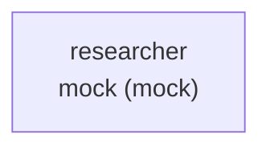
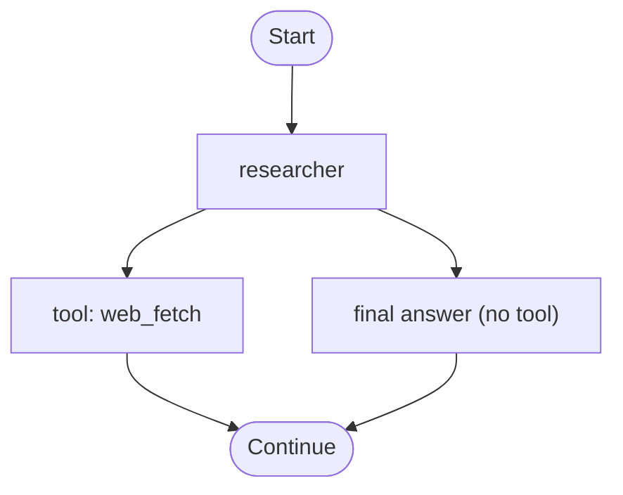

# E4-S09 — Workflow path Mermaid docs (all paths)

| | |
|---|---|
| **Document** | User story |
| **File** | `docs/stories/epic-stories/66-story.md` |
| **Created** | 2026-08-26 |
| **Last modified** | 2026-08-26 (Tester validation) |
| **Status** | Ready |
| **Story ID** | E4-S09 |
| **Epic** | [E4 — Compile and GEPA Pipeline](../04-epic.md) |
| **Phase** | 2+ *(post–Phase 4 backlog; extends E4-S08)* |
| **Epic build order** | 4 of 8 |
| **Story sequence** | 66 of 66 (global build order) |
| **Source** | Developer request: enumerate all harness workflow paths as Mermaid in harness `docs/` (2026-08-26) |
| **Related** | [Stories index](../00-README.md) · [Epic E4](../../prd.md#epic-e4--compile-and-gepa-pipeline-phase-2) · [E4-S08](33-story.md) · [Architecture §5.4](../../architecture/04-data-flows.md#54-workflow-diagram-compile) |

---

## E4-S09 — Workflow path Mermaid docs (all paths)

| Field | Value |
|---|---|
| **Feature** | E4.8 |
| **Persona** | Harness developer |
| **Priority** | P1 |
| **Prerequisites** | [E4-S08](33-story.md#e4-s08-workflow-diagram-at-compile) ✅ · [E2-S07](08-story.md#e2-s07-workflowyaml-schema-serial) ✅ · [E3-S08](17-story.md#e3-s08-zaumzeug-run-serial-workflow) ✅ |
| **Surface** | `zaumzeug compile` · `--workflow-diagram-only` · `usr-harnesses/<name>/docs/workflow-paths.md` · doctor staleness (workflow + agent yaml) · deploy `docs/` (copy_rules + packager) |

### User story

As a **harness developer**, I want an auto-generated Markdown file under my harness `docs/` that documents **stage routes** and **configured per-agent tool branches** as Mermaid diagrams, so that I can review and share how a run can flow through the harness without reading YAML by hand.

### Why (scope guardrails)

[E4-S08](33-story.md) already writes a single serial overview flowchart (`docs/workflow-diagram.md`). That is not enough when a developer needs **path-level** documentation: an index of stage routes plus per-agent tool-branch views. This story adds a sibling file — it does **not** replace the overview diagram.

**Product value (locked):** the paths file’s primary value is the **index + tool-branch sections**. For serial workflows, stage-path `P1` may mirror `workflow-diagram.md` (same stage order / labels) — that duplication is acceptable; do not fold tool branches into the overview file in this story.

| In scope | Out of scope (this story) |
|---|---|
| `docs/workflow-paths.md` under `usr-harnesses/<name>/docs/` | Replacing or removing `docs/workflow-diagram.md` |
| Enumerate **stage paths** from `workflow.yaml` as Mermaid | Parallel / DAG / `parallelism` path explosion (deferred until non-serial workflows ship) |
| Per **agent** stage: Mermaid of **configured** tool branches (builtin / mcp / custom) + “final answer” | Combinatorial cross-product of tools × stages (2ⁿ paths); multi-hop “tool then tool again” sequences |
| Regenerate on every `zaumzeug compile` (incl. `--agent`) and `--workflow-diagram-only` | New CLI flag / rename (`--workflow-docs-only` deferred) |
| Doctor warn when paths missing/stale vs `workflow.yaml` **or** workflow agent `agent.yaml` files | Staleness vs `agents-models.yaml` / model-id drift (parity with E4-S08 diagram check) |
| Deploy: `copy_rules` **and** packager explicit copy (same as diagram) | Chainlit / Open WebUI diagram UI |
| User-docs + Architecture §5.4 + CLI help text for `--workflow-diagram-only` | Hand-authored path docs (overwrite on generate); runtime trace → Mermaid replay |
| | Changing serial-only `workflow.yaml` semantics; inventing remote MCP tool catalogs |

### References

- [PRD E4.8](../../prd.md#epic-e4--compile-and-gepa-pipeline-phase-2) *(added with this story)*
- [Architecture §5.4 — workflow diagram](../../architecture/04-data-flows.md#54-workflow-diagram-compile) *(extend for paths)*
- [E4-S08 — Workflow diagram at compile](33-story.md)
- [Mermaid flowchart syntax](https://mermaid.js.org/syntax/flowchart.html)
- [user-docs — compile](../../../user-docs/guides/compile.md) · [multi-agent-workflow](../../../user-docs/guides/multi-agent-workflow.md)

### Implementation resources

**Internal**

- `src/zaumzeug/compile/workflow_diagram.py` — **required:** export shared stage-label / model-resolve / Mermaid-escape helpers (or a tiny shared private module under `compile/`) so paths and diagram cannot drift; do not copy-paste
- `src/zaumzeug/compile/workflow_paths.py` — **new** `WORKFLOW_PATHS_REL`, `render_workflow_paths()` / `write_workflow_paths()` / `WorkflowPathsError`; signature parity with diagram (`project_root`, `deploy`, `generated_on`)
- `src/zaumzeug/compile/runner.py` — extend `_write_diagram` (or rename to `_write_workflow_docs`) to write **diagram then paths**; map `WorkflowPathsError` → `CompileError` (same pattern as `WorkflowDiagramError`); `--workflow-diagram-only` and post-GEPA paths both use it
- `CompileResult` — add `paths_path: Path | None`; `format_compile_result` lists both files on diagram-only and full compile
- Agent tools: `load_agent_yaml` → `load_agent_config` → `AgentConfig.tools` (`AgentToolsConfig`) — **labels only**; never import custom/MCP tool modules
- Pipeline stages: pipeline id as a single node (no tool branches)
- `src/zaumzeug/doctor/checks.py` — `check_workflow_paths_staleness` (separate check name, e.g. `workflow_paths`); wire in `doctor/runner.py` **only when not `deploy_mode`** (parity with diagram)
- `src/zaumzeug/deploy/copy_rules.py` — add `docs/workflow-paths.md` to `ALWAYS_INCLUDED_HARNESS_FILES`, `resolve_deploy_copy_plan` (`CopyKind` **`paths`**), required like diagram
- `src/zaumzeug/deploy/packager.py` — explicit `_copy_file` for `docs/workflow-paths.md` next to diagram
- `src/zaumzeug/cli.py` — update `--workflow-diagram-only` help
- Architecture ship-time: §5.4, §10.1 include matrix, §11 / SDK map row, §15 anti-pattern (do not hand-edit paths)
- Example / install templates: regenerate under `usr-harnesses/example/docs/` and `install/templates/usr-harnesses/example/docs/`

**Libraries**

- stdlib + existing config loaders only — no LLM, no Mermaid CLI dependency (Markdown fenced blocks)

**Output path (locked)**

| Output | Path |
|---|---|
| Workflow paths (Markdown + Mermaid) | `usr-harnesses/<harness>/docs/workflow-paths.md` |

Same relative path under `deploy/<harness>/docs/` after `zaumzeug deploy`.

**Path model (locked — serial v1)**

1. **Stage paths** — use `workflow.stages` **list order** (do not reorder by `entry`). Serial → exactly one path `P1`. Emit one Mermaid `flowchart` for `P1` (nodes = stages; agent labels via shared helpers). Under `P1`, a one-line note may state it matches `workflow-diagram.md` stage order. Show `entry` in the footer/index metadata like the diagram file does for stages count.
2. **Agent tool-branch diagrams** — for each **agent** stage on a stage path with ≥1 configured tool, emit a **separate** Mermaid fenced block under that path:
   - Nodes: `Start` → `Agent <id>` → fan-out to each **configured** tool branch **and** `final answer (no tool)` → `Continue` / `End`
   - Branch labels (locked):
     - `tools.builtin` → `tool: <id>`
     - `tools.custom` → `tool: <stem>` where stem = basename without `.py`, or last dotted segment before optional `:attr` (e.g. `tools/search_docs.py` → `search_docs`, `tools.foo:bar` → `foo`)
     - `tools.mcp` → if `tool_names` set → one branch each `mcp:<server.name>/<tool_name>`; else one branch `mcp:<server.name>` (never probe live MCP)
   - No 2ⁿ cross-product; no multi-turn tool loops
   - Node ids need only be unique **within** each fenced Mermaid block (separate fences are independent)
3. **Index** — path id, stage sequence (`agent:` / `pipeline:` ids), tool-branch subsection count
4. Header: auto-generated by `zaumzeug compile <harness>`; do not edit by hand ([§15](../../architecture/10-operations-and-reference.md#15-anti-patterns))
5. Future non-serial: enumerate complete stage paths; tool-branch rules stay per-agent (follow-up)

**Module / error boundary (locked)**

- Public unit/SDK hooks: `render_workflow_paths` + `write_workflow_paths` (tests call these; CLI stays thin)
- Domain error type: `WorkflowPathsError`; runner wraps to `CompileError` (no new CLI exit taxonomy)
- Runner writes diagram then paths whenever diagram is written today; either failure → `CompileError`

**Deploy matrix (locked)**

- `docs/workflow-paths.md` is **always included / required** on the deploy copy plan (same class as `docs/workflow-diagram.md`). Missing file → `assert_required_paths` / deploy fails. Templates + first compile must produce it before deploy.

**Doctor staleness (locked)**

Warn (dev mode only — **skip under `doctor --deploy`**, parity with diagram) when `docs/workflow-paths.md` is **missing**, or mtime older than the newest of:

- `workflow.yaml`
- every `agents/<agent>/agent.yaml` for agent stages listed in `workflow.yaml`

Check name distinct from diagram (e.g. `workflow_paths`). Suggest `zaumzeug compile <harness> --workflow-diagram-only`. Do not include `agents-models.yaml` in the staleness set.

**Happy path (required)**

```text
zaumzeug compile <harness> [--agent <name>]
  → docs/workflow-diagram.md          (E4-S08, unchanged)
  → docs/workflow-paths.md            (this story; full harness paths always)

zaumzeug compile <harness> --workflow-diagram-only
  → refreshes diagram + paths (no GEPA / no LLM)
  → CLI help must mention both files
```

**Example sketch** (`example` harness — one agent with `web_fetch`)

````markdown
# Workflow paths — example

> Auto-generated by `zaumzeug compile example`. Do not edit by hand.

## Index

| Path | Stages | Tool-branch diagrams |
|---|---|---|
| P1 | `researcher` | 1 (`researcher`) |

## Path P1 — full stage route



### P1 · agent `researcher` — tool branches



**Generated:** 2026-08-26
````

### Acceptance criteria

- [ ] **AC-1** Every `zaumzeug compile <harness>` (non–dry-run), including `--agent`, writes `usr-harnesses/<harness>/docs/workflow-paths.md` with an auto-generated header via `write_workflow_paths()`. `--dry-run` does **not** write. Diagram behavior unchanged. Runner wraps `WorkflowPathsError` → `CompileError`. `CompileResult.paths_path` set when written.
- [ ] **AC-2** Paths file includes an **index** and **at least one** stage-path Mermaid (`P1` for serial) using `workflow.stages` order and **shared** label helpers with E4-S08. Pipeline stages use pipeline id. Serial `P1` may mirror the overview.
- [ ] **AC-3** For each agent stage with ≥1 configured tool, a **separate** Mermaid tool-branch diagram (configured branches + `final answer (no tool)`). Labels: builtin `tool:<id>`; custom stem rules; MCP `tool_names` → `mcp:<server>/<tool>` else `mcp:<server>`. Tools read via `load_agent_config` / `AgentToolsConfig` only — no tool module / live MCP imports. No cross-product across stages.
- [ ] **AC-4** `--workflow-diagram-only` refreshes **both** files without GEPA/LLM; CLI help mentions both; diagram-only CLI summary lists both paths.
- [ ] **AC-5** Dev-mode doctor **warns** (`workflow_paths`) when paths missing or older than newest of `workflow.yaml` + workflow-listed `agents/*/agent.yaml`. **Skipped in `doctor --deploy`**. Suggest `--workflow-diagram-only`.
- [ ] **AC-6** Deploy: `ALWAYS_INCLUDED` + copy plan `CopyKind` `paths` + packager explicit copy; required when packaging (missing → fail like diagram). Golden / copy-plan assert.
- [ ] **AC-7** **Docs:** user-docs (compile + multi-agent-workflow + CLI) + Architecture §5.4 (sibling file, path model, staleness inputs, deploy include) + §10.1 / §11 SDK map + §15 anti-pattern. Example + install templates in sync.

### Implementation tasks (build)

- [ ] Extract/share Mermaid label helpers; add `compile/workflow_paths.py` (`render` / `write` / `WorkflowPathsError` / `WORKFLOW_PATHS_REL`)
- [ ] Runner: write diagram+paths together; `CompileResult.paths_path`; `CompileError` wrap; format summary
- [ ] Doctor `check_workflow_paths_staleness` (dev only); CLI help
- [ ] Deploy: `ALWAYS_INCLUDED` + `CopyKind` `paths` + packager `_copy_file` + golden
- [ ] Regenerate example + install-template paths md
- [ ] User-docs + Architecture §5.4 / §10.1 / §11 / §15

### Verification (after build)

Per [Story verification](../00-README.md#story-verification-required). Test file header: `# Story: E4-S09 / E4.8`.

**Primary automation:** call `render_workflow_paths` / `write_workflow_paths` in unit tests; use `run_compile(..., workflow_diagram_only=True)` for refresh / summary / `--agent` wiring. Prefer diagram-only (no GEPA / no live LLM). Reuse E4-S08-style tmp harness scaffolds; extend with `tools:` blocks and multi-stage / pipeline fixtures as needed. Doctor staleness: use `os.utime` (same pattern as `test_e4_s08_ac5_*`).

| AC | Test |
|---|---|
| AC-1 | `tests/unit/compile/test_workflow_paths.py::test_e4_s09_ac1_compile_writes_paths_md` · `…::test_e4_s09_ac1_dry_run_skips_write` · `…::test_e4_s09_ac1_agent_flag_still_writes_paths` · `…::test_e4_s09_ac1_paths_error_is_compile_error` · `…::test_e4_s09_ac1_auto_generated_header` · `…::test_e4_s09_ac1_paths_path_on_result` |
| AC-2 | `…::test_e4_s09_ac2_index_and_p1_mermaid` · `…::test_e4_s09_ac2_agent_nodes_include_model_ids` · `…::test_e4_s09_ac2_pipeline_stage_label` · `…::test_e4_s09_ac2_stages_list_order` · `…::test_e4_s09_ac2_example_paths_snapshot` *(fixed `generated_on`; structure like E4-S08 diagram golden)* |
| AC-3 | `…::test_e4_s09_ac3_tool_branch_diagram` · `…::test_e4_s09_ac3_final_answer_branch_present` · `…::test_e4_s09_ac3_no_tools_skips_branch_section` · `…::test_e4_s09_ac3_no_tool_cross_product` · `…::test_e4_s09_ac3_mcp_tool_names_vs_server_only` · `…::test_e4_s09_ac3_custom_stem_rules` · `…::test_e4_s09_ac3_missing_custom_module_still_renders` *(custom entry that would fail import — paths must succeed)* |
| AC-4 | `…::test_e4_s09_ac4_diagram_only_refreshes_paths` · `…::test_e4_s09_ac4_summary_lists_both_files` · `…::test_e4_s09_ac4_flag_help_mentions_paths` *(parser/`--help` or CLI docs substring)* · `…::test_e4_s09_ac4_diagram_only_no_gepa` |
| AC-5 | `tests/integration/test_doctor.py::test_e4_s09_ac5_missing_paths_warning` · `…::test_e4_s09_ac5_stale_vs_workflow_yaml` · `…::test_e4_s09_ac5_stale_vs_agent_yaml` · `…::test_e4_s09_ac5_skipped_in_deploy_mode` · assert check `name == "workflow_paths"`, severity `warn`, exit 0 |
| AC-6 | `tests/unit/deploy/test_copy_rules.py::test_e4_s09_ac6_always_includes_workflow_paths` · `…::test_e4_s09_ac6_missing_paths_fails_assert_required` · packager/golden: bundle contains `docs/workflow-paths.md` when seeded (`test_deploy.py` / `test_deploy_golden.py` / `example_bundle_paths.json`) |
| AC-7 | `tests/unit/docs/test_workflow_paths_docs.py` — see substring checklist below |
| Regression | `pytest tests/unit/compile/test_workflow_diagram.py -v` still passes (E4-S08 unchanged) |

**AC-7 docs substring checklist** (stable assertions; pattern like `test_production_auth.py` / E6-S08):

| File | Must contain |
|---|---|
| `user-docs/guides/compile.md` (+ install template if mirrored) | `workflow-paths.md`; stage path / tool-branch wording; `--workflow-diagram-only` refreshes paths |
| `user-docs/guides/multi-agent-workflow.md` (+ template if present) | `workflow-paths.md` or path Mermaid mention |
| `user-docs/reference/cli.md` | `--workflow-diagram-only`; mention of `workflow-paths` / paths refresh |
| Architecture §5.4 | `workflow-paths.md`; stage routes; tool branches; doctor staleness (`agent.yaml`); `--workflow-diagram-only` |
| Architecture §10.1 | `docs/workflow-paths.md` in include / always-included matrix |
| Architecture §11 / SDK map | `workflow_paths.py` (or E4-S09 / E4.8) |
| Architecture §15 | do not hand-edit `workflow-paths` (anti-pattern) |
| `usr-harnesses/example/docs/workflow-paths.md` + install template twin | file present; live↔template content match (or both regenerated from same generator in test) |

**Fixture notes (locked for implementers)**

- Multi-stage AC-2/AC-3: ≥2 agent stages and/or one `pipeline:` stage in `workflow.yaml`.
- Cross-product guard: two agents each with ≥1 tool → expect **one** `P1` stage Mermaid + **two** tool-branch subsections (not 2ⁿ path diagrams).
- Import guard: `tools.custom` points at a non-existent module; `write_workflow_paths` must not raise import errors.
- Deploy seeds: harness fixtures used by deploy tests must create `docs/workflow-paths.md` (required file) or compile `--workflow-diagram-only` before package.

- [ ] Every AC row above has a passing test or documented manual exception
- [ ] `pytest tests/unit/compile/test_workflow_paths.py tests/unit/docs/test_workflow_paths_docs.py tests/unit/deploy/test_copy_rules.py tests/integration/test_doctor.py tests/integration/deploy/test_deploy.py tests/integration/deploy/test_deploy_golden.py -k "e4_s09 or workflow_paths" -v` passes
- [ ] `pytest tests/unit/compile/test_workflow_diagram.py -v` passes (E4-S08 regression)

### Definition of done

- [ ] `write_workflow_paths()` / shared labels / `CompileError` boundary locked; `CompileResult.paths_path` surfaced
- [ ] Harness `docs/workflow-paths.md` has serial stage routes + configured tool branches as Mermaid
- [ ] Compile (incl. `--agent`) + `--workflow-diagram-only` keep diagram and paths in sync; doctor warns in **dev only** (workflow + agent yaml)
- [ ] Deploy requires + ships paths via copy_rules **and** packager; E4-S08 overview unchanged
- [ ] Architecture §5.4 / §10.1 / §11 / §15 + user-docs + CLI help; verification complete (including AC-7 substring checklist + E4-S08 regression)

### PO decisions (2026-08-26)

**Approve with changes** — applied after validation against E4-S08 / doctor / deploy / `AgentToolsConfig`:

1. **Keep sibling file** — primary product value is index + tool-branch sections; serial `P1` mirroring overview is acceptable (do not merge into `workflow-diagram.md` in this story).
2. **Honest scope wording** — “stage routes + configured tool branches,” not unbounded “every possible runtime path” / multi-hop tool sequences.
3. **No new CLI flag in v1** — reuse `--workflow-diagram-only`; update help/docs to say it refreshes diagram **and** paths (`--workflow-docs-only` deferred).
4. **Doctor staleness inputs** — `workflow.yaml` **plus** workflow-listed `agents/*/agent.yaml` (tool config lives there). Skip `agents-models.yaml` for parity with E4-S08.
5. **MCP branch labels** — use configured `tool_names` when present; else `mcp:<server.name>`; never probe live MCP.
6. **Deploy parity** — both `copy_rules.py` and packager explicit `_copy_file` (diagram is hardcoded today).
7. **`--agent` compile** — still regenerates full-harness paths (same harness-level refresh as the diagram).
8. **Priority P1 retained** — same class as E4-S08 (compile-time harness docs sync).

No hard conflicts with Done stories. Soft conflicts resolved above.

### Architect decisions (2026-08-26)

**Approve with changes** — applied against compile runner / copy_rules / doctor deploy skip / `AgentToolsConfig`:

1. **Shared label helpers required** — extract from `workflow_diagram.py` (or tiny shared compile helper); paths must import them (no duplicated model/escape logic).
2. **Error + runner boundary** — `WorkflowPathsError` → `CompileError` in runner; write diagram then paths in one helper; `CompileResult.paths_path` + summary lists both.
3. **Primary hooks** — `render_workflow_paths` / `write_workflow_paths` are the unit/SDK API; signature parity with diagram (`deploy`, `generated_on`).
4. **Tools via config only** — `load_agent_config` / `AgentToolsConfig`; never import custom tools or connect MCP for docs generation.
5. **Custom stem algorithm locked** — basename without `.py`, or last dotted segment before `:attr`.
6. **Stage order** — `workflow.stages` list order (not reorder by `entry`).
7. **Deploy required file** — add to `ALWAYS_INCLUDED_HARNESS_FILES` + `CopyKind` `paths` (same required class as diagram).
8. **Doctor** — separate check name `workflow_paths`; **dev only** (skip `--deploy`); inputs per PO.
9. **Architecture ship-time** — §5.4, §10.1, §11 SDK map, §15 anti-pattern (do not hand-edit paths).
10. **Mermaid fences** — node-id uniqueness is per fenced block only.

### Tester decisions (2026-08-26)

**Approve with changes** — applied against E4-S08 test patterns / doctor / copy_rules / deploy golden:

1. **Primary hooks** — unit tests call `render_workflow_paths` / `write_workflow_paths`; wiring via `run_compile(..., workflow_diagram_only=True)` (no live LLM / GEPA).
2. **Expanded AC map** — header + `paths_path`; example snapshot; `final answer` branch; missing-custom-module still renders; missing paths fails `assert_required_paths`; doctor check name `workflow_paths` + deploy skip; golden bundle path.
3. **AC-7 substring checklist** — compile / multi-agent / CLI / §5.4 / §10.1 / §11 / §15 / example↔template (same style as E6-S08).
4. **Fixture notes locked** — multi-stage + pipeline; two-agent cross-product count; import guard; deploy seeds must include paths file.
5. **E4-S08 regression required** — `test_workflow_diagram.py` stays green.
6. **Staleness** — use `os.utime` like existing diagram doctor tests; agent-yaml-only bump for AC-5 agent stale case.


---
