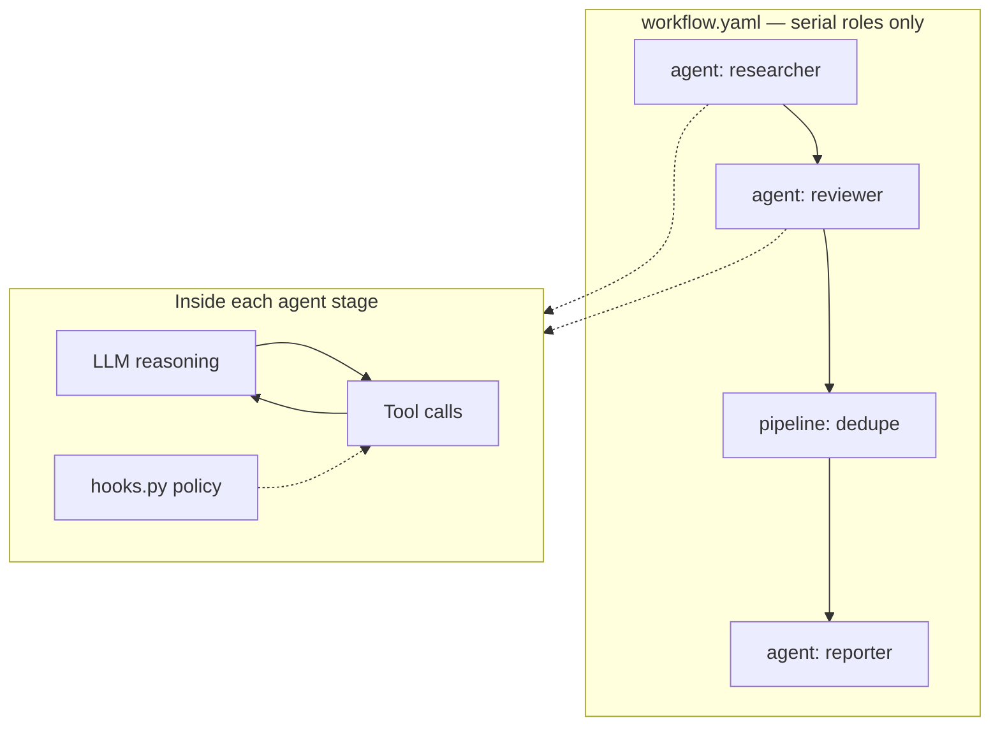

# Multi-agent workflow

| | |
|---|---|
| **Audience** | Harness developers |
| **Last updated** | 2026-07-05 |

A **harness** is not a single agent. It is a **workflow** (who runs, in what order) plus a **collection of agents** (each with its own prompts, tools, and LLM config). This guide explains `workflow.yaml`, how **pipeline** stages differ from **agent** stages, and where **looping and branching** belong in Phase 1.

---

## Files at a glance

```text
usr-harnesses/<harness-name>/
├── harness.yaml       # serve port, deploy, optional pipeline exposure
├── workflow.yaml      # which stages run, in order
├── agents/
│   ├── researcher/
│   │   ├── agent.yaml
│   │   └── agents-models.yaml
│   └── reviewer/
│       ├── agent.yaml
│       └── agents-models.yaml
├── pipelines/         # Haystack pipelines (Phase 4+)
└── docs/
    └── workflow-diagram.md   # later: auto-generated at compile (E4-S08)
```

| File | Role |
|---|---|
| `workflow.yaml` | **Orchestration graph** — serial list of agent and pipeline steps |
| `agents/<name>/` | **One role** — prompts, tools, LLM, compile artifacts |
| `pipelines/` | **Deterministic steps** — dedupe, RAG, re-queue, transforms |
| `harness.yaml` | Harness-wide settings; **`serve.expose`** registers pipeline ids |

---

## `workflow.yaml` — the stage list

Phase 1 workflows are **serial**: stages run top to bottom. There is no `if`, `while`, or `goto` in the workflow file today.

```yaml
entry: researcher
stages:
  - agent: researcher
  - agent: reviewer
  - agent: summarizer
```

| Field | Meaning |
|---|---|
| **`entry`** | Agent id used by **`zaumzeug serve`** for interactive chat (MCP/REST entry point) |
| **`stages`** | Ordered steps executed by **`zaumzeug run`** |

Each stage is **exactly one** of:

```yaml
- agent: <agent-name>      # LLM agent loop
- pipeline: <pipeline-id>  # deterministic Haystack pipeline
```

The **`entry`** agent must exist under `agents/<name>/`. Every **`agent:`** reference in `stages` must match an `agents/<name>/` folder. Agent folder names must match the `name` field in each `agent.yaml`, and agent names must be unique within the harness.

**Validation:** `zaumzeug doctor` and `zaumzeug serve --dry-run` load `workflow.yaml` through `load_workflow()` and fail with field-level errors when:

- `entry` or `stages` is missing or empty
- a stage has both `agent` and `pipeline`, or neither
- an `agent` ref (including `entry`) does not resolve to `agents/<name>/agent.yaml`
- agent folder names do not match `agent.yaml` `name`, or names are duplicated
- `parallelism` is set on a stage (Phase 2 — rejected in Phase 1 with a phase hint)

### Minimal example (Phase 1)

The reference **`example`** harness uses one stage:

```yaml
entry: researcher
stages:
  - agent: researcher
```

After **`zaumzeug compile`**, each agent's GEPA run writes **`artifacts/<run_id>/`** (and updates **`artifacts/current`**) with Haystack export files (`artifact-manifest.json`, `prompts/system.md`, optional `input_rewrite.md`). GEPA optimizes the **template**, not end-user chat — see [Compile and export](compile.md). When `input_rewrite` is listed, serve/`run` apply that fixed template before the agent loop. Harness **`docs/workflow-diagram.md`** regeneration is a later E4 story (E4-S08).

---

## Agent stages — judgment and tool loops

An **`agent:`** stage runs a **Haystack Agent**: an LLM that can call tools in a loop until it finishes that role’s task.

```yaml
- agent: finding-validator
```

When this stage runs, ZaumZeug:

1. Loads **`agents/finding-validator/agent.yaml`** (prompts, tools, artifacts).
2. Loads **`agents/finding-validator/agents-models.yaml`** (provider and model for **this role only**).
3. Runs the agent loop (tool calls, multi-turn reasoning).
4. Passes output as **context** to the next stage when you use **`zaumzeug run`**.

**Important:** Each agent stage gets its **own** LLM configuration. A hunter might use one provider and a validator another — the workflow switches models when the stage changes, not via request overrides.

### Where looping and branching live (Phase 1)

**Looping and branching are handled inside each agent**, not in `workflow.yaml`.

| Control flow | Where it belongs | Examples |
|---|---|---|
| Retry a tool until success | Agent loop + tools | Re-read a file, retry HTTP fetch |
| “Try path A, else path B” | Prompt + tool use | Search alternate directories |
| Loop until a stop condition | Agent session | “Keep refining until checklist passes” |
| Enforce “must not emit X” | Tools policy + `hooks.py` | Validator cannot call `emit_finding` |

The workflow file only answers: **which role runs next in the fixed sequence**. It does **not** express:

- `if no findings, skip validator`
- `while queue not empty, run hunter`
- parallel fan-out over a task queue

That is intentional in Phase 1. Use **agent behavior** for within-role logic; use **pipeline stages** (below) for deterministic glue between roles; use **shared files under `data/`** plus re-running **`zaumzeug run`** when you need an outer loop across passes (advanced / future fan-out).



**Do not** collapse a multi-role harness into one long agent session when roles need different models, tools, or compile targets. Split roles into **`agents/<name>/`** and list them in **`stages`**.

---

## Pipeline stages — deterministic glue

A **`pipeline:`** stage runs a **Haystack Pipeline**: a fixed graph of components (Python/YAML), **not** an open-ended LLM agent.

```yaml
- pipeline: dedupe_gapfill
```

### Agent vs pipeline

| | **Agent stage** | **Pipeline stage** |
|---|---|---|
| **Runtime** | Haystack `Agent` (tool-calling LLM) | Haystack **Pipeline** (wired components) |
| **Config** | `agents/<name>/agent.yaml` + `agents-models.yaml` | `pipelines/<id>.yaml` (or Python wrapper) |
| **Behavior** | Explores, reasons, uses tools creatively | Same steps every time — dedupe, merge, format, RAG retrieve→generate |
| **LLM** | Central to the stage | Only if the pipeline includes a generator component |
| **Best for** | Research, review, adversarial check | Dedupe findings, append to queue, ingest feedback, batch transforms |

Think of pipelines as **reliable machinery** between **judgment** agents.

### Example in a multi-stage workflow

```yaml
entry: recon-analyst
stages:
  - agent: recon-analyst
  - agent: vuln-hunter
  - agent: finding-validator
  - pipeline: dedupe_gapfill      # collapse duplicates; append coverage gaps to queue
  - agent: reachability-tracer
  - pipeline: ingest_feedback    # write new hunt tasks from reachable traces
  - agent: finding-reporter
```

When **`zaumzeug run`** reaches **`pipeline: dedupe_gapfill`**, it invokes that Haystack pipeline with context from prior stages — it does **not** load an agent folder or `agents-models.yaml`.

### Defining and exposing a pipeline

1. **Author** the pipeline under **`pipelines/`** (Haystack YAML or code).
2. **Register** its id in **`harness.yaml`**:

```yaml
serve:
  hayhooks:
    port: 1416
  expose: [dedupe_gapfill, ingest_feedback]
```

3. **Reference** the same id in **`workflow.yaml`**:

```yaml
- pipeline: dedupe_gapfill
```

The id in **`workflow.yaml`**, **`serve.expose`**, and the file under **`pipelines/`** must match.

Pipelines are also callable over HTTP as **`POST /{pipeline-id}/run`** when the harness is served — the workflow stage is how you slot that pipeline into the serial graph.

### Phase note

Full **pipeline exposure** ships in **Phase 4** (RAG and production hardening). The **schema** already allows `- pipeline: <id>` in `workflow.yaml`; the reference Phase 1 **`example`** harness uses **agent stages only**. Until your project enables pipelines, treat pipeline stages as optional advanced configuration.

---

## Commands and workflow

| Command | Workflow behavior |
|---|---|
| **`zaumzeug serve <harness>`** | Runs the **`entry`** agent only (interactive) |
| **`zaumzeug run <harness>`** | Runs all **`stages`** in order (agents + pipelines) |
| **`zaumzeug run <harness> --from <stage>`** | Partial run from a given stage (debug) |
| **`zaumzeug compile <harness>`** | Runs GEPA per agent with a `compile:` block; writes `artifacts/<run_id>/` + `current` with Haystack export. Live models need API keys in `.env`. See [Compile and export](compile.md). Workflow diagram generation is a later E4 story |
| **`zaumzeug compile <harness> --dry-run`** | Validates Phase 2 compile config, module imports, and task/reflection models — no GEPA, no LLM calls, no artifacts |
| **`zaumzeug doctor <harness>`** | Validates `workflow.yaml` (schema + agent refs), `harness.yaml`, models, runtime paths; warns on stale diagram |
| **`zaumzeug serve <harness> --dry-run`** | Same workflow validation path as doctor before resolving the entry agent |

---

## Choosing agent vs pipeline vs agent-internal logic

| You need… | Use… |
|---|---|
| Fixed sequence of roles (A → B → C) | **`workflow.yaml`** `stages` |
| Different LLM or tools per role | Separate **`agents/<name>/`** + agent stages |
| Retry, branch, loop within one role | **Inside that agent** (prompts, tools, hooks) |
| Deterministic dedupe, merge, re-queue | **`pipeline:`** stage + **`pipelines/`** |
| Skip a stage when empty / loop until queue done | Not in workflow YAML today — pipeline + `data/` + re-run, or future workflow extensions |

---

## Deferred (not Phase 1 workflow YAML)

These may appear in later releases; they are **not** required to build a Phase 1 harness:

| Feature | Status |
|---|---|
| **`parallelism` / `map_over`** on a stage | Deferred — fan-out over queue files |
| **`when:` / conditional stages** | Not in schema — use pipelines or agent logic |
| **Automatic outer loop** until shared queue empty | Re-invoke **`zaumzeug run`** or future orchestration |

---

## Related reading

- [Getting started — first harness](../getting-started/first-harness.md)
- [CLI reference](../reference/cli.md) — `serve`, `run`, `compile`, `--verbose`, `HARNESS_LOG_LEVEL`
- Generated diagram (E4-S08): **`usr-harnesses/<harness>/docs/workflow-diagram.md`** after compile
