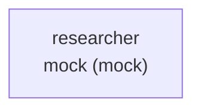
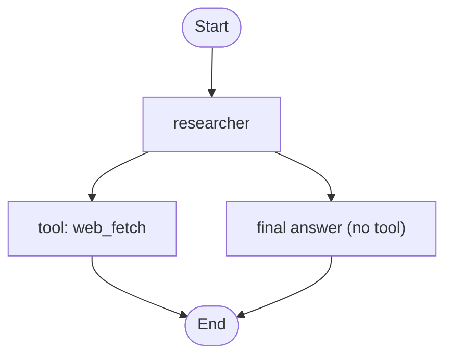

# Workflow paths — example

> Auto-generated by `zaumzeug compile example`. Do not edit by hand.

## Index

| Path | Stages | Tool-branch diagrams |
|---|---|---|
| P1 | `agent:researcher` | 1 (`researcher`) |

## Path P1 — full stage route

> Stage order matches `workflow-diagram.md`.

### P1 · agent `researcher` — tool branches

**Stages:** 1 serial stage · **Entry:** `researcher` · **Generated:** 2026-08-26
